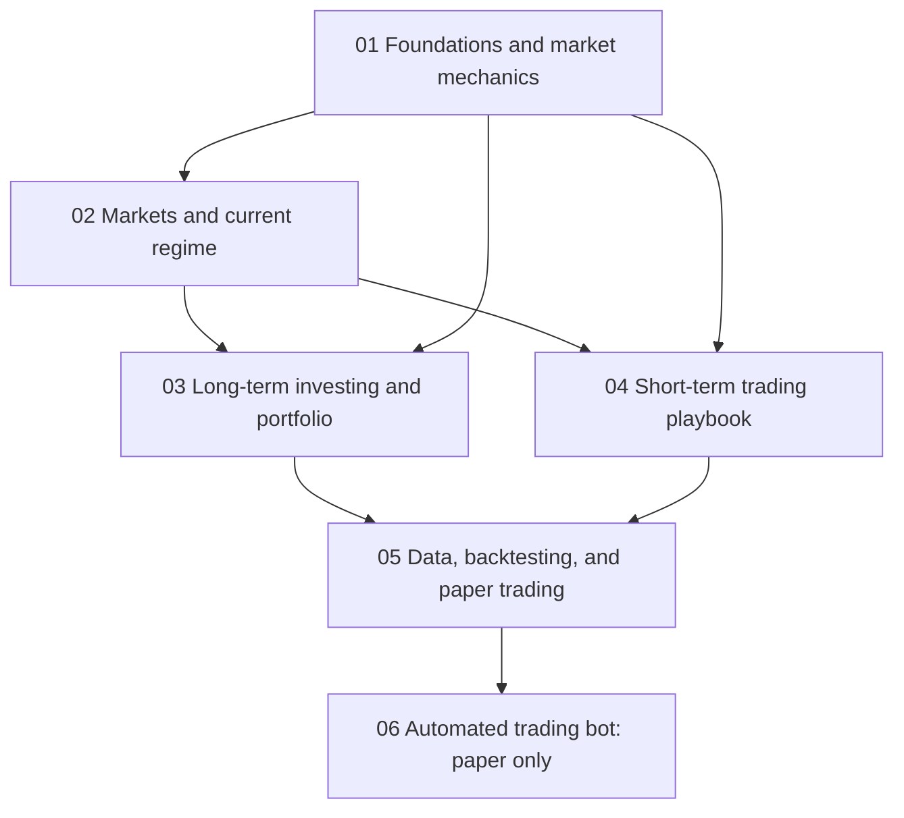
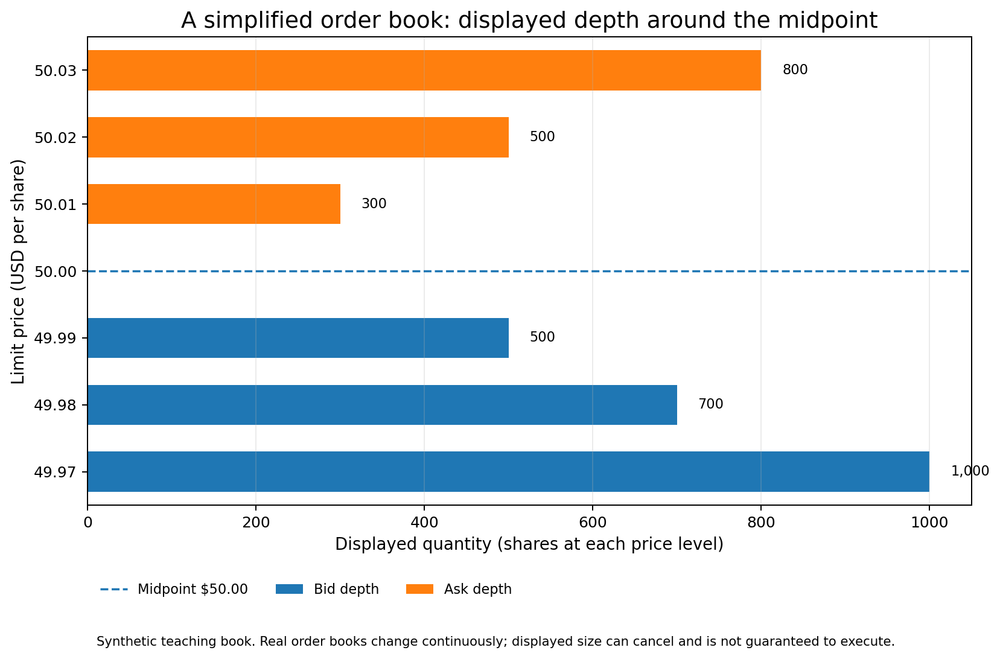
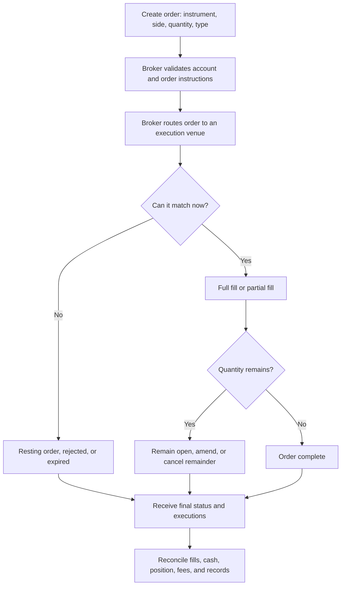
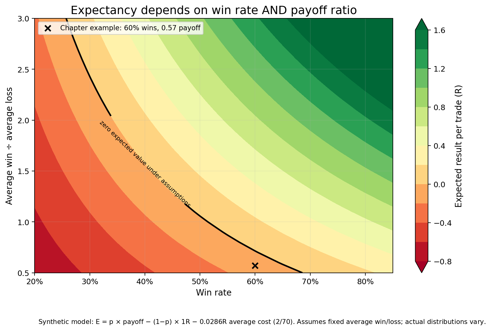
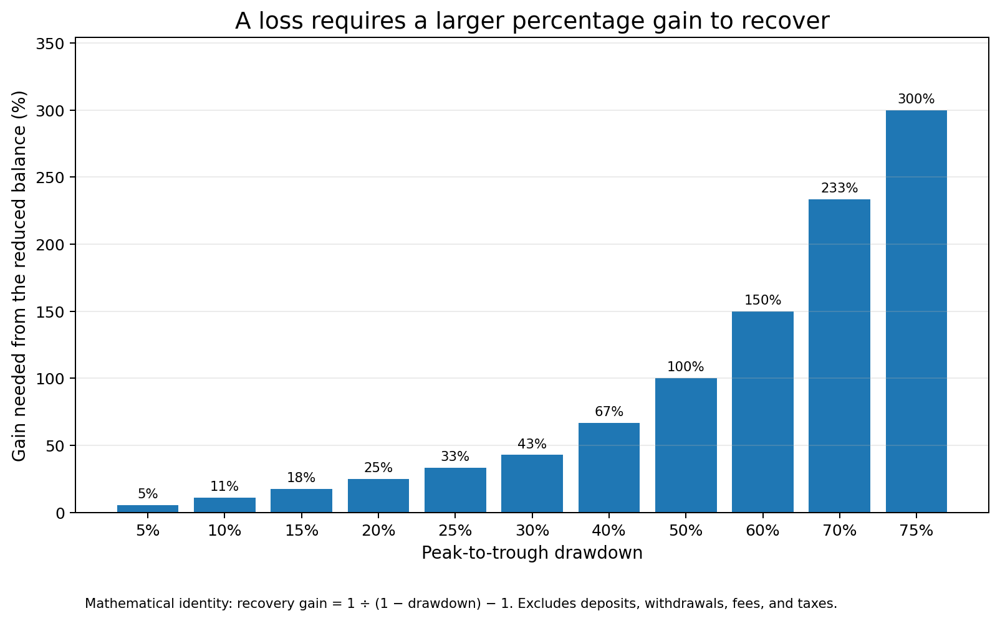

# 01 — Foundations and Market Mechanics

**Learning path:** Trading & Investing Study Guide  
**Level:** Beginner → practical foundations  
**Estimated study time:** 8–12 focused hours over 1–2 weeks  
**Data note:** All prices, order-book values, trades, and account balances in worked examples and exercises are explicitly synthetic. They are teaching examples, not current quotes, recommendations, or evidence of a profitable strategy.  
**Source check:** Official source pages and market-structure references below were checked on **2026-11-10 (America/Los_Angeles)**. Market schedules and product rules can change; verify them with the relevant venue, broker, issuer, or regulator before using them operationally.

> **Purpose and boundary:** This chapter gives you the minimum working foundation for studying investments, short-term trading, and paper-trading automation. It is financial education, not individualized investment, tax, or legal advice. It does not identify a strategy that is guaranteed to make money. Your first objective is to understand how losses happen and how to measure a decision—not to place a trade.

---

## 1. How to use this guide

The six chapters build on one another. Do not skip the foundations: later strategy tests and trading bots can produce precise-looking but meaningless results when orders, costs, returns, or risk are misunderstood.

### Six-chapter learning map

| Chapter | Main question | Evidence of mastery |
|---|---|---|
| **01 — Foundations and market mechanics** *(this file)* | What am I buying or selling, how does an order execute, and how do I measure return and risk? | Calculate returns, expectancy, position size, and drawdown; explain order types and product differences. |
| **[02 — Markets and current regime](02-markets-and-current-regime.md)** | Which markets and instruments are suitable to study, and what do current data actually show? | Build a timestamped comparison of equity ETFs/stocks, Bitcoin, gold, and oil without comparing unlike products. |
| **[03 — Long-term investing and portfolio](03-long-term-investing-and-portfolio.md)** | How do I research, hold, review, and rebalance investments? | Write a thesis, compare a fund/company, build a watchlist, and apply a repeatable review process. |
| **[04 — Short-term trading playbook](04-short-term-trading-playbook.md)** | How can a trading idea be written as a falsifiable rule set? | Specify one paper experiment with entry, exit, sizing, filters, costs, and a benchmark. |
| **[05 — Data, backtesting, and paper trading](05-data-backtesting-and-paper-trading.md)** | Does a strategy survive realistic data and execution assumptions? | Reproduce a backtest, control common biases, evaluate out of sample, and paper trade without live-money orders. |
| **[06 — Automated trading bot](../.github/prompts/06-automated-trading-bot.prompt.md)** | How can a system observe data and manage simulated orders safely? | Build and test an auditable, paper-only bot with risk gates, logs, reconciliation, alerts, and failure handling. |



**Suggested pace:** Spend 8–12 hours on this chapter. Complete the exercises without looking at the answer key, then redo any calculation you missed. Chapter 2 should follow before you choose a market to specialize in. Do not start automating trades before you can explain every metric and execution assumption in Chapters 1–5.

### Prerequisites

You need basic arithmetic, percentages, and comfort opening a terminal. Python is helpful for Exercise 8 but is not required for the other exercises. No brokerage account, paid data subscription, or real money is required.

## 2. Learning objectives

By the end of this chapter, you should be able to:

1. Explain the roles of an exchange, broker, order book, and market participant.
2. Read a basic bid/ask quote and explain spread, liquidity, volume, slippage, partial fills, and transaction costs.
3. Choose an order type based on its trade-off rather than assuming a stop or limit guarantees execution.
4. Distinguish stocks, ETFs, bonds/Treasuries, cash equivalents, spot Bitcoin, gold exposure, oil exposure, futures, options, and leveraged products.
5. Calculate holding-period return, compound growth, CAGR, volatility, expectancy, payoff ratio, position size, and drawdown.
6. Explain why a high win rate, a favorable planned risk/reward ratio, or an attractive backtest does not prove profitability.
7. Distinguish long-term investing, swing trading, day trading, and scalping by horizon, workload, and execution friction.
8. Keep a structured journal that records the thesis, rules, costs, outcome, and learning.

## 3. 80/20 — what matters most

Prioritize these before studying advanced indicators or derivatives:

- **Know the instrument.** A share of stock, an ETF share, a Bitcoin unit, a gold trust share, an oil futures contract, and an option are different legal and economic exposures.
- **Know the execution price.** A displayed last price is not a promise that your next order will execute there. The bid/ask spread and market movement matter.
- **Understand the order trade-off.** A market order prioritizes execution, not price. A limit order controls the worst acceptable price, not whether you get filled. A stop order can trigger and then execute far from its stop price.
- **Measure net outcomes.** Spread, slippage, commissions, fund expenses, financing, borrow, and other applicable fees can turn a small gross gain into a net loss.
- **Think in distributions, not single outcomes.** Expectancy depends on win rate, average win, average loss, and costs. Losses can cluster; drawdowns require disproportionately large recoveries.
- **Stay solvent and operationally cautious.** Avoid leverage while learning. Size positions before entry. Never assume a stop guarantees your maximum loss.
- **Separate investing from trading.** A long-term thesis is not a short-term signal, and a profitable-looking short-term signal is not a reason to abandon a portfolio plan.

**Optional / later:** advanced options pricing, high-frequency market making, complex futures spreads, statistical arbitrage, machine learning, and detailed market-microstructure models. They are outside the first learning path because they add complexity before you have demonstrated skill with basic execution, risk, and measurement.

---

## 4. How financial markets and orders work

### 4.1 Exchange versus broker

An **exchange** is a marketplace with rules and systems that bring buy and sell interest together. A **broker** is the firm or platform through which a customer places orders. A broker may route an order to one or more exchanges, alternative trading systems, or other execution venues, subject to its routing practices and applicable rules. A broker is not necessarily the exchange that executes the trade.

A **market participant** may be an individual, fund, bank, market maker, company, or other institution. Participants can have different goals, time horizons, information, and constraints. There is no requirement that the person on the other side of your trade has the same reason for trading as you do.

### 4.2 The order book, bid, ask, spread, and volume

A simplified **order book** lists resting buy and sell orders. A **bid** is a price a buyer is willing to pay; an **ask** (or offer) is a price a seller is willing to accept. The **best bid** is the highest displayed buy price; the **best ask** is the lowest displayed sell price. The **spread** is the best ask minus the best bid.

**Synthetic quote example:**

| Side | Price | Displayed quantity |
|---|---:|---:|
| Best bid | $49.99 | 500 shares |
| Best ask | $50.01 | 300 shares |
| Midpoint | $50.00 | — |
| Quoted spread | **$0.02** | — |

The midpoint is the average of the best bid and ask. It is a reference, not necessarily an executable price. A market buy for 100 shares may execute at the $50.01 ask if that offer is still available. A market sell may execute against the bid. If an order is larger than the quantity available at the best price, it can execute against multiple price levels and receive a volume-weighted average price.

**Liquidity** is the ability to trade in a desired size promptly without moving the price too much. It is not captured by a single number. Consider spread, displayed depth, trading activity, order size, time of day, and how quickly quotes change. **Volume** is the amount traded over a period. High volume can be a useful clue, but it does not guarantee a tight spread or deep order book at the exact moment you trade. Dollar volume (shares × price) can make comparisons across differently priced shares more useful than share volume alone.

**Slippage** is the difference between an expected/reference execution price and the actual fill price. State the reference you use—for example, decision price, arrival price, or midpoint—because slippage calculations can differ. Do not double-count the spread: if you compare a buy fill with the midpoint, the difference may already include paying half or more of the spread. Add commissions and other fees separately when computing net performance.

**Visual: displayed depth and price levels (synthetic).** The figure expands the quote into a small three-level book on each side. It shows why an order larger than the quantity at the best ask may execute at progressively worse prices. Displayed depth is not guaranteed liquidity; orders can be cancelled or changed before your order reaches the venue.



*Figure 1. Synthetic order-book snapshot. The accompanying source values are in `data/ch01_synthetic_order_book.csv`; recreate it with `python study-guide/scripts/generate_ch01_ch03_visuals.py`.*

### 4.3 Main order types and their trade-offs

| Order type | What it does | Main advantage | Main risk or limitation |
|---|---|---|---|
| **Market** | Seeks execution at the best available prices. | Execution is generally prioritized. | Price is not guaranteed; fast markets and thin books can create worse fills or multiple fill prices. |
| **Limit** | Buys only at the limit price or lower; sells only at the limit price or higher. | Controls the worst acceptable price. | May never execute; partial fills are possible. |
| **Stop / stop-loss** | Becomes a market order after its stop trigger is reached, subject to broker/venue rules. | Can trigger an exit or entry after a specified price level is reached. | Stop price is not a guaranteed fill price; gaps and fast markets can produce large slippage. |
| **Stop-limit** | Becomes a limit order after the stop trigger. | Adds a price boundary after triggering. | Can remain unfilled while the market moves away; it does not guarantee an exit. |

A **partial fill** means only part of the requested quantity executes. The remaining quantity may stay open, expire, be cancelled, or be modified depending on the order instructions and broker. A cancellation request is not the same as confirmation that an order is cancelled; a fill can occur while a cancellation is being processed. Later chapters will use this distinction when designing the bot's order-state handling.

Common time-in-force instructions include **Day** (valid for the trading day), **Good-Til-Cancelled (GTC)** (remains active until filled or cancelled, subject to broker limits), **Immediate-or-Cancel (IOC)** (execute what can be filled immediately and cancel the rest), and **Fill-or-Kill (FOK)** (execute the entire order immediately or cancel it). Availability and definitions can vary by broker and venue. Read the broker's order documentation before relying on a special instruction.

**Important:** A stop order is not an insurance policy. When its trigger is reached it typically becomes a market order, so a gap or fast move can produce a much worse fill. A stop-limit can control price but may not fill. The SEC's investor bulletin explains these trade-offs and notes that broker procedures and order availability can differ. See [SEC: Trading Basics — Understanding the Different Ways to Buy and Sell Stock](https://www.sec.gov/tm/investor-alerts-bulletins/trading101basics.pdf) (Investor Bulletin, March 2011; accessed 2026-11-10).

### 4.4 A simplified order lifecycle



A trading system must distinguish an **order** (an instruction), an **execution/fill** (a completed transaction), and a **position** (the resulting holding). Never infer that an order filled merely because it was submitted or accepted.

### 4.5 Trading hours, auctions, and volatility interruptions

Many U.S. listed equities trade in a regular **core session**, but each exchange and product has its own schedule. The NYSE's published schedule for its main Tape A equities market lists the core session as **9:30 a.m.–4:00 p.m. Eastern Time**, with opening and closing auctions; other NYSE markets and other venues can have different pre-market and after-hours sessions. See [NYSE: Holidays & Trading Hours](https://www.nyse.com/trade/hours-calendars) and [NYSE: Auctions](https://www.nyse.com/trade/auctions) (accessed 2026-11-10). Always check the exact listing venue, product, holiday calendar, and broker access. Pre-market and after-hours trading can have different participation, quote depth, spreads, order-type availability, and execution risks than the core session.

An **opening auction** collects eligible orders and determines an opening price under venue rules. A **closing auction** similarly matches eligible orders near the close and is important for benchmark and index-related activity. Auction orders have specific eligibility, cutoffs, and cancellation rules; do not assume an ordinary continuous-market order behaves like an auction order.

Volatility controls can pause or constrain trading, but do not guarantee a fair exit price. Examples in U.S. equities include **Limit Up-Limit Down (LULD)** price bands for individual securities and **market-wide circuit breakers**. NYSE's current market-wide circuit breaker reference describes thresholds based on S&P 500 declines of 7%, 13%, and 20% from the prior close, with halt behavior depending on threshold and time of day. Rules and implementation details should be checked against current exchange materials. See [NYSE: Trading Information](https://www.nyse.com/trade/trading-information) and [NYSE: Market-Wide Circuit Breakers FAQ (PDF, version 4.0, February 2026)](https://www.nyse.com/publicdocs/nyse/NYSE_MWCB_FAQ.pdf) (accessed 2026-11-10).

### 4.6 Commissions, fees, fund expenses, and total trading friction

A trade's economic result is not just the change in quoted price. Potential frictions include:

- **Bid/ask spread:** the cost of crossing from the bid to the ask, or vice versa.
- **Slippage/market impact:** the difference between an expected price and actual execution, including the effect of your own order size.
- **Commissions and transaction fees:** broker or venue-related charges where applicable; schedules vary and can change.
- **Fund expense ratio:** an ongoing operating cost reflected in a fund's assets/NAV rather than necessarily appearing as a separate trade commission.
- **Financing, margin interest, borrow fees, and futures roll costs:** product- and account-specific costs that can be significant.

A strategy that targets a small gross move can be unviable after costs. For example, if a hypothetical trade captures $0.03 per share before costs but spread, slippage, and fees total $0.04 per share, its net result is negative $0.01 per share. This example is synthetic and excludes taxes. Chapter 5 will teach how to model these frictions rather than assume fills at candle closing prices.

### 4.7 Dividends, splits, and adjusted prices

A **dividend** is a distribution to shareholders. The **ex-dividend date** determines whether a new buyer is entitled to the declared distribution under the applicable market rules. Around the ex-date, a stock's quoted price may adjust downward by approximately the distribution amount, all else equal; real market movements can differ. Do not count both a dividend and an unadjusted price move as though they were independent gains. See [Investor.gov: Ex-Dividend Dates](https://www.investor.gov/introduction-investing/investing-basics/glossary/ex-dividend-dates-when-are-you-entitled-stock-and) (accessed 2026-11-10).

A **stock split** changes the number of shares and price per share proportionally without, by itself, changing the holder's total economic ownership. In a 2-for-1 split, 10 shares at $100 become 20 shares at approximately $50. A reverse split works in the opposite direction. See [Investor.gov: Stock Split](https://www.investor.gov/introduction-investing/investing-basics/glossary/stock-split) (accessed 2026-11-10).

Historical price datasets may show **raw/unadjusted** prices or prices adjusted for splits, dividends, or both. The adjustment convention matters. A split-unadjusted series can show a false-looking 50% price collapse on a 2-for-1 split; a dividend-adjusted series is often used to estimate reinvested total return. Read the data provider's field definitions. Never mix adjusted close with raw open/high/low/close without understanding the adjustment, and never use future corporate-action information in a backtest before its effective/known date.

---

## 5. Know what you own: asset classes and products

A market name is not enough to identify your exposure. Read the product description, prospectus or offering document, contract specification, custody terms, and fees.

| Exposure / product | What it represents | Important risks and distinctions |
|---|---|---|
| **Individual stock** | An equity ownership interest in one company. Shareholders may receive dividends and certain voting rights depending on share class. | Company-specific business, valuation, governance, dilution, and bankruptcy risk. Common shareholders rank behind creditors and preferred shareholders in liquidation. |
| **Broad stock-market ETF / index fund** | A fund share representing an interest in a portfolio designed to track an index or follow a stated strategy. ETF shares trade on an exchange at market prices. | Diversification depends on holdings and concentration; price can differ from NAV; fees, tracking difference, bid/ask spread, and fund structure matter. An ETF is not automatically diversified. |
| **Bond / fixed-income security** | A loan to a government or company under stated terms, commonly involving interest and principal repayment. | Credit/default, interest-rate, inflation, call, and liquidity risk. A bond sold before maturity can be worth more or less than face value. |
| **U.S. Treasury bill/note/bond** | Debt security issued by the U.S. Treasury. Bills are short-term; notes and bonds have longer maturities and stated payment structures. | Market prices can fluctuate before maturity as rates change. Do not treat a Treasury security as identical to a bank deposit or a Treasury fund. See [TreasuryDirect: Marketable Securities](https://www.treasurydirect.gov/marketable-securities/). |
| **Cash equivalents** | Examples include certain short-term Treasury bills, bank deposits, and money-market instruments/funds. | These products are not interchangeable. Bank deposits may have deposit-insurance coverage subject to limits and eligibility; a money-market mutual fund is an investment and is not a bank deposit. Consider yield, liquidity, credit, and access terms. |
| **Spot Bitcoin** | Direct exposure to the price of the Bitcoin crypto asset; ownership and control depend on wallet/private-key custody or a third-party custodian. | High volatility, custody/key loss, exchange/counterparty, cybersecurity, market-integrity, and changing legal/regulatory risks. Direct spot ownership differs from a Bitcoin ETP or futures fund. See [Investor.gov: Crypto Asset-Related Investments](https://www.investor.gov/introduction-investing/investing-basics/investment-products/crypto-asset-related-investments). |
| **Gold exposure** | Could mean physical bullion/coins, shares in a gold-backed trust/ETP, futures, or gold-mining company shares. | Physical metal has storage, insurance, dealer spread, and authenticity risks. A trust/ETP has its own structure, fees, custody, and tracking. Mining shares are equities with business risks, not bullion. |
| **Oil exposure** | Could mean a futures contract, a futures-based commodity pool/ETP, or shares of an oil producer/refiner. | Futures expire and may involve delivery or cash settlement. Futures-based products can roll contracts and may not track spot oil over time. Energy prices are affected by supply, demand, storage, geopolitics, and contract structure. |
| **Futures** | Standardized exchange-traded contract for a future purchase/sale or cash settlement under defined terms. | Leverage through margin, expiration, contract size, daily settlement, liquidity, delivery/settlement, and potentially losses beyond initial margin. CFTC warns commodity futures/options are complex and risky; understand the contract and disclosure document before trading. |
| **Options** | A call gives its buyer the right to buy; a put gives its buyer the right to sell an underlying asset at a strike price before/at expiration according to contract style. The writer takes the other side's contractual obligation. | Premium decay, volatility, expiration, assignment, liquidity, and nonlinear payoff. The option's notional exposure can be much larger than its premium. Do not assume buying an option is equivalent to owning the underlying share. |
| **Leveraged / inverse ETPs** | Products designed to target a multiple or inverse of a benchmark's return, often over a stated daily period. | Compounding and daily reset can make multi-day returns diverge from the simple multiple/inverse of the benchmark's cumulative return. Leverage magnifies losses as well as gains. Outside the beginner's first experiments. |

An index fund seeks to track an index; it does not guarantee the index return. A sector ETF can be concentrated. The SEC explains that ETFs trade at market prices that may differ from net asset value (NAV), and that fund fees and underlying holdings affect outcomes. See [Investor.gov: Exchange-Traded Funds](https://www.investor.gov/introduction-investing/investing-basics/investment-products/mutual-funds-and-exchange-traded-2) (accessed 2026-11-10).

Commodity-linked products deserve special care. A futures-based commodity fund does not necessarily own barrels of oil or bullion. Futures contracts expire and require a roll, offset, or settlement process; as a result, the fund's performance can diverge from changes in spot commodity prices. See [CFTC: Customer Advisory — Risks Before Investing in Commodity ETPs or Funds](https://www.cftc.gov/LearnAndProtect/AdvisoriesAndArticles/CustomerAdvisory_CommodityETPs.htm) and [CFTC: Futures Market Basics](https://www.cftc.gov/LearnAndProtect/AdvisoriesAndArticles/FuturesMarketBasics/index.htm) (accessed 2026-11-10).

**Learning rule:** start by understanding unleveraged, liquid cash securities and diversified funds. Do not start with options, futures, leveraged/inverse products, or margin. This is a curriculum sequence, not a recommendation to buy any specific instrument.

---

## 6. Return and risk mathematics

Use consistent units and state assumptions. Keep **gross** results separate from **net** results after trading costs. For a leveraged position, percentage return on account equity can differ substantially from the simple percentage move in the underlying price; leverage is intentionally excluded from the beginner examples below.

### 6.1 Dollar profit and simple holding-period return

For a long position in `Q` shares:

\[
\text{Net P\&L} = Q(P_{exit}-P_{entry}) + \text{cash distributions} - \text{costs}
\]

\[
\text{Holding-period return} = \frac{\text{Net P\&L}}{\text{initial capital committed}} \times 100\%
\]

**Worked example (synthetic):** Buy 50 shares at $40, then sell at $44. Receive a $0.20-per-share cash dividend while holding, and pay $5 total trading costs. Initial cost is $2,000. Price gain is `50 × ($44 − $40) = $200`; dividend is `50 × $0.20 = $10`; net P&L is `$200 + $10 − $5 = $205`. Holding-period return is `$205 / $2,000 = 10.25%` before taxes. The dividend is included once, not double-counted in an adjusted price series.

A percentage return tells you how large the result was relative to capital; dollar P&L tells you the amount. Both matter. A 5% gain on $200 is $10; a 5% gain on $20,000 is $1,000. Percentage outcomes are comparable; dollar outcomes determine actual account impact.

### 6.2 Compounding and CAGR

If a balance earns a constant return `r` each period and all gains remain invested:

\[
V_n = V_0(1+r)^n
\]

**Worked example (hypothetical):** `$10,000 × (1.08)^5 = $14,693.28` after five years at a constant 8% annual return, before taxes and costs. This is a mathematical illustration, not a forecast or an expected return.

For a beginning value `V_0`, ending value `V_n`, and `n` years with no external cash flows, the **compound annual growth rate (CAGR)** is:

\[
\text{CAGR} = \left(\frac{V_n}{V_0}\right)^{1/n}-1
\]

If $10,000 grows to $15,000 over five years, CAGR is `(1.5)^(1/5) − 1 ≈ 8.45%` per year. CAGR smooths the path into one annualized rate; it does not reveal volatility or interim drawdowns. With deposits or withdrawals, use a cash-flow-aware return method rather than applying this formula blindly.

### 6.3 Volatility

Volatility is commonly estimated as the standard deviation of periodic returns. For daily returns, a simple annualized estimate is:

\[
\text{Annualized volatility} \approx s_{daily}\sqrt{252}
\]

where `s_daily` is the sample standard deviation of daily returns and 252 is a conventional approximation for U.S. equity trading sessions per year. The square-root-of-time scaling assumes conditions that may not hold, especially when returns are serially correlated or volatility clusters. Use matching frequencies and explain the convention.

**Small synthetic demonstration:** daily returns of `+1.0%, −1.0%, +0.5%, −0.5%, 0.0%` have a sample standard deviation of approximately `0.7906%` per day. Annualizing by `√252` gives about `12.55%`. Five observations are far too few to estimate a market's true volatility; the example only demonstrates the calculation.

Volatility is not the same as total risk. It treats upside and downside variation symmetrically and does not describe gap risk, liquidity, permanent loss, concentration, or tail events by itself.

### 6.4 Expectancy, win rate, and payoff ratio

**Expectancy** is the average amount a strategy is expected to make or lose per trade under the assumed win/loss distribution:

\[
E = p(\text{average win}) - (1-p)(\text{average loss}) - \text{average costs}
\]

Here, `p` is the probability of a win and average loss is expressed as a positive amount. Expectancy is an estimate from a sample or model, not a guarantee about the next trade.

**Worked example — high win rate, negative expectancy (synthetic):** A strategy wins 60% of trades, gains $40 on an average winner, and loses $70 on an average loser. Before costs:

`E = 0.60 × $40 − 0.40 × $70 = $24 − $28 = −$4 per trade`.

Even though 60% of trades win, the average result is negative. If average costs are another $2 per trade, expectancy falls to `−$6`. The break-even win rate before costs is `70 / (40 + 70) = 63.64%`; with $2 average cost it is `(70 + 2) / (40 + 70) = 65.45%`, assuming the average win/loss remain unchanged.

The **payoff ratio** is average win divided by average loss. In this example it is `$40 / $70 = 0.57`. A strategy with a low payoff ratio needs a higher win rate to break even. Do not compare win rates without also comparing average wins, average losses, costs, and sample size.

The heatmap below visualizes the same trade-off in units of one average loss (`R`). The black curve marks zero modeled expectancy after the assumed $2 average cost normalized by the $70 average loss (approximately 0.0286R). Above/right of the curve, expectancy is positive under the simplified assumptions; below/left, it is negative. It does not account for changing win/loss distributions, estimation error, or tail events.



*Figure 2. Synthetic expectancy model. Source grid: `data/ch01_expectancy_grid.csv`. Recreate with `python study-guide/scripts/generate_ch01_ch03_visuals.py`.*

### 6.5 Planned risk/reward ratio

A planned reward-to-risk ratio compares the target distance with the planned stop distance. If entry is $25, planned stop is $23.75, and target is $27.50, planned risk is $1.25 per share and planned reward is $2.50 per share: **2:1 reward-to-risk**.

This ratio does not tell you the probability of reaching either level, and it does not prove positive expectancy. Gaps, slippage, partial fills, and changed plans can make actual losses larger or gains smaller. Evaluate the full distribution of outcomes.

### 6.6 Position sizing

A basic position-sizing calculation is:

\[
\text{Quantity} = \left\lfloor\frac{\text{risk budget}}{\text{entry price}-\text{planned stop price}}\right\rfloor
\]

for a long stock position with a stop below entry. The risk budget is a planning constraint, not a guaranteed maximum loss.

**Worked example (synthetic, educational only):** Account equity is $10,000. A hypothetical risk budget of 0.5% is `$50`. Entry is $25 and planned stop is $23.75, so the planned price distance is `$1.25` per share. Quantity is `floor($50 / $1.25) = 40 shares`. The notional position is `$1,000`. If the stock gaps below the stop, the loss can exceed $50; commissions and slippage can add to it. The 0.5% is only an arithmetic example, not a personalized or universal risk rule.

A complete sizing decision also checks cash available, concentration, correlated positions, liquidity, expected slippage, event/gap risk, and whether the product allows fractional shares. For a futures contract or option, the per-contract risk calculation is different and can be much more complex.

### 6.7 Drawdown and recovery math

A **drawdown** measures a decline from a previous account or strategy equity peak:

\[
\text{Drawdown}_t = \frac{\text{Equity}_t}{\text{Prior peak equity}_t}-1
\]

If equity falls from $10,000 to $8,500, drawdown is `(8,500 / 10,000) − 1 = −15%`. To return from $8,500 to $10,000 requires a gain of `$1,500 / $8,500 = 17.65%`, not 15%. Losses and recoveries are asymmetric because the recovery is earned on a smaller base.

A drawdown can also create behavioral and operational pressure. A strategy with an attractive average return but an unacceptable drawdown may be unsuitable for an investor or system. Track maximum drawdown, duration below the prior peak, and the largest individual loss—not only final return.

The recovery requirement accelerates as a loss becomes deeper: a 50% drawdown requires a 100% gain on the reduced balance just to return to the starting peak. This is why drawdown control matters even when a strategy's average return looks attractive.



*Figure 3. Mathematical recovery relationship, not market data. Source values: `data/ch01_drawdown_recovery.csv`; recreate with `python study-guide/scripts/generate_ch01_ch03_visuals.py`.*

### 6.8 Correlation, Sharpe ratio, and profit factor

**Correlation** describes the direction and strength of a linear relationship between two return series, usually from −1 to +1. A positive correlation means the series have tended to move together over the measured sample; a negative value means they have tended to move in opposite directions. Correlation is not causation, can change over time, and may rise during market stress. Two different tickers are not necessarily meaningful diversification if their underlying exposures overlap.

The **Sharpe ratio** compares average excess return (return above a chosen risk-free rate) with the standard deviation of excess returns. The simple period ratio is often annualized using a frequency convention. Results depend on the measurement window, return frequency, risk-free-rate alignment, serial correlation, and treatment of outliers. A high Sharpe from a tiny sample or heavily tuned backtest is weak evidence.

**Profit factor** is gross profits divided by the absolute value of gross losses. A value above 1 means the sample's winning trades outweighed its losing trades in aggregate before any omitted costs. It can be distorted by small samples, one unusually large win, or assumptions about fill prices. Always report trade count, net costs, average trade, drawdown, and a benchmark alongside it.

No single metric describes a strategy. At minimum, evaluate net returns, drawdown, volatility, exposure, turnover, trade count, expectancy, and benchmark-relative results. Chapter 5 will explain how backtest design can make all of these numbers misleading.

---

## 7. Risk and survival

The first job of a trader or investor is to avoid preventable ruin. Risk controls cannot make a risky asset safe, but they can reduce avoidable mistakes.

- **Concentration risk:** one company, industry, commodity, or theme can dominate an account. Diversification can reduce some concentration risk, but it does not guarantee gains or eliminate losses. A fund can be concentrated too; inspect its holdings.
- **Leverage and margin:** borrowing increases exposure relative to your capital and magnifies losses. A broker may impose a margin call or liquidate positions under its agreement and applicable rules. Avoid leverage while learning. FINRA's [Guidance on Margin](https://www.finra.org/sites/default/files/InvestorDocument/p005897.pdf) explains that firms may liquidate securities to meet margin requirements.
- **Gap risk:** prices can open far from the prior close after news, earnings, economic releases, or trading halts. A stop trigger cannot force a fill at the stop price.
- **Liquidity shock:** the spread may widen and displayed depth may disappear when you need to exit. Backtests that assume every order fills at a bar's close can be unrealistic.
- **Loss streaks and drawdown:** even a strategy with positive historical expectancy can experience long losing sequences. A drawdown can become unrecoverable if position size rises in an attempt to win it back.
- **Behavioral traps:** fear of missing out, revenge trading, moving a stop farther away, taking profits too early while letting losses grow, changing rules after each trade, and overtrading are measurable process risks.
- **Model risk:** a rule may stop working after the market structure or regime changes. The more parameters you tune on historical data, the easier it is to fit noise.

A written **maximum loss policy** should define when you stop trading, pause a system, or review results. In later chapters the paper bot will fail closed if data are stale, the broker disconnects, orders cannot be reconciled, or risk limits are breached. Do not treat an emergency stop as a substitute for sizing and system design.

## 8. Investing, swing trading, day trading, and scalping

These labels describe different holding horizons and workloads; exact definitions vary across practitioners and markets.

| Approach | Typical holding horizon | Main work | Important frictions |
|---|---|---|---|
| **Long-term investing** | Months to years or longer. | Research a business/fund, portfolio construction, periodic review, and rebalancing. | Valuation risk, company/fund changes, fees, taxes, inflation, and behavioral discipline through market declines. |
| **Swing trading** | Several days to weeks, sometimes longer. | Define a setup, manage overnight/event exposure, review positions periodically. | Overnight gaps, spread/slippage, opportunity cost, and repeated decision-making. |
| **Day trading** | Positions opened and closed within the same trading day. | Monitor intraday prices, order flow/market context, risk limits, and execution. | Time demands, rapid decisions, spread and slippage, market hours, and execution quality. |
| **Scalping** | Seconds to minutes, often many trades. | Seek small price changes with highly consistent execution and strict controls. | Very high sensitivity to spread, queue position, latency, fees, market impact, and rare large losses. |

More trades do not automatically mean more opportunities for profit. Frequent small gains can be offset by costs or occasional large losses. Scalping is not a low-risk shortcut and is a poor starting point for an untested system. A sensible learning order is to understand long-term investing and basic order execution first, then test a low-frequency paper strategy before considering more demanding styles.

## 9. Practical trade and investment journal

Keep a journal even during paper trading. It turns vague impressions into evidence and helps identify whether results came from the strategy, execution, or rule-breaking.

Copy this template for each idea or position:

```text
ID / Date / Time zone:
Instrument / Ticker / Product structure:
Mode: Historical test | Paper | Live-data observation (no order)
Decision type: Long-term investment | Swing | Day trade | Other
Thesis / hypothesis:
Evidence and source links (include timestamps):
Benchmark:
Setup and conditions required:
Entry rule / intended entry price:
Exit rule / target / time stop:
Invalidation condition (what proves the thesis or setup wrong?):
Planned position size and sizing calculation:
Planned risk budget and account exposure:
Order type / time in force:
Fill details: quantity, average price, partial fills, timestamps:
Spread / slippage / commissions / fees / financing:
Cash distributions or corporate actions:
Gross P&L:
Net P&L and return:
Largest adverse move / maximum unrealized drawdown:
Outcome versus benchmark:
Emotions / process deviations:
What worked / what did not:
One specific lesson or rule change to test later:
```

Do not change a rule because of one losing trade. Record the idea, define the sample needed to evaluate it, and make rule changes as a new experiment. Preserve the original version so you can compare results honestly.

---

## 10. Exercises — attempt before reading the answer key

All values below are synthetic. Use a calculator or spreadsheet. Record your work and units, not only the final number.

### Exercise 1 — Read a basic quote

**Objective:** Interpret bid, ask, spread, and displayed size.

**Input:** A hypothetical stock quote shows bid `$24.98 × 800 shares` and ask `$25.02 × 500 shares`.

**Steps:**
1. Identify the best bid and best ask.
2. Calculate the spread in dollars per share and as a percentage of the midpoint.
3. Calculate the midpoint.
4. Explain what a market buy for 700 shares might do if the displayed ask quantity is still 500 when the order arrives.

**Output to submit:** A four-line calculation and a two-sentence explanation of possible execution.

**Evaluation:** Correct prices, spread, percentage, and an explanation that distinguishes displayed depth from guaranteed total liquidity.

### Exercise 2 — Match an order type to a constraint

**Objective:** Understand execution certainty versus price control.

**Input:** The current synthetic quote is `$49.99 bid / $50.01 ask`. You have three separate hypothetical instructions:
- A: “Buy now; execution matters more than getting the exact price.”
- B: “Buy only at $49.80 or lower; I am willing not to trade.”
- C: “If the market falls to $48.00, submit an exit but do not sell below $47.50.”

**Steps:**
1. Select a suitable basic order type for A, B, and C.
2. For each, state what it controls and what it does not guarantee.
3. Explain why C can remain unfilled after it triggers.

**Output to submit:** A three-row table with order type, benefit, and failure mode.

**Evaluation:** Correctly selects market, limit, and stop-limit respectively, and does not claim that any order guarantees both price and execution.

### Exercise 3 — Calculate a net holding-period return

**Objective:** Include both cash distributions and costs.

**Input:** You hypothetically buy 20 shares at `$50`, later sell all 20 at `$52`, receive a cash dividend of `$0.50` per share while holding, and pay `$4` total costs. Assume no leverage and ignore taxes.

**Steps:**
1. Calculate initial capital committed.
2. Calculate price P&L and dividend cash received.
3. Subtract costs to calculate net P&L.
4. Calculate the net holding-period return.
5. State one reason an adjusted-price data series could produce a different-looking price return.

**Output to submit:** Formula, dollar calculation, percentage, and one sentence about adjusted data.

**Evaluation:** Includes dividend once, costs once, and uses initial capital as denominator.

### Exercise 4 — Size a position from a risk budget

**Objective:** Convert a planned per-share loss into a quantity.

**Input:** A hypothetical account has `$10,000` of equity. For this exercise only, use a risk budget of `0.5%` of equity. Planned entry is `$25.00`; planned stop is `$23.75`.

**Steps:**
1. Calculate the dollar risk budget.
2. Calculate planned risk per share.
3. Calculate the maximum whole-share quantity under this simplified model.
4. Calculate the position's notional value.
5. List at least three reasons actual loss could exceed the planned risk budget.

**Output to submit:** All five calculations or statements.

**Evaluation:** Uses floor/rounding down for whole shares and recognizes gaps, slippage, costs, and stop execution uncertainty.

### Exercise 5 — Show why a high win rate can lose money

**Objective:** Calculate expectancy and break-even win rate.

**Input:** A hypothetical strategy wins 60% of its trades. Average win is `$40`, average loss is `$70`, and average total trading cost is `$2` per trade.

**Steps:**
1. Calculate expectancy before costs.
2. Calculate expectancy after costs.
3. Calculate the break-even win rate before costs.
4. Calculate the break-even win rate with the `$2` average cost, assuming average win/loss stay unchanged.
5. Explain why “60% winners” is not enough information to evaluate the strategy.

**Output to submit:** Equations, numerical answers, and a short interpretation.

**Evaluation:** Uses average loss as a positive magnitude in the formula and subtracts costs once.

### Exercise 6 — Drawdown and recovery

**Objective:** Understand percentage-loss asymmetry.

**Input:** A paper account rises to `$10,000`, then falls to `$8,500`.

**Steps:**
1. Calculate the peak-to-trough drawdown percentage.
2. Calculate the percentage gain required to return from `$8,500` to `$10,000`.
3. Explain why the recovery percentage is larger than the drawdown percentage.
4. State one reason a drawdown limit can be useful in a trading process.

**Output to submit:** Two percentages and a short explanation.

**Evaluation:** Uses the peak as denominator for drawdown and the trough as denominator for recovery.

### Exercise 7 — Paper-trade ledger and costs

**Objective:** Calculate the difference between gross and net performance and evaluate more than win rate.

**Input:** Start a synthetic paper ledger with `$1,000`. Five closed trades have these gross P&Ls and costs:

| Trade | Gross P&L | Total cost |
|---|---:|---:|
| 1 | +$20 | $2 |
| 2 | −$15 | $2 |
| 3 | +$30 | $2 |
| 4 | −$50 | $2 |
| 5 | +$10 | $2 |

Assume no open positions, deposits, withdrawals, dividends, or interest.

**Steps:**
1. Calculate gross total P&L, total costs, net total P&L, and ending equity.
2. Calculate the win rate using net P&L per trade.
3. Calculate net profit factor (sum of positive net trade P&Ls divided by the absolute sum of negative net trade P&Ls).
4. Track running equity after each trade and calculate the maximum peak-to-trough drawdown from the starting equity peak.
5. Write one sentence explaining why win rate alone gives an incomplete picture.

**Output to submit:** A five-row ledger plus the five requested metrics.

**Evaluation:** All costs are subtracted once, net winners/losers are classified correctly, and the drawdown is calculated from the highest equity reached to date (including initial equity).

### Exercise 8 — Run a small Python return and risk calculation

**Objective:** Use `pandas` and `numpy` to compute returns, sample volatility, and drawdown from a clearly labeled synthetic price series.

**Input:** The code below creates five synthetic business-day closing prices. These prices are invented only for this exercise; they are not downloaded market data.

**Steps:**
1. Create a file named `foundations_metrics.py` and paste the code below.
2. Install Python 3.10 or later if it is not already installed.
3. In a terminal, run `python -m pip install pandas numpy`.
4. Run `python foundations_metrics.py` from the file's folder.
5. Compare the output with the expected values below and explain why five observations are not enough to estimate a real market's risk.

```python
"""Calculate metrics from a small, synthetic price series."""

from __future__ import annotations

import numpy as np
import pandas as pd


def main() -> None:
    # Synthetic teaching values; not a real ticker or downloaded market data.
    close = pd.Series(
        [100.00, 101.00, 99.00, 100.50, 100.00],
        index=pd.bdate_range("2026-01-05", periods=5),
        name="close",
        dtype="float64",
    )

    daily_returns = close.pct_change().dropna()
    starting_equity = 10_000.00
    equity = starting_equity * (1.0 + daily_returns).cumprod()
    running_peak = np.maximum.accumulate(
        np.concatenate(([starting_equity], equity.to_numpy()))
    )[1:]
    drawdown = equity / running_peak - 1.0
    annualized_volatility = daily_returns.std(ddof=1) * np.sqrt(252)

    print("Synthetic daily returns:", [f"{value:.6%}" for value in daily_returns])
    print(f"Mean daily return: {daily_returns.mean():.6%}")
    print(f"Annualized sample volatility: {annualized_volatility:.2%}")
    print(f"Maximum drawdown in sample: {drawdown.min():.2%}")
    print(f"Ending equity: ${equity.iloc[-1]:,.2f}")


if __name__ == "__main__":
    main()
```

**Expected output (minor floating-point display differences are acceptable):**

```text
Synthetic daily returns: ['1.000000%', '-1.980198%', '1.515152%', '-0.497512%']
Mean daily return: 0.009360%
Annualized sample volatility: 25.04%
Maximum drawdown in sample: -1.98%
Ending equity: $10,000.00
```

**Evaluation:** Script runs without errors, returns match the provided price changes, `ddof=1` is used for sample volatility, and the learner explains the sample-size limitation. Do not treat this synthetic series as evidence of a tradable edge.

---

## 11. Answer key and solution notes

Try the exercises before reading this section.

### Exercise 1

- Best bid: `$24.98`; best ask: `$25.02`.
- Spread: `$25.02 − $24.98 = $0.04` per share.
- Midpoint: `($24.98 + $25.02) / 2 = $25.00`.
- Spread as a percentage of midpoint: `$0.04 / $25.00 = 0.16%`.
- A 700-share market buy may take the 500 shares displayed at $25.02 and seek the remaining 200 shares at higher available prices. The quote can change before the order arrives, and displayed quantity is not a guarantee of execution.

### Exercise 2

- **A: Market order.** It prioritizes execution at available prices, not a guaranteed price.
- **B: Buy limit at $49.80.** It will not intentionally execute above the limit, but it may not fill.
- **C: Sell stop-limit with stop $48.00 and limit $47.50.** Once triggered, it becomes a limit order and can remain open if buyers are not available at $47.50 or better. It does not guarantee an exit.

### Exercise 3

- Initial capital: `20 × $50 = $1,000`.
- Price P&L: `20 × ($52 − $50) = $40`.
- Dividend: `20 × $0.50 = $10`.
- Net P&L: `$40 + $10 − $4 = $46`.
- Net return: `$46 / $1,000 = 4.6%`.
- A split-adjusted or dividend-adjusted series changes the historical price values to account for corporate actions; the provider's adjustment convention must be checked to avoid double-counting distributions.

### Exercise 4

- Risk budget: `$10,000 × 0.005 = $50`.
- Per-share planned risk: `$25.00 − $23.75 = $1.25`.
- Quantity: `floor($50 / $1.25) = 40 shares`.
- Notional: `40 × $25 = $1,000`.
- Actual loss can exceed the plan because of a price gap, stop-market slippage, a stop-limit that does not execute, spread widening, commissions/fees, or a data/broker failure.

### Exercise 5

- Before costs: `0.60 × $40 − 0.40 × $70 = $24 − $28 = −$4` per trade.
- After costs: `−$4 − $2 = −$6` per trade.
- Break-even win rate before costs: `70 / (40 + 70) = 63.64%`.
- Break-even win rate with $2 cost: solve `p × 40 − (1 − p) × 70 − 2 = 0`; therefore `110p = 72`, so `p = 65.45%`.
- Win rate omits the size of wins and losses and the effect of costs. A majority of winners can still produce negative expectancy.

### Exercise 6

- Drawdown: `($8,500 / $10,000) − 1 = −15%`.
- Recovery gain: `($10,000 / $8,500) − 1 ≈ 17.65%`.
- The recovery percentage is measured against the smaller $8,500 base. A percentage loss and the percentage needed to recover are not symmetrical.
- A pre-defined drawdown limit can force a pause and review before losses, leverage, or emotional decisions compound. It is a governance rule, not a guarantee that losses stop at that exact level.

### Exercise 7

| Trade | Gross P&L | Cost | Net P&L | Running equity |
|---|---:|---:|---:|---:|
| 1 | +$20 | $2 | +$18 | $1,018 |
| 2 | −$15 | $2 | −$17 | $1,001 |
| 3 | +$30 | $2 | +$28 | $1,029 |
| 4 | −$50 | $2 | −$52 | $977 |
| 5 | +$10 | $2 | +$8 | $985 |

- Gross total P&L: `+$20 − $15 + $30 − $50 + $10 = −$5`.
- Total costs: `$10`.
- Net P&L: `−$5 − $10 = −$15`.
- Ending equity: `$1,000 − $15 = $985`.
- Net win rate: 3 winners / 5 trades = `60%`.
- Net profit factor: `(18 + 28 + 8) / (17 + 52) = 54 / 69 ≈ 0.78`.
- Maximum drawdown: the equity peaks at `$1,029`, then falls to `$977`; drawdown is `($977 / $1,029) − 1 ≈ −5.05%`. The account began at $1,000, so the initial balance is also a peak, but the $1,029 peak produces the larger peak-to-trough drawdown.
- A 60% net win rate coexists with a negative net P&L because the losing trades are larger than the winners and costs further reduce results.

### Exercise 8

Expected output is shown with the exercise. The returns are approximately `+1.000000%`, `−1.980198%`, `+1.515152%`, and `−0.497512%`. Sample volatility is calculated with four return observations, annualized by `√252`; this is a deliberately tiny sample. A real analysis needs far more data, clean timestamps, consistent corporate-action handling, and an understanding of the instrument and data source. The final synthetic equity returns to $10,000 because the price series ends at its initial $100 level; the path still experienced a drawdown.

---

## 12. Common misconceptions

| Misconception | Better understanding |
|---|---|
| “The last traded price is the price I will get.” | A market order executes against available liquidity; the fill can differ from the last price and can be split across prices. |
| “A limit order guarantees a trade at my chosen price.” | It controls the worst acceptable price, but may not fill. |
| “A stop-loss guarantees I will lose only the planned amount.” | A stop trigger is not a guaranteed execution price. Gaps and fast markets can create larger losses. |
| “A high win rate means a profitable strategy.” | Average win, average loss, costs, and sample reliability determine expectancy. |
| “A 15% loss needs a 15% gain to recover.” | A 15% loss needs about a 17.65% gain from the reduced balance. |
| “All ETFs are diversified.” | Some ETFs are narrow, concentrated, leveraged, commodity-linked, or otherwise structurally different. Read the holdings and documents. |
| “An oil ETF is the same as owning oil.” | Many commodity products hold expiring futures or other derivatives and may diverge from spot-price changes. |
| “A stop or circuit breaker prevents a crash loss.” | Trading controls can pause or constrain trading; they do not guarantee execution price or capital preservation. |
| “More trades create more chances to win.” | More trades also create more costs, opportunities for execution error, and exposure to noisy signals. |
| “A good backtest proves the bot will work.” | Data bias, overfitting, unrealistic fills, and changing regimes can make a backtest misleading. Chapter 5 addresses these issues. |

## 13. Concise glossary

- **Adjusted close:** A provider's historical closing-price field adjusted for some corporate actions; inspect whether dividends, splits, or both are included.
- **Ask / offer:** Lowest displayed price at which a seller is willing to sell.
- **Bid:** Highest displayed price at which a buyer is willing to buy.
- **CAGR:** Compound annual growth rate; a smoothed annualized rate between two values.
- **Circuit breaker:** A market control that pauses trading after specified conditions are met.
- **Correlation:** A measure of linear co-movement between two series over a stated sample.
- **Drawdown:** Decline from a previous equity peak.
- **ETF:** Exchange-traded fund; a pooled investment product whose shares trade on an exchange.
- **Expectancy:** Average expected result per trade under specified outcome and cost assumptions.
- **Liquidity:** Ability to transact promptly in size without excessive price impact.
- **Market impact:** Price movement attributable to executing an order.
- **Midpoint:** Average of best bid and best ask.
- **NAV:** Net asset value per fund share, based on fund assets minus liabilities.
- **Order book:** Displayed buy and sell orders waiting to be matched.
- **Partial fill:** Execution of less than the full order quantity.
- **Payoff ratio:** Average winning trade divided by average losing trade magnitude.
- **Slippage:** Difference between a chosen expected/reference price and actual execution price.
- **Spread:** Difference between best ask and best bid.
- **Stop price:** Trigger level for a stop order; not necessarily its final execution price.
- **Volatility:** Statistical dispersion of returns, commonly measured by standard deviation.

## 14. Mastery checklist

You are ready to move on when you can do all of the following without relying on the answer key:

- [ ] Explain how an exchange and broker differ and trace a basic order from submission to reconciliation.
- [ ] Calculate bid/ask spread and explain why a market order may fill at multiple prices.
- [ ] Explain the price/execution trade-off among market, limit, stop, and stop-limit orders.
- [ ] Explain partial fills, slippage, commissions, fund expenses, and why net P&L matters.
- [ ] Explain the difference between stocks, ETFs, bonds/Treasuries, cash equivalents, spot Bitcoin, physical gold, commodity ETPs, futures, options, and leveraged products.
- [ ] Calculate holding-period return, compounding, CAGR, expectancy, break-even win rate, position size, and drawdown recovery.
- [ ] Explain why volatility, Sharpe ratio, profit factor, and correlation are incomplete when used alone.
- [ ] Describe at least four risks that can make actual losses exceed a planned stop-based risk budget.
- [ ] Distinguish investing, swing trading, day trading, and scalping without describing any as easy or reliably profitable.
- [ ] Complete the journal template and run the Python exercise successfully.

**Suggested pass standard:** at least 7 of 8 exercises correct on the first attempt, and all calculation errors corrected on a second attempt. For any exercise involving execution or risk, an answer that incorrectly claims guaranteed fills or guaranteed maximum loss is not a pass, even if the arithmetic is correct.

## 15. References and further reading

All links below were checked on **2026-11-10 (America/Los_Angeles)**. Where a page has a publication or version date, it is noted. Recheck venue schedules, rules, product terms, fee schedules, and broker order handling before operational use.

1. **U.S. Securities and Exchange Commission (SEC), Investor.gov — [Introduction to Investing](https://www.investor.gov/introduction-investing).** Compound growth, risk, asset allocation, diversification, and investment horizons.
2. **SEC / Investor.gov — [Trading Basics: Understanding the Different Ways to Buy and Sell Stock](https://www.sec.gov/tm/investor-alerts-bulletins/trading101basics.pdf).** Investor Bulletin, March 2011. Market, limit, stop, stop-limit, and time-in-force order instructions; broker availability may differ.
3. **Investor.gov — [Stock Quotes](https://www.investor.gov/introduction-investing/investing-basics/glossary/stock-quotes).** Bid, offer, historical OHLC data, and volume.
4. **Investor.gov — [Stocks: Frequently Asked Questions](https://www.investor.gov/introduction-investing/investing-basics/investment-products/stocks).** Stock ownership, dividends, and stockholder risk.
5. **Investor.gov — [Exchange-Traded Funds](https://www.investor.gov/introduction-investing/investing-basics/investment-products/mutual-funds-and-exchange-traded-2).** ETF structure, trading price versus NAV, fees, holdings, and risk.
6. **Investor.gov — [Bonds: Frequently Asked Questions](https://www.investor.gov/introduction-investing/investing-basics/investment-products/bonds-or-fixed-income-products/bonds).** Credit, interest-rate, inflation, and liquidity risks.
7. **U.S. Treasury — [About Treasury Marketable Securities](https://www.treasurydirect.gov/marketable-securities/).** Treasury bills, notes, bonds, TIPS, and floating-rate notes.
8. **Investor.gov — [Crypto Asset-Related Investments](https://www.investor.gov/introduction-investing/investing-basics/investment-products/crypto-asset-related-investments).** Direct crypto exposure, wallet/private-key custody, third-party custody, and volatility.
9. **Investor.gov — [Ex-Dividend Dates](https://www.investor.gov/introduction-investing/investing-basics/glossary/ex-dividend-dates-when-are-you-entitled-stock-and).** Dividend entitlement and ex-dividend timing.
10. **Investor.gov — [Stock Split](https://www.investor.gov/introduction-investing/investing-basics/glossary/stock-split).** Share-count and price mechanics of stock splits.
11. **NYSE — [Holidays & Trading Hours](https://www.nyse.com/trade/hours-calendars) and [Auctions](https://www.nyse.com/trade/auctions).** Venue-specific session times and auction processes.
12. **NYSE — [Trading Information](https://www.nyse.com/trade/trading-information) and [Market-Wide Circuit Breakers FAQ](https://www.nyse.com/publicdocs/nyse/NYSE_MWCB_FAQ.pdf), version 4.0, February 2026.** LULD and market-wide volatility controls.
13. **CFTC — [Futures Market Basics](https://www.cftc.gov/LearnAndProtect/AdvisoriesAndArticles/FuturesMarketBasics/index.htm).** Futures contracts and commodity-futures risk.
14. **CFTC — [Risks Before Investing in Commodity ETPs or Funds](https://www.cftc.gov/LearnAndProtect/AdvisoriesAndArticles/CustomerAdvisory_CommodityETPs.htm).** Commodity pools, futures exposure, expiration, delivery/offset, and tracking differences.
15. **Options Industry Council — [Options Basics](https://www.optionseducation.org/referencelibrary/faq/basics).** Calls, puts, strike prices, expiration, and writer obligations.
16. **FINRA — [Guidance on Margin (PDF)](https://www.finra.org/sites/default/files/InvestorDocument/p005897.pdf).** Borrowing, margin calls, and possible broker liquidation.

## 16. Handoff to Chapter 2

Next, compare **representative instruments**, not just asset labels: for example, a broad U.S. equity ETF, a specific stock, spot Bitcoin or a clearly identified Bitcoin product, a defined gold product, and an oil product with its futures/roll structure stated. Chapter 2 must collect a fresh, timestamped market snapshot when it is generated, identify whether quotes are live, delayed, or end-of-day, compare like-for-like periods where possible, and recommend a learning sequence based on liquidity, complexity, cost, data quality, and paper-trading access—not on a forecast of which asset will rise.

Do not choose a trading strategy or bot instrument solely because its recent chart looks attractive. Complete the market comparison and understand the instrument before proceeding to Chapter 3 or Chapter 4.

**Next file:** [`02-markets-and-current-regime.md`](02-markets-and-current-regime.md) *(created in Chapter 2; link is intentional and the file may not exist yet).* 
