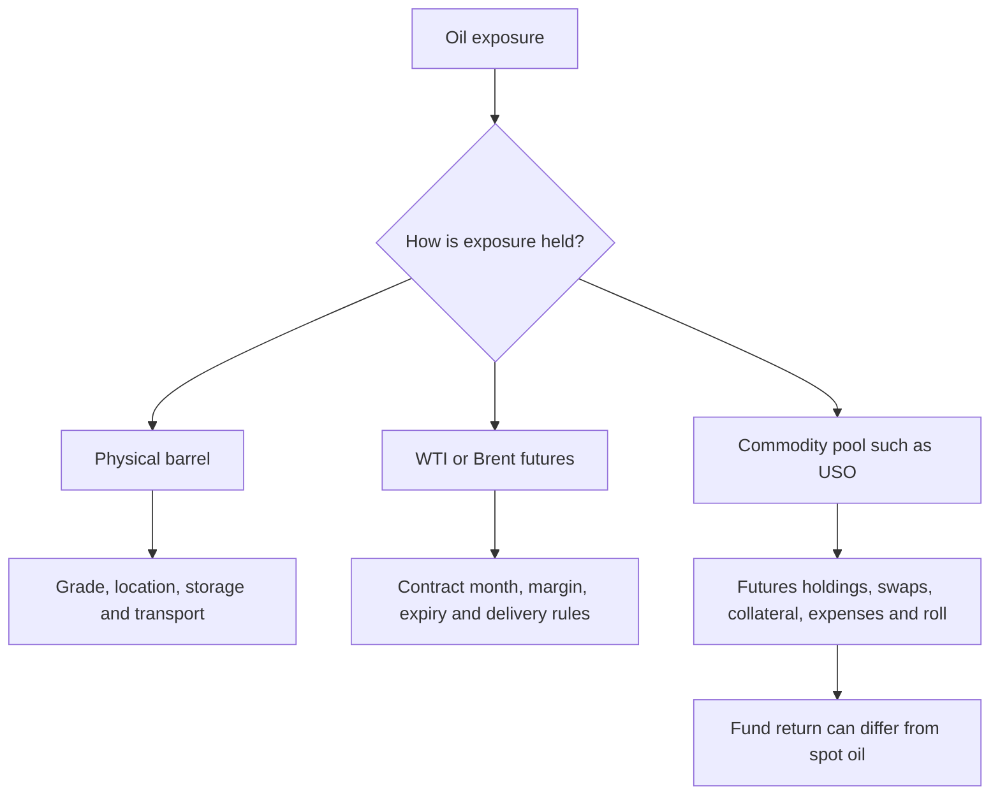
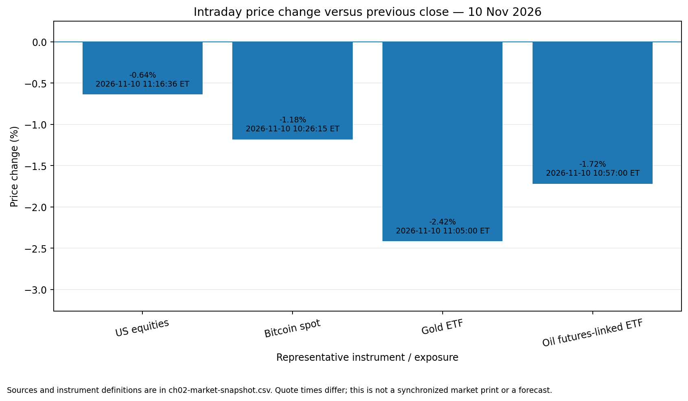

# 02 — Markets and the Current Market Regime

**Learning path:** Trading & Investing Study Guide  
**Level:** Beginner → informed market comparison  
**Estimated study time:** 6–9 focused hours  
**Research checked:** **10 November 2026, 09:25 Pacific Standard Time (PST) / 12:25 Eastern Standard Time (EST)**. This is the research-access time, not a claim that all quotes below were captured simultaneously.  
**Purpose:** Compare representative ways to access U.S. equities, Bitcoin, gold and oil; understand what is actually owned; learn what drives each market; and choose a sensible order for study and paper practice.  
**Safety boundary:** This is educational research, not individualized investment, tax or legal advice. The scorecard ranks learning suitability, not expected returns. Nothing below is a buy/sell signal or a promise of profit.

> **The most important conclusion:** Start by studying a broad, liquid U.S. equity index ETF and use a short-term Treasury/cash benchmark. Add gold as a second, relatively interpretable macro exposure. Observe Bitcoin after learning its continuous-market, custody and venue risks. Postpone oil futures and leveraged derivatives until you understand contract structure, expiry and roll yield. This is a learning sequence—not a prediction that one market will outperform another.

---

## 1. How to use this chapter

Chapter 1 established how orders, prices, returns, volatility, drawdowns and costs work. This chapter applies those concepts to actual market choices. It deliberately does **not** teach company valuation or portfolio construction in depth; those belong in [Chapter 3 — Long-term investing and portfolio](03-long-term-investing-and-portfolio.md). It also does not choose a short-term signal; that belongs in [Chapter 4 — Short-term trading playbook](04-short-term-trading-playbook.md).

### Learning objectives

By the end, you should be able to:

1. Explain the difference between an asset, a market benchmark and a product that provides exposure to that asset.
2. Compare broad U.S. equity ETFs, individual stocks, Bitcoin spot, Bitcoin ETPs, physical gold, gold trusts, oil futures and oil-linked funds without treating them as interchangeable.
3. Explain the main trading hours, liquidity sources, price drivers, costs, custody risks, leverage and contract risks for each exposure.
4. Read a dated market snapshot and identify which data are live, delayed, intraday or end-of-day—and why the timestamps may not match.
5. Interpret a current regime as a set of observations and competing explanations, not as a forecast.
6. Use a transparent scorecard to prioritize markets for learning and paper experiments.
7. Refresh cross-asset daily data and calculate returns, realized volatility, dollar-volume proxies and maximum drawdown with Python.

### Prerequisites

Complete Chapter 1 first. You should know the meaning of an ETF, bid/ask spread, daily return, volatility, drawdown, benchmark, spot price, futures contract and expense ratio. Python is optional for the written lessons but required for the data-refresh lab.

## 2. 80/20 — what matters most

- **Start with the simplest instrument that still teaches useful skills.** A broad equity ETF is a share traded on a regulated exchange, with published holdings and a familiar U.S. market session. It is not risk-free, but it is easier to reason about than a futures-linked commodity pool.
- **A ticker is not the underlying asset.** GLD is a trust share backed by gold bullion; USO is a futures-linked commodity pool; a Bitcoin ETP is a security; BTC held in a wallet is a cryptoasset. Each introduces different risks and costs.
- **Market access is not the same as market quality.** Bitcoin trades around the clock, but trading venues differ in liquidity, spreads, custody and reliability. Extended-hours ETF trading can be thinner than the core session.
- **Understand the product's return engine.** Fund expenses, tracking differences, collateral income, financing, futures rolls, distributions, premiums/discounts and custody can separate product performance from the headline asset price.
- **Do not choose the market because it recently moved the most.** High volatility may create larger gross price swings, but it also increases gap, slippage, liquidation and model-failure risk.
- **Use cash/Treasuries as a comparison point.** A trading idea should be judged against an appropriate alternative, not merely against a zero return.

**Optional / later:** options strategies, leveraged/inverse ETFs, perpetual swaps, calendar spreads, calendarized commodity curves, delivery mechanics and cross-exchange arbitrage. Know that these exist; do not make them part of your first paper strategy.

---

## 3. The four exposures are not four equivalent assets

The word *market* is often used casually. For research, write down the exact exposure and product.

| Exposure | What the underlying represents | Common beginner access route | What the investor/trader actually owns |
|---|---|---|---|
| U.S. equities | Residual ownership claims in corporations | Individual stock or broad index ETF | A share in one company, or a share in a fund that owns a basket of securities |
| Bitcoin | A native digital asset recorded on the Bitcoin network | BTC/USD spot on a crypto venue; alternatively, a spot Bitcoin ETP | BTC in an exchange/custody account or a wallet; an ETP holder owns fund/security shares, not private keys to BTC |
| Gold | A physical commodity, usually quoted per troy ounce | Physical bullion, a physically backed trust/ETF, or futures | Metal with storage and dealer costs; trust/ETF shares; or a futures contract with margin and expiry |
| Oil | A physical commodity with location, grade, delivery and timing specifications | Energy-company shares, an oil-linked fund, or futures | Equity in an energy company; shares in a futures pool; or a contract for a specified grade, month and delivery terms |

A physical asset, an equity in a company that produces it, a security that holds it, and a derivative linked to its price can behave differently. Start every analysis by asking: **What legal/economic claim do I own, how is its value calculated, and what can make it deviate from the headline price?**

### 3.1 Individual stocks versus broad index ETFs

An individual stock is an ownership interest in one issuer. Its price can be affected by company-specific events: earnings, management, product launches, lawsuits, financing, competition, governance and dilution. A correct view about the overall economy does not protect you from a company-specific collapse.

A broad equity ETF holds a portfolio designed to track an index or strategy. A large U.S. index ETF can provide exposure to hundreds of companies through one exchange-traded share. This reduces single-company concentration compared with owning one stock, but it does not remove equity-market risk. Market-cap-weighted indexes can be concentrated in their largest constituents and sectors; broad does not mean evenly weighted.

Examples of S&P 500 ETF products include SPY, IVV and VOO. They seek exposure to the same broad index but are separate funds with their own fees, liquidity, bid/ask spreads, tracking differences, distribution schedules and trading characteristics. Do not select among them by share price alone. Compare the current prospectus, expense ratio, assets, tracking difference, average spread and the use case. A very liquid instrument may be useful for short-term paper execution; another fund tracking the same index may be cheaper for a long holding period. Those are different selection questions.

**Key distinction:** an index is calculated, not directly owned. An ETF share is a security that seeks to track that index. The ETF can trade at a small premium or discount to its net asset value, and its returns can differ slightly from the index because of fees, cash, trading and tracking effects.

### 3.2 Bitcoin spot versus Bitcoin securities and derivatives

Bitcoin spot trades on crypto venues continuously. A BTC/USD price displayed by one venue is not necessarily the global executable price on every venue. Order books, fees, withdrawal rules, stablecoin pairs, bank rails and market depth vary by platform. Aggregated price feeds help with research but do not guarantee the quote or fill available on a specific exchange.

If you hold BTC directly, learn the distinction between exchange custody and self-custody. Exchange custody creates counterparty, operational, account-access and insolvency risks. Self-custody transfers responsibility to you: private-key loss, theft, mistaken transfers and recovery failures can be irreversible. Network fees and withdrawal delays also matter.

A spot Bitcoin exchange-traded product lets an investor trade security shares in a brokerage account. The SEC approved the listing and trading of a number of spot Bitcoin ETP shares on 10 January 2024; that approval was not an endorsement of Bitcoin or a conclusion that it is safe. ETP shares trade during exchange sessions and have fund fees, custody arrangements, market-price/NAV differences and brokerage costs. They are not the same as holding BTC in a personal wallet. (See the [SEC statement dated 10 January 2024](https://www.sec.gov/newsroom/speeches-statements/gensler-statement-spot-bitcoin-011023).)

Bitcoin futures, perpetual swaps and options add another layer. Futures have expiry and basis risk; perpetuals use funding mechanisms; margin can magnify gains and losses; liquidation may occur automatically. These are **not** required to learn spot-market mechanics. Do not use leverage as a shortcut to make small price moves appear profitable.

### 3.3 Gold: bullion, trust shares and futures

Physical gold is not a yield-producing business. Its owner faces the dealer premium when buying, a dealer spread on sale, authentication/assay concerns, secure storage, insurance and possible transport costs. The quoted spot price is a reference, not necessarily the price at which a small retail buyer can purchase a coin or bar.

A physically backed gold trust or ETF can be easier to trade through a brokerage account. As one specific example, State Street's SPDR Gold Shares (GLD) says its objective is for shares to reflect the performance of gold bullion less expenses. Its posted gross expense ratio was **0.40% as of 10 November 2026**. Fund shares trade on an exchange; the fund holds bullion through custodians. Individual retail shares are not individually redeemable for a bar. The market price can differ from NAV, and the ongoing expense reduces the gold represented by each share over time. See the [official GLD product page and prospectus links](https://www.ssga.com/us/en/intermediary/etfs/spdr-gold-shares-gld).

Gold futures are standardized contracts with margin, expiry and a contract specification. They can be useful for market professionals and advanced study, but they are not the same as a retail bullion purchase or a GLD share. A futures position can lose more than the initial margin deposited.

Gold can sometimes diversify a portfolio because its drivers differ from corporate earnings and interest-bearing assets. That relationship is unstable: gold can fall alongside equities, especially when the dollar or real yields rise or investors sell liquid assets. Diversification is a historical relationship to measure, not a promise that gold will protect a portfolio during every crisis.

### 3.4 Oil: benchmark price, futures curve and oil-linked funds

Oil is not one uniform global price. WTI and Brent are benchmark grades with different delivery locations and market structures. Physical oil also varies by grade, sulfur content, transport route, storage access and delivery terms. A headline WTI or Brent futures quote is not the cost of a barrel delivered to every buyer.

Oil prices respond to expected supply and demand, inventories, OPEC+ policy, production disruptions, refinery demand, shipping constraints, sanctions, war risk, economic growth, currency moves and seasonal patterns. Inventory reports can cause abrupt moves. A correct long-term view of oil demand does not by itself tell you what the next futures contract will do.

A futures contract is an agreement for a standardized quantity, grade, month and settlement/delivery procedure. CME lists standard WTI crude oil futures at **1,000 barrels per contract** and Micro WTI at **100 barrels**. Contract notional value can be large compared with the margin deposit. Margin is a performance bond, not the maximum possible loss. Contract size, tick value, expiry, first notice/last trade dates and broker liquidation rules must be understood before a paper test, let alone a live trade. See [CME WTI futures specifications](https://www.cmegroup.com/markets/energy/wti-crude-oil-futures.html).

An oil fund may use futures rather than store barrels. USO, for example, says it primarily invests in oil futures and may also use swaps and other instruments. Its benchmark futures exposure is rolled from the near-month contract to the next-month contract over a five-day period near the start of the month. USCF explicitly warns that an investment in USO should not be viewed as an investment in the benchmark futures contract or in physical light sweet crude oil. See the [USO product page](https://www.uscfinvestments.com/uso).

#### Contango, backwardation and roll yield

The **futures curve** plots futures prices by delivery month. It can differ from the current spot price.

- **Contango:** later-dated futures trade above nearer-dated contracts. A fund that repeatedly sells a nearer contract and buys a more expensive later contract may experience negative roll effects, all else equal.
- **Backwardation:** later-dated futures trade below nearer-dated contracts. Rolling may have a positive effect, all else equal.
- **Roll yield:** the return effect associated with moving exposure from one contract month to another. It is only one part of total fund performance; the futures price move, collateral return, expenses, tracking difference and other holdings also matter.

**Synthetic illustration (not actual oil prices):** imagine a fund sells an expiring contract at $80 and buys the next contract at $84. It has to buy the later contract at a 5% higher price per barrel. If the curve and spot level do not otherwise change, this price gap is a headwind as the later contract converges toward expiry. Reverse the prices—sell at $84 and buy at $80—and the roll relationship is more favorable. The example isolates the roll mechanism; it is not a forecast and not a complete fund-return calculation.



**Beginner rule:** do not paper trade crude futures until you can explain contract notional, tick value, initial/maintenance margin, expiry, delivery/settlement, the curve and the roll calendar without looking them up.

---

## 4. Trading hours, liquidity and data quality

### 4.1 Trading hours are part of the strategy

| Exposure or product | Typical access window | Practical implication |
|---|---|---|
| U.S.-listed equity ETFs (SPY, GLD, USO) | Core U.S. session generally 9:30 a.m.–4:00 p.m. ET on market days; some venues/brokers offer extended sessions | Open/close auctions, economic releases and earnings can create gaps. Extended-hours liquidity and price discovery can be weaker. |
| Bitcoin spot | 24 hours a day, 7 days a week, subject to venue maintenance/outages | No single daily close across all venues; weekends and overnight periods are part of the risk. |
| Gold OTC/spot references | Global dealer market across major time zones, mostly weekday trading; exact quotes are provider-specific | OTC quotes, liquidity and benchmark times differ; a spot reference is not a universal consolidated order book. |
| Gold or oil futures | Exchange-defined electronic sessions, daily maintenance breaks and holiday schedules | Contract liquidity varies by month; front-month contracts are often more active, but expiry/roll dates matter. |
| U.S. Treasury bills | Treasury auction and secondary-market schedules; bills do not trade like a 24/7 spot token | Useful cash benchmark, but yields, maturities, settlement and sale-before-maturity prices still matter. |

Nasdaq publishes its core regular session as 9:30 a.m.–4:00 p.m. Eastern and lists extended sessions; NYSE publishes a similar core session. Extended trading is not equivalent to the regular session. Check the exchange, broker and product calendar before each experiment: [Nasdaq 2026 hours and calendar](https://www.nasdaq.com/market-activity/stock-market-holiday-schedule) and [NYSE trading information](https://www.nyse.com/trade/trading-information).

### 4.2 Liquidity and spread by market

Do not memorize a claim such as “this asset always has a one-cent spread.” Spread depends on the product, venue, market session, volatility, price, trade size and data timestamp.

- **SPY and large broad equity ETFs:** among the most actively traded U.S.-listed ETF products. During the regular session, the order book is generally deep and spreads are typically tight. Liquidity can be less favorable just before/after the core session or during shocks. An ETF share can still trade away from NAV.
- **Individual stocks:** liquidity ranges from very deep to extremely thin. A large company may have a tight spread; a small or distressed issuer may have a wide spread and shallow depth. Never infer liquidity from the word “stock.”
- **Bitcoin spot:** the market is fragmented across centralized and decentralized venues. Evaluate the exact exchange pair you would use, not only a global volume number. Compare quoted spread, order-book depth at your position size, fees, outages, withdrawal constraints and whether displayed volume is trustworthy.
- **GLD:** a large U.S.-listed gold trust with exchange-traded shares and observable bid/ask quotes. Its spread can widen when underlying gold trading is less active or markets are stressed. The fund's ongoing expense and any premium/discount to NAV are separate from the broker spread.
- **WTI futures:** the benchmark front-month contract is actively traded, but liquidity migrates as expiry approaches. A futures quote may look liquid while the next-month contract or a micro contract has a different depth. A futures-linked ETF such as USO can be easier to simulate as a share, but its fund structure adds roll and tracking effects.

For a paper strategy, record the spread at the actual decision time and at your intended order size. Also record the bid/ask midpoint, order book depth if available, estimated fees and fill model. Daily volume is a screening measure, not evidence that your particular order would have filled at the displayed price.

### 4.3 Data quality checklist

For every dataset, record:

1. **Instrument and venue:** e.g., SPY on NYSE Arca, BTC-USD from a named crypto venue or a named aggregator, GLD, USO or the WTI front-month contract.
2. **Timestamp and timezone:** quote timestamp, retrieval timestamp and bar-label timezone. Do not assume a bar's date means the same closing time across markets.
3. **Quote type:** live, delayed, end-of-day, settlement, index value, indicative NAV or estimated value.
4. **Price convention:** last trade, bid, ask, midpoint, official close, settlement, adjusted close, spot reference or futures mark.
5. **Corporate actions and distributions:** stock splits, dividends, capital gains, fund distributions and adjusted-price methodology.
6. **Volume definition:** shares, BTC units, USD turnover, contracts or an aggregator's estimate. Avoid direct comparison until units and venues match.
7. **Missing periods:** equity exchange holidays versus 24/7 crypto bars and futures sessions. Never silently fill a missing trade with a made-up price.
8. **Corrections and licensing:** historical feeds can be corrected, rate-limited, restricted or unsuitable for redistribution. Read provider terms.

### Quote freshness in this chapter

The research-access time above is **09:25 PST / 12:25 EST on 10 November 2026**. The following observations are from different source timestamps and are not one consolidated market print:

| Product used for the snapshot | Displayed observation | Source timestamp | Previous reference | Approx. intraday change | Source/data limitation |
|---|---:|---|---:|---:|---|
| SPY | $747.89 | 11:16:36 a.m. EST | $752.69 prior close | −0.64% | Yahoo Finance page labeled NYSE Arca/Nasdaq real-time; page quote and historical data can refresh at different moments. |
| BTC-USD | $74,334.08 | 10:26:15 a.m. EST (15:26:15 UTC) | $75,223.15 previous daily close | −1.18% calculated from displayed closes | Yahoo Finance aggregated BTC-USD historical page; continuous crypto day boundary differs from U.S. equity close. |
| GLD | $370.36 | 11:05 a.m. EST | $379.53 prior close | −2.42% | Stock Analysis page labeled real-time; GLD is a trust share, not spot gold. |
| USO | $140.21 | 10:57 a.m. EST | $142.66 prior close | −1.72% | Stock Analysis page labeled real-time; USO is a futures-linked commodity pool, not physical oil. |

The bar chart is a quick illustration of the day's direction at those provider timestamps. It does **not** imply that the instruments were observed at the same second, nor does it say which is safer or better.



Recreate it from the cited CSV:

```bash
python -m pip install pandas matplotlib
python study-guide/scripts/plot_ch02_snapshot.py
```

Snapshot source rows and source URLs: [`data/ch02-market-snapshot.csv`](data/ch02-market-snapshot.csv). Reproducible chart script: [`scripts/plot_ch02_snapshot.py`](scripts/plot_ch02_snapshot.py).

---

## 5. What the market is doing in this snapshot—and what it does not prove

### 5.1 Observations reported on 10 November 2026

The following is a dated news-and-market context snapshot, not a real-time trading instruction:

- The U.S. Bureau of Labor Statistics reported that October CPI increased **0.4% month over month** and CPI less food and energy increased 0.3%. Reuters reported those readings were above its surveyed consensus estimates of 0.3% and 0.2%, respectively. The report linked the surprise with higher Treasury yields and changing expectations for the Federal Reserve's December meeting.
- In the same dated global-markets report, the 2-year Treasury yield was reported at **4.74%**, the 10-year at **4.988%**, the S&P 500 index down 0.71%, the Nasdaq Composite down 0.90%, and the Dow down 0.57% at the cited report's market timestamp.
- Reuters reported spot gold down 2.3% to **$4,043.73 per ounce** after the inflation news and a stronger U.S. dollar.
- Reuters separately reported WTI crude around **$85.41 per barrel** and Brent around **$90.64**, both lower on the day and near two-month lows. The article discussed a reduced expectation of further U.S. strikes against Iran while noting that conflict and tanker risks remained.
- FRED's H.15 interest-rate page showed a 3-month Treasury bill secondary-market rate of approximately **4.03%** in its 9 November 2026 release. Its daily 10-year Treasury series showed 4.86% on 6 November; Reuters' later 10 November report quoted a higher intraday yield. These are different observation dates and data types, not a contradiction to be averaged.

Sources: [Reuters global markets report, 10 November 2026](https://www.reuters.com/world/china/global-markets-wrapup-1-2026-11-10/); [Reuters oil-market report, 10 November 2026](https://www.reuters.com/business/energy/oil-falls-trump-downplays-prospect-escalation-with-iran-2026-11-10/); [Federal Reserve H.15, 9 November 2026](https://www.federalreserve.gov/releases/h15/); [FRED DGS10](https://fred.stlouisfed.org/series/DGS10).

### Scheduled events in the immediate learning window

Calendar checked on **10 November 2026**. These are dates to annotate in a journal, not predictions of market direction:

| Date and time (Eastern) | Event | Why it belongs on the calendar |
|---|---|---|
| Tue 10 Nov, 8:30 a.m. | October CPI release (already published by the snapshot time) | The release was the inflation surprise discussed above; record actual versus consensus without hindsight. |
| Wed 11 Nov | Veterans Day; U.S. federal holiday | Government statistical releases can shift; confirm the exchange and broker holiday calendar separately. |
| Thu 12 Nov, 12:00 p.m. | EIA Weekly Petroleum Status Report (holiday-adjusted release) | Inventory and supply data can affect crude and refined-product expectations. EIA also lists a 2:00 p.m. release time in its holiday notice. |
| Fri 13 Nov, 8:30 a.m. | October Producer Price Index (PPI) | A further inflation input; markets may focus on details as well as the headline. |
| Tue 17 Nov, 8:30 a.m. | October U.S. Import and Export Price Indexes | Trade prices can provide additional inflation context. |
| Wed 18 Nov, 2:00 p.m. | FOMC minutes for the 27–28 October meeting | Provides additional policy discussion; it is not a new rate decision. |
| Tue–Wed 8–9 Dec | Scheduled FOMC meeting | Policy decision and communication are potential volatility events; date and time should be rechecked closer to the meeting. |

Official calendars: [BLS November 2026 release schedule](https://www.bls.gov/schedule/2026/11_sched.htm); [EIA holiday-adjusted petroleum report notice](https://www.eia.gov/petroleum/supply/weekly/); [Federal Reserve November calendar](https://www.federalreserve.gov/newsevents/2026-november.htm) and [December calendar](https://www.federalreserve.gov/newsevents/2026-december.htm). Release schedules can change; check the issuing agency on the day.

### Reported 1-month and 1-year context

The following are **source-reported price-performance figures**, not a harmonized total-return calculation. The providers use different products, time boundaries and calculation methods. They are useful for practicing source reading, not for declaring a winning asset.

| Exposure/reference | Reported 1 month | Reported 1 year | Basis and source |
|---|---:|---:|---|
| SPY | −0.57% | +9.99% | Yahoo Finance quote-page performance display on 10 Nov 2026; ETF-share performance, provider convention. |
| Bitcoin spot | −9.97% | −29.94% | BTC/USD price comparisons from Fortune, 10 Nov 2026 at 7:15 a.m. EST. |
| Gold spot | −2.81% | −0.90% | Spot gold comparison from Fortune, 10 Nov 2026 at 9:15 a.m. EST. |
| WTI crude futures reference | −10.11% | +41.18% | WTI price-history provider's calculations, last close 10 Nov 2026; futures-price series, not USO total return. |

Do not compare these as if they were one common total-return dataset: SPY is a fund share, BTC and gold are spot-price references, and WTI is a futures benchmark. Fund distributions, product expenses, custody, collateral and futures rolls are not consistently represented in this table. The included Python script is the preferred learning tool for calculating metrics from one downloaded series per proxy and recording the exact data-vendor convention. Sources: [Yahoo Finance SPY quote page](https://finance.yahoo.com/quote/SPY/); [Fortune Bitcoin quote, 10 Nov 2026](https://fortune.com/article/price-of-bitcoin-11-10-2026/); [Fortune gold quote, 10 Nov 2026](https://fortune.com/article/current-price-of-gold-11-10-2026/); [WTI returns and volatility](https://financial.investments/asset/crude-oil-wti).

### 5.2 Interpretation—keep it separate from the observations

One plausible interpretation is that the hotter CPI surprise increased the expected path of policy rates and bond yields. Higher nominal yields and a stronger dollar can create headwinds for gold, which does not pay interest. Higher borrowing costs can pressure equity valuations, especially for companies whose expected cash flows are far in the future. Oil, meanwhile, was responding to a different mix of geopolitical supply risk and expectations about how much disruption might persist; weaker geopolitical risk premium can pull crude down even while inflation remains elevated.

These are **mechanisms to study**, not deterministic rules:

- A hot CPI report does not force every stock lower. Earnings, positioning, liquidity, policy interpretation and expectations already priced in all matter.
- Gold does not always fall when yields rise; real yields, currency moves, central-bank demand, risk aversion and positioning interact.
- Oil can fall while inflation is high if the market expects supply to normalize or demand to weaken. A shipping disruption can reverse that quickly.
- Bitcoin may respond to liquidity, rates and risk appetite, but there is no stable one-variable mapping from the Fed to Bitcoin's next move.

**Regime label for learning purposes:** inflation/rate repricing is interacting with an evolving geopolitical oil-risk premium. This is a provisional narrative for the cited 10 November news window, not a quantitative volatility-regime classification. A proper regime model would need rolling volatility, market breadth and cross-asset correlations calculated from a consistent historical sample. Recheck before any later experiment; do not turn a news summary into a trade signal.

### 5.3 Why not publish one “definitive” return/volatility ranking here?

Current quote pages are asynchronous. The ETF quotes above are intraday exchange observations. Bitcoin trades continuously and its daily candle boundary is provider-defined. Gold spot and oil futures references differ from GLD and USO shares. Some performance pages report adjusted fund total returns; others report spot or futures price changes. Volatility pages use different lookbacks and annualization conventions.

A strict cross-market table must calculate from one selected, documented dataset with consistent rules. The snapshot did not provide a consistent, timestamp-matched advance/decline breadth series or correlation matrix across the four proxies, so neither is inferred. This chapter therefore records reliable dated observations but does not pretend that provider-reported one-month returns or 20-day volatility values are fully comparable. As separate context, a current BTC page reported 30-day annualized realized volatility of 35.6%, while a WTI page reported roughly 56.6% annualized volatility using a 20-session measure. The lookbacks, data source and conventions are not identical; do not interpret those two numbers as a precise contest. Use the Python refresh lab below to calculate a consistent set from the same daily data vendor before you compare them.

---

## 6. Asset and product comparison

| Criterion | Broad U.S. equity ETF / individual stock | Bitcoin spot / Bitcoin ETP | Gold bullion / GLD | WTI / USO / futures |
|---|---|---|---|---|
| **What is owned** | ETF share in an index portfolio, or one company's stock | Direct BTC claim held by exchange/wallet, or ETP security share | Physical bullion, trust share backed by bullion, or gold futures | Physical crude (not typical retail exposure), futures contract, energy-company stock, or futures-pool share |
| **Hours** | Exchange sessions; extended hours vary | Spot is 24/7 by venue; ETP follows exchange hours | Bullion/OTC quotes across global weekday sessions; GLD exchange hours; futures exchange schedule | Futures electronic session with maintenance and expiry; USO share exchange hours |
| **Liquidity / spread** | SPY is highly liquid; individual stocks vary widely | Highly venue-dependent; aggregate price is not an executable quote | GLD is exchange-traded and liquid; physical dealer spreads/premiums can be substantial | Front WTI futures can be liquid; depth varies by contract month; USO adds ETF spreads and tracking effects |
| **Main price drivers** | Earnings, growth, rates, margins, valuation, policy, index weights and risk appetite | Network demand, liquidity, regulation, supply schedule, adoption, venue flows, leverage positioning and sentiment | Real yields, dollar, inflation expectations, central-bank/ETF/physical demand, risk appetite and jewelry/industrial use | Supply/demand balance, inventories, production policy, geopolitics, transport, refining, weather and global growth |
| **Volatility / tail risk** | Broad index risk lower than single-stock concentration but still large drawdowns; single names can gap on company news | High volatility, 24/7 gaps between your monitoring periods, venue/custody and liquidation risks | Can be volatile and can suffer long drawdowns; no yield | Can be very volatile; futures leverage, gaps, delivery/expiry and curve changes add risks |
| **Data availability** | Strong public historical data; exchange/issuer and SEC filings | Many price feeds, but fragmented venues and variable volume quality | Spot references, futures, issuer holdings/NAV and ETF data; quote conventions vary | EIA inventories, exchange futures curves, fund holdings and issuer data; contract rolls matter |
| **Costs** | Broker commissions if any, spread, slippage, fund expense ratio, taxes | Exchange fees, spread, custody/withdrawal/network costs; ETP fee and brokerage spread if used | Physical dealer premium, storage/insurance; GLD 0.40% annual gross expense ratio as of 10 Nov 2026; spread | Futures commissions, spread, exchange/clearing fees, margin funding; USO expense ratio (0.86% shown by issuer's official page at last captured source state) and roll/tracking costs |
| **Leverage / financing** | Avoid margin while learning; stock borrow/shorting has separate risks | Margin/futures/perpetuals magnify losses; direct spot avoids embedded leverage but not price loss | Physical and an unleveraged trust share have no futures margin, but a broker may permit margin; futures use margin | Futures are margined; fund may use futures/swaps. Position notional can greatly exceed deposited margin |
| **Passive holding suitability** | Broad, diversified low-cost funds can serve as long-term portfolio building blocks; individual stock holding needs issuer risk analysis | Highly speculative and concentrated; a small allocation policy is a separate portfolio decision | Can be a diversifier for some portfolios, but no yield and no guaranteed hedge | Single-commodity futures exposure is generally a poor default for a beginner's passive core due to volatility, roll and concentration |
| **Beginner paper suitability** | **High** for a broad index ETF; individual names later | Medium for unleveraged spot observation; no need to trade 24/7 | **Medium-high** for GLD share research and macro observation | **Low** for futures; medium-low for observing USO after understanding its benchmark and roll |
| **Common failure modes** | Concentration, index drawdown, earnings gaps, wrong benchmark, fees, unrealistic fills | Exchange outage/failure, stolen keys, withdrawal restriction, manipulation, illiquidity on one venue, high leverage/liquidation | Confusing spot with retail purchase price; storage/dealer costs; trust fee and NAV premium/discount; assuming gold hedges every crisis | Wrong contract/month, unplanned expiry, margin call, curve/roll drag, supply shock, weather/geopolitical gap, confusing USO with spot |

### Cash and U.S. Treasury bills as reference points

Cash is not a trading strategy, but it is a necessary baseline. If a strategy earns a small positive return while taking large drawdowns, turnover and complexity, compare it with the return available on short Treasury bills and with a diversified portfolio benchmark.

Treasury bills are short-term U.S. government securities. A bill held to maturity pays its stated face value at maturity; before maturity, a marketable bill's sale price can change. Reinvestment rates can fall when a bill matures. Inflation reduces purchasing power. A Treasury bill is not the same as a bank deposit, and a money-market fund is not a Treasury bill. The Federal Reserve H.15 release showed a 3-month secondary-market bill rate around 4.03% on 9 November 2026; rates move and the exact investment yield depends on instrument, purchase price, maturity and method of quotation. See [Treasury marketable securities](https://www.treasurydirect.gov/marketable-securities/) and the [Federal Reserve H.15 release](https://www.federalreserve.gov/releases/h15/).

---

## 7. Beginner market scorecard: where to spend study time first

This scorecard answers **“Which market helps me learn the most safely and efficiently?”** It does not answer “Which market will go up?” Scores are educational judgments based on the instruments described here and should be revisited when data feeds, spreads, fees, broker access or your knowledge change.

### Criteria and weights

| Criterion | Weight | A higher score means… |
|---|---:|---|
| Instrument simplicity and transparency | 20% | You can explain the claim, benchmark, price formation and main product mechanics |
| Risk manageability for a beginner | 20% | You can test without leverage and understand plausible loss mechanisms |
| Liquidity and trading friction | 15% | The instrument generally has accessible depth, tight spreads and lower friction in its main session |
| Historical/research data availability | 15% | Useful, documented data are accessible for repeated analysis |
| Paper-practice infrastructure | 15% | It is reasonably straightforward to observe or simulate orders without money |
| Long-term learning value | 15% | It teaches useful portfolio or market concepts beyond one short-term trade |

Scores are 1 (poor fit) to 5 (strong fit). The weighted score is the sum of `score × weight` divided by 100.

| Market/instrument for this learning path | Simplicity 20 | Risk 20 | Liquidity 15 | Data 15 | Paper 15 | Long-term value 15 | Weighted score / 5 |
|---|---:|---:|---:|---:|---:|---:|---:|
| Broad U.S. equity ETF (e.g. SPY as a liquid practice proxy) | 5 | 3 | 5 | 5 | 5 | 5 | **4.60** |
| Cash / short Treasury bill benchmark | 5 | 5 | 5 | 5 | 4 | 4 | **4.70** |
| Physically backed gold trust share (GLD) | 4 | 3 | 4 | 4 | 4 | 3 | **3.65** |
| Bitcoin spot (one named venue/pair, unleveraged) | 3 | 2 | 3 | 4 | 3 | 2 | **2.80** |
| WTI futures-linked fund (USO) | 2 | 2 | 3 | 4 | 4 | 1 | **2.60** |
| Direct WTI futures | 1 | 1 | 4 | 4 | 2 | 1 | **2.05** |

**How to read it:** Cash/T-bills score highest as a low-complexity benchmark, but they are not the recommended first short-term trading instrument. For actual equity market mechanics and paper trading, a broad index ETF such as SPY is the primary learning instrument. A lower-cost S&P 500 ETF may be a better long-term holding candidate than SPY depending on its current costs and use case; compare fund documents rather than treating the trading proxy as an automatic portfolio recommendation.

### Why SPY is the first practice instrument

SPY's central advantage for a beginner is not a promise of superior returns. It is that it provides broad U.S. large-cap equity exposure through one highly traded exchange share, has extensive historical data, and is easier to paper test during a fixed regular session than a 24/7 venue or an expiring futures contract. Its disadvantages remain important: it is still an equity risk asset, it can fall sharply, and its S&P 500 exposure is not the whole U.S. or global market.

### Second market: gold via a physically backed trust share

Use GLD as a *study instrument* for understanding bullion exposure, trust structure, expense ratio, NAV and macro sensitivity. Also compare its movement with real yields and the U.S. dollar. Do not assume gold will always hedge equities or inflation. Before progressing to futures, understand contract size and margin.

### Observe Bitcoin before trading it

Track BTC/USD on one clearly named spot venue and compare it with a spot Bitcoin ETP, if studying brokerage securities. Record venue, price pair, time zone and 24/7 candle convention. Do not start with perpetual swaps, futures or leverage. Only consider a paper experiment after you can explain the exchange/custody model, market outages, spread/depth, funding/borrow and weekend risk.

### Postpone oil derivatives

For now, observe WTI/Brent prices, EIA inventories and the futures curve. You can study USO as a share product once you understand that it follows a futures benchmark and rolls exposure. Postpone direct futures trading, options, leveraged oil products and calendar spreads until you can calculate contract notional, tick value, margin stress and the impact of contango/backwardation under at least two curve scenarios.

### What would change this ranking?

Re-score the instruments if:

- Your broker's paper environment does not support the chosen product, or its data are delayed/incomplete.
- SPY spreads or market data become unreliable at the time your proposed strategy trades.
- You gain access to a clearly documented BTC spot venue with better depth, fee transparency and safe paper infrastructure.
- You complete a structured futures course and can demonstrate contract/roll competence with historical data and simulated orders.
- A market's complexity no longer overwhelms its learning benefit for you.

Do **not** change the ranking solely because an asset just rallied, crashed or appeared in a viral video.

---

## 8. A practical study-time split

This is a split of **learning time**, not of investment capital.

For the first six weeks, use this starting schedule:

- **50% — long-term investing research:** understand broad funds, diversification, fees, benchmarks, company fundamentals and portfolio review. Chapter 3 develops this work.
- **30% — short-term trading research:** learn one simple, falsifiable setup on a broad equity ETF. Keep it in a notebook/backtest/paper account only. Chapter 4 defines the setup; Chapter 5 tests it.
- **20% — cross-asset observation:** update a weekly panel for SPY, BTC, gold and WTI. Explain what happened and list alternative explanations, but do not force a trade from every observation.

After you can produce a clean data report, explain a strategy's costs, and complete paper-trading logs without rule changes, you may increase the short-term experimentation share. Do not increase live risk based on a short winning streak.

A simple weekly routine:

| Day | Task | Evidence to save |
|---|---|---|
| Monday | Record market/benchmark levels and the upcoming macro/earnings calendar | One dated snapshot and event list |
| Tuesday | Review broad index ETF versus cash/T-bill benchmark | One chart and a paragraph on relative performance |
| Wednesday | Compare BTC and GLD behavior; note venue/product differences | Two annotated charts, with timestamps |
| Thursday | Review WTI/Brent and the curve/inventory context | Curve screenshot/data table and roll-risk note |
| Friday | Review the paper journal and whether any hypothesis was falsified | Weekly metrics; no trade is a valid decision |

---

## 9. Python lab: refresh a consistent comparison

The live snapshot above uses multiple public sources and honest timestamp caveats. For a more comparable historical study, calculate metrics for the four defined symbols from one data provider using the same code and conventions. The included script uses Yahoo Finance historical data through the community `yfinance` Python package. This is convenient for education but is **not** an exchange-certified real-time feed, not a broker execution feed and not a guarantee of complete history. Quotes can be delayed, corrected, blocked or rate-limited.

### 9.1 Symbols and interpretation

| Symbol | Proxy definition | What it is not |
|---|---|---|
| `SPY` | SPDR S&P 500 ETF Trust | Not the S&P 500 index itself or the entire global equity market |
| `BTC-USD` | Yahoo Finance's BTC/USD reference series | Not the executable order book on your chosen crypto venue |
| `GLD` | SPDR Gold Shares trust share | Not a direct spot-ounce quote; expenses and market price/NAV matter |
| `USO` | United States Oil Fund share | Not physical crude or a direct spot-oil investment; futures and roll matter |

### 9.2 Install and run

From the repository root:

```bash
python -m venv .venv
# Windows PowerShell:
.venv\Scripts\Activate.ps1
# macOS/Linux:
# source .venv/bin/activate
python -m pip install --upgrade pip
python -m pip install yfinance pandas
python study-guide/scripts/refresh_asset_metrics.py
```

The script writes `study-guide/data/refreshed-asset-metrics.csv` when it runs successfully; the output file is generated locally and is not pre-populated with stale or invented prices. It reports retrieval time in UTC, latest daily bar date, one-bar return, approximate one-month and one-year returns, annualized 20-observation realized volatility, maximum drawdown in the downloaded window, and median 20-observation dollar volume where volume is available.

Conventions used by the script:

- It requests one year of daily bars and uses provider-adjusted close for ETFs. That is an approximation of total-return data when distributions are included by the provider; check corporate-action treatment before using figures in a formal report.
- It uses the latest available completed daily bar, not a real-time quote. The one-month and one-year bases are the last observations on or before 30 and 365 calendar days before retrieval.
- It annualizes 20 observations using 252 sessions for U.S.-listed funds and 365 calendar days for BTC. Because the market calendars differ, the annualized volatilities are not a perfect apples-to-apples comparison.
- Maximum drawdown is calculated from the downloaded, adjusted price path, from a prior running peak to a later trough. It is not the same as the current distance from a 52-week high.
- Median dollar volume is a rough liquidity proxy. It does not measure bid/ask spread, order-book depth or executable slippage. BTC volume may be aggregate/vendor-specific.
- The script fails or reports an error when data are missing. It does not fabricate prices or fill missing periods with synthetic values.

**Validation task:** inspect the CSV's `last_bar_date`. If one ticker's latest bar is stale relative to the others, do not compare the figures as if synchronized. Open each provider page and investigate the missing bar, time zone and market holiday.

---

## 10. Learning-by-doing exercises

Do these without looking at the answer key first. Save each output in a local folder such as `study-guide/labs/ch02/` (create it yourself; the chapter does not require committing raw third-party data).

### Exercise 1 — Identify the actual claim

For each item, write what you own, the underlying exposure, one cost and one risk that is unique to the product structure:

1. One share of SPY.
2. One share of an individual semiconductor company.
3. 0.01 BTC held in a self-custody wallet.
4. One share of a spot Bitcoin ETP.
5. One share of GLD.
6. One share of USO.
7. One standard WTI futures contract.

**Expected output:** a seven-row table with at least four columns: legal/economic claim, underlying exposure, ongoing/transaction cost and product-specific failure mode.

**Evaluation:** full credit only if you do not say that GLD is a physical bar in your personal possession, that a Bitcoin ETP gives you private keys, or that USO is a barrel of oil.

### Exercise 2 — Reproduce the intraday snapshot chart

1. Open [`data/ch02-market-snapshot.csv`](data/ch02-market-snapshot.csv).
2. Verify the value, previous-close reference, source timestamp and URL for each row.
3. Run `python study-guide/scripts/plot_ch02_snapshot.py`.
4. Explain why the four bar values are not a synchronized comparison and why they are not a forecast.

**Expected output:** the PNG chart plus a 150–250 word note on timestamp mismatch and product mismatch.

**Evaluation:** every bar must match the CSV to within 0.01 percentage point; the note must mention that SPY/GLD/USO are exchange-traded shares while BTC-USD is a continuous-market reference.

### Exercise 3 — Compare two products with similar exposure

Compare SPY with IVV or VOO using each issuer's current official fact sheet/prospectus. Record: benchmark, expense ratio, assets under management, tracking difference if available, average daily volume, typical bid/ask spread, creation/redemption structure, distribution yield and trading venue. Do not use a blog as the sole source for fund mechanics.

**Expected output:** one product comparison table and a 5-sentence conclusion that separates “better for trading practice” from “better for long-term holding.”

**Evaluation:** the comparison must use one common data date for fund statistics or clearly mark dates that differ. It must not select a fund based only on share price or one day's volume.

### Exercise 4 — Event annotation without hindsight bias

Using the dated 10 November 2026 reports linked in Section 5, make an event timeline with:

- CPI release/consensus versus actual (as reported by Reuters).
- Treasury yield observations and their timestamp/source.
- Equity index moves.
- Gold and oil moves.
- At least two alternative explanations or confounding variables.

Write two separate columns: **Observed at the time** and **Interpretation made after reading the report**. Do not claim that you would have predicted the move before the data.

**Expected output:** a one-page annotated timeline and a 100–150 word “what I cannot infer” note.

**Evaluation:** the note must state that one event does not establish causality, that markets price expectations in advance, and that the reported moves have timestamps that may not match.

### Exercise 5 — Can a small target survive transaction costs?

Synthetic example: a paper strategy buys an ETF at a $100.00 midpoint and aims to sell at a $100.10 midpoint. Assume a $0.02 quoted spread at entry and exit, a marketable buy at the ask and marketable sell at the bid, $0 commission, and an additional $0.01 per share of slippage on each side. Ignore taxes for this exercise.

Calculate the approximate net P&L per share. Then repeat if the gross target is $0.30. State which assumptions would need actual broker data before a backtest.

**Expected output:** a short calculation with gross move, spread cost, slippage, net result and a conclusion.

**Evaluation:** do not double-count spread. From midpoint to ask is $0.01 and midpoint to bid is $0.01, for $0.02 round-trip spread cost, plus $0.02 round-trip slippage.

### Exercise 6 — Refresh returns, realized volatility and drawdown

Install the script dependencies and run `refresh_asset_metrics.py`. Inspect each row. For SPY and GLD, compare the adjusted-close return with the product issuer's published performance data. For BTC, verify the daily time-zone convention. For USO, read the fund's latest holdings and benchmark description.

**Expected output:** a refreshed CSV, a one-page metric interpretation and a list of at least three data limitations.

**Evaluation:** correctly explain why realized volatility is not an estimate of next week's return, why maximum drawdown is path-dependent, and why different trading calendars affect annualization.

### Exercise 7 — Contango/backwardation mechanics

Use the synthetic contracts below:

| Curve scenario | Near-month contract | Next-month contract |
|---|---:|---:|
| A | $80 | $84 |
| B | $84 | $80 |

For each scenario, describe which contract a simple near-month rolling fund sells and buys, and the direction of the roll-price headwind/tailwind *all else equal*. Explain why it still cannot predict the fund's total return.

**Expected output:** two annotated curve sketches or a table with the roll sequence and caveats.

**Evaluation:** correctly identify A as contango and B as backwardation; mention underlying price movement, collateral return, expenses and tracking difference.

### Exercise 8 — Re-score the markets with another time horizon

Repeat the Chapter 2 scorecard for a learner who wants to study only long-term diversified investing over 10+ years. Change the criterion weights and justify them. Then repeat for a learner studying short-term swing trading who can monitor only after work.

**Expected output:** two scorecards, with weights summing to 100% each, and a paragraph explaining why the rankings differ.

**Evaluation:** a scorecard is a transparent judgment, not a return forecast. The long-term case should value diversification, fees and holding structure more; the part-time swing-trading case should penalize instruments with difficult execution times, high costs and complex rolls.

---

## 11. Answer key and solution notes

### Exercise 1 — Example distinctions

- **SPY:** owns a share in a fund that tracks the S&P 500; costs include the fund expense and spread; risks include broad equity drawdown and fund tracking error.
- **Individual company share:** owns a residual claim in one issuer; costs include spread/commission; company-specific earnings, fraud, financing or product failure can dominate broad market trends.
- **BTC in self-custody:** controls a digital asset through private keys; costs can include network/transaction fees; irreversible key loss or a mistaken transfer is a custody failure.
- **Bitcoin ETP:** owns a security share in a vehicle that holds/obtains Bitcoin exposure; costs include fund fee and brokerage spread; custody, market price/NAV and fund structure matter.
- **GLD:** owns a trust share designed to reflect bullion less expenses; 0.40% gross annual operating expense as of the cited 10 November 2026 page; not a redeemable personal bar for an ordinary share holder.
- **USO:** owns a commodity-pool share whose exposure is primarily oil futures and possibly swaps; expenses and roll/tracking differences matter; not a barrel of oil.
- **WTI future:** holds a standardized, margined contract on a defined quantity, grade and month; commission, exchange/clearing fees and spread apply; margin calls, expiry and delivery/settlement mechanics are material.

### Exercise 2 — Snapshot chart

Expected changes from the dated displayed values are approximately SPY −0.64%, BTC-USD −1.18%, GLD −2.42% and USO −1.72%. Small rounding differences are expected. Timestamps range from 10:26:15 to 11:16:36 a.m. EST and the underlying price conventions differ.

### Exercise 3 — Product comparison

There is no permanent answer. A very liquid product may be more useful for a short-horizon paper exercise, while a product with a lower expense ratio and adequate execution quality may better serve a long holding period. The learner must cite issuer materials and compare current values on a common date.

### Exercise 4 — Event annotation

The Reuters report says October CPI exceeded consensus and Treasury yields rose; equities and gold fell in the cited report window, while oil was also lower amid changing geopolitical expectations. A good answer does not claim that CPI alone caused all moves. Other contributors include the dollar, prior positioning, earnings, geopolitics, inventory/supply expectations and the information already priced in. It is not possible to infer the correct trade or a counterfactual price path from one report.

### Exercise 5 — Transaction-cost arithmetic

For a marketable round trip, the approximate spread cost is $0.01 paid above midpoint at entry plus $0.01 received below midpoint at exit = $0.02. Add $0.01 slippage per side = $0.02. Total assumed friction is about $0.04 per share.

- On a $0.10 gross midpoint move: $0.10 − $0.04 = **+$0.06 net per share** before taxes and any other costs.
- On a $0.30 gross midpoint move: $0.30 − $0.04 = **+$0.26 net per share** before taxes and any other costs.

This example assumes a fill at the quoted ask/bid and the stated slippage. Actual results depend on price changes, size, queue priority, spread variability, order type, broker routing and partial fills. A target that appears positive in a frictionless backtest may fail after realistic execution costs.

### Exercise 6 — Metric definitions

- **Return:** change in adjusted daily value over a stated interval. Check whether the source includes distributions and whether the first/last observations are the intended dates.
- **Realized volatility:** standard deviation of observed returns over a stated lookback, annualized with an explicit convention. It describes historical variability, not direction or a reliable forecast.
- **Maximum drawdown:** largest peak-to-subsequent-trough decline in the selected sample. A different sample start or end can materially change it.
- **Dollar volume:** price × volume estimate; it is not the spread, depth or guaranteed capacity to trade.

### Exercise 7 — Futures curve

- **Scenario A:** contango ($84 next month > $80 near month). A near-month rolling fund sells the near contract and buys the more expensive deferred contract; the price gap can be a headwind as contracts converge, all else equal.
- **Scenario B:** backwardation ($80 next month < $84 near month). The fund sells the near contract and buys the cheaper deferred contract; the curve relationship can be a tailwind, all else equal.

In both cases, actual total return also includes price changes, collateral interest, fees, tracking error, roll timing and the fund's precise holdings.

### Exercise 8 — Re-scoring

A long-term diversified investor should generally weight diversification, fees, broad exposure and investment-vehicle clarity more heavily. That could elevate a low-cost broad equity fund and cash/Treasury benchmark, while reducing the relevance of 24/7 crypto trading or oil futures. A part-time swing trader should increase the weight on available trading hours, reliable data, spreads, paper order support and ability to monitor the instrument; that usually favors liquid U.S. ETFs and penalizes continuously traded or complex futures products. Scores must be justified, not selected to reach a preferred result.

---

## 12. Chapter mastery checklist

You are ready to continue when you can do all of the following without relying on marketing material:

- [ ] Explain what is actually owned in SPY, a single company share, BTC held in a wallet, a Bitcoin ETP, GLD, USO and a WTI future.
- [ ] Explain why the 24/7 Bitcoin market and weekday U.S. ETF market create different bar timestamps and operational demands.
- [ ] Describe how gold bullion, GLD and gold futures differ in custody, costs, trading and legal structure.
- [ ] Explain why USO can diverge from spot oil and what contango, backwardation and roll yield mean.
- [ ] Identify at least four key drivers each for equities, Bitcoin, gold and oil.
- [ ] Read a quote with its venue, timestamp, timezone, quote basis and data-delay label.
- [ ] Distinguish a current distance from a high from a true maximum drawdown calculation.
- [ ] Run the Python refresh script, inspect its limitations and identify stale/missing bars.
- [ ] Explain why the scorecard ranks learning suitability, not future asset returns.
- [ ] Justify why a broad U.S. equity ETF is the first short-term paper-practice instrument and why cash/Treasuries remain useful benchmarks.

If any item is unclear, revisit that section and redo the matching exercise. Do not proceed to futures or leverage simply because the material is available.

## 13. Glossary

- **Adjusted close:** a historical close adjusted by a data provider for events such as distributions and splits; exact methodology varies.
- **Backwardation:** a futures curve in which later-dated contracts are priced below nearer-dated contracts.
- **Benchmark:** a reference index, rate or asset used to assess performance.
- **Contango:** a futures curve in which later-dated contracts are priced above nearer-dated contracts.
- **Commodity pool:** a pooled vehicle that trades commodity interests such as futures and swaps; its legal structure differs from a conventional investment company fund.
- **Custody:** safekeeping/control of an asset or the keys/records that establish control.
- **Futures curve:** prices for contracts on the same underlying but different delivery months.
- **NAV:** net asset value per fund share, generally assets less liabilities divided by shares outstanding.
- **Premium/discount:** difference between an exchange-traded fund share price and its NAV.
- **Realized volatility:** statistical variability of historical returns over a specified sample.
- **Roll / roll yield:** process and performance effect of replacing an expiring futures contract with a later one.
- **Spot price:** reference price for an asset traded for near-immediate settlement under market convention.
- **Tracking difference:** difference between a fund's return and its stated benchmark over a specified period.
- **Troy ounce:** precious-metals weight unit of approximately 31.1035 grams.

## 14. Sources and further reading

**Primary and official sources**

1. [SEC — Statement on approval of spot Bitcoin ETPs, 10 January 2024](https://www.sec.gov/newsroom/speeches-statements/gensler-statement-spot-bitcoin-011023).
2. [BLS — Consumer Price Index, October 2026, released 10 November 2026 at 8:30 a.m. ET](https://www.bls.gov/news.release/archives/cpi_11102026.htm).
3. [State Street — SPDR Gold Shares (GLD), fund information and prospectus, viewed 10 November 2026](https://www.ssga.com/us/en/intermediary/etfs/spdr-gold-shares-gld). The page displayed a 0.40% gross expense ratio and described GLD's objective as reflecting bullion less expenses.
4. [USCF — United States Oil Fund (USO), fund strategy and risk disclosures, viewed 10 November 2026](https://www.uscfinvestments.com/uso). The issuer describes futures/swaps exposure and a five-day near-month-to-next-month benchmark roll.
5. [CME Group — WTI Crude Oil Futures](https://www.cmegroup.com/markets/energy/wti-crude-oil-futures.html). Contract sizes and current specifications should be checked before each exercise.
6. [Nasdaq — 2026 trading hours and holiday calendar](https://www.nasdaq.com/market-activity/stock-market-holiday-schedule).
7. [NYSE — Trading information and core session](https://www.nyse.com/trade/trading-information).
8. [Federal Reserve — H.15 Selected Interest Rates](https://www.federalreserve.gov/releases/h15/), release dated 9 November 2026.
9. [FRED — DGS10 Treasury constant-maturity yield](https://fred.stlouisfed.org/series/DGS10), source: Board of Governors of the Federal Reserve System.
10. [U.S. Treasury — Marketable securities](https://www.treasurydirect.gov/marketable-securities/).
11. [EIA — Weekly Petroleum Status Report](https://www.eia.gov/petroleum/supply/weekly/), for official U.S. petroleum inventory and supply data.
12. [CFTC — Learn & Protect](https://www.cftc.gov/LearnAndProtect/), for futures and commodity derivatives risk education.
13. [BLS — November 2026 release schedule](https://www.bls.gov/schedule/2026/11_sched.htm), including October PPI scheduled for 13 November 2026 at 8:30 a.m. ET.
14. [EIA — Weekly Petroleum Status Report](https://www.eia.gov/petroleum/supply/weekly/), including the Veterans Day-shifted 12 November 2026 release.
15. [Federal Reserve — November 2026 calendar](https://www.federalreserve.gov/newsevents/2026-november.htm) and [December 2026 calendar](https://www.federalreserve.gov/newsevents/2026-december.htm), including the December 8–9 FOMC meeting.


**Dated market observations and secondary data sources used for the 10 November 2026 snapshot**

1. [Reuters — U.S. yields rise, stocks fall as inflation data boosts odds of larger December rate hike, 10 November 2026](https://www.reuters.com/world/china/global-markets-wrapup-1-2026-11-10/).
2. [Reuters — Oil prices hit two-month lows as U.S. downplays further Iran strikes, 10 November 2026](https://www.reuters.com/business/energy/oil-falls-trump-downplays-prospect-escalation-with-iran-2026-11-10/).
3. [Yahoo Finance — SPY historical quote page](https://finance.yahoo.com/quote/SPY/history/?p=SPY), quote displayed 10 November 2026 at 11:16:36 a.m. EST.
4. [Yahoo Finance — BTC-USD historical quote page](https://finance.yahoo.com/quote/BTC-USD/history/?frequency=1d), daily observation displayed for 10 November 2026 around 15:26 UTC.
5. [Stock Analysis — GLD historical quote page](https://stockanalysis.com/etf/gld/history/), intraday observation displayed 10 November 2026 at 11:05 a.m. EST.
6. [Stock Analysis — USO historical quote page](https://stockanalysis.com/etf/uso/history/), intraday observation displayed 10 November 2026 at 10:57 a.m. EST.
7. [Fortune — Bitcoin price, 10 November 2026](https://fortune.com/article/price-of-bitcoin-11-10-2026/), 7:15 a.m. EST observation with one-month and one-year comparisons.
8. [Fortune — Gold price, 10 November 2026](https://fortune.com/article/current-price-of-gold-11-10-2026/), 9:15 a.m. EST spot-price observation with one-month and one-year comparisons.
9. [Financial.Investments — WTI crude oil price, returns and volatility](https://financial.investments/asset/crude-oil-wti), dated 10 November 2026; provider's return/volatility methodology should be checked before reproducing.
10. [Yahoo Finance — United States Oil Fund performance page](https://finance.yahoo.com/quote/USO/performance/), trailing performance shown as of 6 November 2026.

**Data-use note:** Public quote pages and search results are useful for dated learning observations, but they are not a substitute for an exchange/broker data entitlement or the full official fund prospectus. Re-check current fees, tax treatment, product structure, market hours, margin and broker support before using any product in a real account.

---

## 15. Where to go next

- [Chapter 1 — Foundations and market mechanics](01-foundations-and-market-mechanics.md): revisit return/risk calculations, orders and execution costs.
- [Chapter 3 — Long-term investing and portfolio](03-long-term-investing-and-portfolio.md): learn fund/company research, diversification, thesis writing and portfolio review.
- [Chapter 4 — Short-term trading playbook](04-short-term-trading-playbook.md): turn a market hypothesis into explicit entry/exit/risk rules.
- [Chapter 5 — Data, backtesting and paper trading](05-data-backtesting-and-paper-trading.md): validate data and evaluate a strategy after realistic costs.
- [Chapter 6 — Automated trading bot](../.github/prompts/06-automated-trading-bot.prompt.md): implement paper-only automation after the research and validation stages.

**Stop condition:** You have completed this chapter when you can explain the instrument and its failure modes, refresh a documented market comparison, and justify a learning priority without making a price prediction. The next objective is to build a long-term research process—not to rush into live trading.
