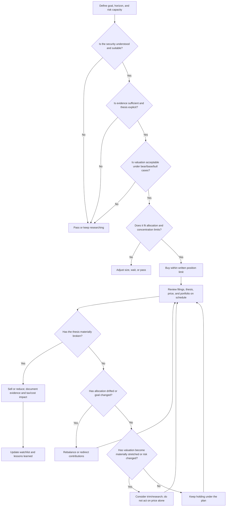
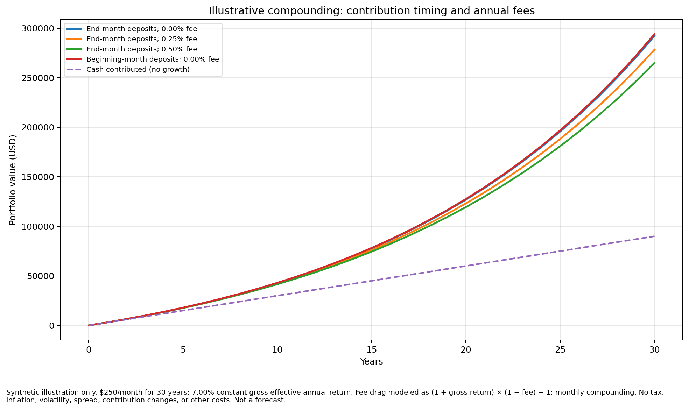

# 03 — Long-Term Investing and Portfolio Building

> **Purpose:** Learn how to decide what an investment is for, select diversified funds, investigate a public company, estimate a range of value, build and review a portfolio, and decide when to buy, hold, trim, rebalance, or sell. This is an educational process—not a list of stocks to buy or a promise of profit.
>
> **Research snapshot:** U.S. rules and product facts checked on **10 November 2026**. Company example uses Microsoft's FY2027 Q1 Form 10-Q for the quarter ended **30 September 2026**, released on 28 October 2026. Fund expense ratios below carry their own issuer-reported as-of dates. Always reopen official documents before making a real decision.

## 1. How to use this chapter

Work through the lessons in sequence. Complete the exercises before reading the answer key. Use the linked filings and official fund documents rather than relying on a social-media summary, a broker's headline, or an LLM-generated opinion.

This chapter focuses on a multi-year investing process. It does **not** teach short-term entries, technical indicators, trading strategy design, or automated execution; those belong in Chapters 4–6. It also does not teach physical-item resale. Buying a used bicycle, laptop, or tool to repair and resell is an inventory business: its economics include sourcing, repair labor, storage, shipping, warranty/return risk, and sales velocity. A share of stock is a security representing ownership in a business; it is not inventory that you control or improve.

### Learning objectives

By the end, you should be able to:

1. Translate a financial goal into a time horizon, liquidity need, and acceptable risk budget.
2. Explain the difference between risk tolerance and risk capacity, and why money needed soon should not be exposed to equity-market risk by default.
3. Compare broad index funds using benchmark, holdings, concentration, tracking, fees, spreads, taxes, and fund documents.
4. Read the income statement, balance sheet, and cash-flow statement together.
5. Calculate and interpret essential profitability, cash-flow, debt, dilution, and valuation measures.
6. Build bear/base/bull valuation scenarios and explain which assumptions drive the result.
7. Write an investment thesis with evidence, risks, valuation, position limits, review triggers, and thesis-break conditions.
8. Review a portfolio against a benchmark and a written allocation policy without chasing recent winners.
9. Use free primary-source tools to maintain a company and fund watchlist.

### Prerequisites

- Chapter 1: returns, compounding, volatility, drawdown, correlation, liquidity, and basic orders.
- Chapter 2: differences among stocks, ETFs, Bitcoin products, gold products, and oil-linked instruments.
- Basic arithmetic and spreadsheet formulas. Python is optional; the supplied chart script uses Python and Matplotlib.

## 2. 80/20 — what matters most

- **Start with the goal, not the ticker.** Decide when the money is needed, how much loss is tolerable, and what would force you to sell at a bad time.
- **Diversify before trying to identify the next winning company.** A broad fund can spread company-specific risk, but it still carries market risk and may be concentrated in a few large companies or sectors.
- **Fees, taxes, spreads, and turnover are part of the return.** Compare total ownership cost, not only the expense ratio or a fund's recent performance.
- **Read all three financial statements.** Earnings can rise while cash conversion weakens, debt increases, shares are diluted, or capital spending consumes cash.
- **A good company is not automatically a good investment at every price.** Price is what you pay; value is an estimate with a wide uncertainty range.
- **Write the thesis before buying.** State why the asset belongs in the portfolio, what evidence would change your mind, and how large the position may become.
- **Review on a schedule.** Rebalance because the portfolio has drifted from a plan or the goal has changed—not simply because one asset has recently risen or fallen.
- **A profit is never guaranteed.** Holding for longer does not make an individual stock safe, and a planned resale price is not a promise that a buyer will be available at that price.

## 3. Goals, time horizon, and readiness

### 3.1 Separate money by purpose

Create separate mental or actual buckets for:

- **Near-term spending:** rent, taxes, tuition, a vehicle purchase, or other known expenses due soon.
- **Emergency reserves:** cash intended to cover unexpected costs or income disruption.
- **Long-term investment goals:** money that can remain invested through market declines and does not have to be sold on a fixed near-term date.
- **Speculative or learning capital:** money that can be lost without disrupting essential obligations. Paper trading should come before allocating any real speculative capital.

Do not treat a brokerage account's displayed balance as spare money. The ability to sell an ETF in seconds does not mean its value will be stable when you need it. The SEC's Investor.gov introduction to investing discusses emergency savings, high-interest debt, time horizon, and the risks of investing: [Introduction to Investing](https://www.investor.gov/introduction-investing).

High-interest consumer debt deserves attention because the interest rate is a known cost, while investment returns are uncertain. An employer retirement-plan match, where available, may also affect priorities. These decisions depend on the terms, taxes, liquidity, and your full financial position; this chapter does not prescribe a personal order of operations.

### 3.2 Time horizon is a constraint, not a return forecast

A useful first question is: **What date could I genuinely need this money?** A goal with a fixed date in two years has a different risk capacity from a goal 20 years away. A long horizon gives more time to recover from some downturns, but it does not guarantee recovery for an individual company, a narrow sector, or a poorly structured product.

Use the following as a planning prompt, not a universal rule:

| Goal timing | Main question | Typical risk concern |
|---|---|---|
| Soon / fixed date | Can the value be available on schedule? | A market fall immediately before the spending date |
| Several years away | Can the goal tolerate a temporary loss or delay? | Sequence of returns and an inflexible deadline |
| Many years away | Can the plan survive long drawdowns without forced selling? | Concentration, behavior, inflation, and changes in the goal |

The risk of an investment is not just daily volatility. It includes permanent business impairment, inflation, liquidity, leverage, counterparty risk, currency exposure, and the chance that you must sell when prices are depressed.

### 3.3 Risk tolerance versus risk capacity

- **Risk tolerance** is your psychological willingness to accept losses and uncertainty.
- **Risk capacity** is your financial ability to absorb those losses without damaging essential goals.

A person may be emotionally comfortable with large swings but have low financial capacity because the money is needed for a down payment soon. Another person may have high capacity because the goal is decades away and income/reserves are stable, but low tolerance because a 20% decline would cause panic selling. The portfolio must be compatible with both dimensions.

A questionnaire is only a prompt. It can be biased by the provider and cannot replace an honest cash-flow and goal review. Investor.gov explains that asset allocation depends on time horizon and risk tolerance and that allocation is personal: [Asset Allocation and Diversification](https://www.investor.gov/introduction-investing/getting-started/asset-allocation).

### 3.4 Write an investment policy before selecting products

A short investment policy statement (IPS) can be one page. Record:

1. Goal and target date.
2. Contributions and expected withdrawal schedule.
3. Minimum cash/reserve needs outside the investment portfolio.
4. A target allocation or acceptable allocation ranges—chosen only after considering the full financial situation.
5. Approved asset types and products; explicitly list products you will not use.
6. Maximum concentration limits for a company, sector, country, or speculative asset.
7. Benchmark and review frequency.
8. Rebalancing rules and taxable-account constraints.
9. Conditions that would cause a thesis review or a sale.
10. What behavior to avoid (panic selling, leverage, doubling down without evidence, or changing the plan after headlines).

The policy is a control system for your own behavior. It is not a prediction of markets.

## 4. Diversification and asset allocation

### 4.1 Asset allocation and security selection are different decisions

**Asset allocation** decides the broad mix—such as equities, bonds, and cash. **Security selection** decides which fund, bond, or company represents each part. A carefully chosen fund cannot repair an allocation that is inappropriate for the goal, and an appropriate allocation can still be implemented poorly through expensive or concentrated products.

The major categories include:

- **Equities:** ownership claims in businesses; potentially strong long-term growth, but prices and company values can fall sharply.
- **Bonds and Treasuries:** contractual debt claims with interest-rate, credit, inflation, and reinvestment risks. Bond funds can lose value when yields rise.
- **Cash and cash equivalents:** useful for liquidity and near-term needs, but exposed to inflation and reinvestment-rate risk.
- **Optional diversifiers:** real estate securities, commodities, gold, or other exposures. They have distinct structures and may not reliably offset equity losses.

Bitcoin, gold, and oil were compared as products in Chapter 2. Do not assume they are interchangeable portfolio diversifiers. Correlations change through time, and a crisis can cause several assets to fall together.

### 4.2 Diversify at more than one level

1. **Across asset classes:** stocks, bonds, cash, and any carefully justified diversifiers.
2. **Within equities:** countries, sectors, company sizes, business models, and individual issuers.
3. **Within bonds:** issuer quality, maturity/duration, and type of debt.
4. **Across underlying holdings:** check whether multiple ETFs own the same large companies.

Owning five ETFs does not automatically mean you own five independent sources of risk. A U.S. large-cap fund, a technology-sector fund, and a growth fund may have substantial overlap. Check top holdings and sector weights, not just the number of tickers. A narrowly focused fund may be less diversified than its name suggests. Investor.gov makes this point in its guide to asset allocation and diversification: [SEC guide](https://www.investor.gov/introduction-investing/getting-started/asset-allocation).

### 4.3 Correlation is useful but unstable

Correlation estimates how two return series moved together over a specified historical window. It is not a permanent property of the assets. Correlation can rise during stress, a portfolio can be diversified by ticker but concentrated by economic factor, and a relationship observed over one period can reverse.

Use correlation to ask better questions—not to claim that an asset will protect the portfolio next time. Also inspect holdings and economic exposures directly. For example, a collection of cloud/software stocks may all be affected by the same enterprise-spending cycle even when the companies are different.

### 4.4 Concentration and position limits

Concentration is the exposure of the total portfolio to one issuer, theme, sector, or correlated risk. It can be hidden inside funds. If a broad ETF already owns a company, adding the same company directly increases exposure to it beyond the ETF's weight.

Before buying an individual company, ask:

- What is its look-through weight after counting fund holdings?
- What percentage of the portfolio would be exposed to the same business driver?
- Could one fraud, product failure, regulatory decision, or technology shift materially damage the whole plan?
- What is the maximum size allowed by the investment policy?

A position limit is a risk-control rule, not a prediction that the maximum loss will stay inside that percentage. Gaps and permanent losses can exceed a planned amount.

### 4.5 Rebalancing

Rebalancing returns the portfolio toward a target or an allowed range after market movements change the weights. Common methods are:

- **Calendar review:** inspect at a set interval, such as annually or semiannually.
- **Threshold review:** inspect when a holding or asset class drifts beyond a preselected band.
- **Contribution-led rebalancing:** direct new contributions toward underweight holdings before selling overweight ones.

Rebalancing can control risk drift, but it does not guarantee higher returns. It can realize taxable gains, incur costs, or cause a portfolio to sell an asset that continues to rise. Investor.gov describes calendar and threshold approaches and notes that rebalancing is generally relatively infrequent: [Rebalancing guidance](https://www.investor.gov/introduction-investing/getting-started/asset-allocation).

## 5. Index funds and ETFs: how to choose the actual product

### 5.1 An index is a rulebook, not an investment

An index provider defines which securities are eligible, how weights are calculated, and when constituents are added, removed, or reweighted. Investors cannot buy an index directly. A fund seeks to track it by holding all or a sample of the index securities, and sometimes by using derivatives.

Common construction methods:

- **Market-cap weighted:** larger companies represent a larger share of the index. This is common in broad equity benchmarks, but it can lead to large weights in a small group of mega-cap companies.
- **Equal weighted:** each holding begins at a similar weight and must be rebalanced. This can increase turnover and exposure to smaller companies.
- **Price weighted:** share price, rather than total company market value, determines weight. This is a different construction choice, not a measure of company quality.
- **Rules-based / factor indexes:** use screens such as value, momentum, quality, or volatility. The result is not necessarily a neutral representation of the whole market.

An index's methodology matters. Read its eligibility, weighting, reconstitution, sector concentration, and treatment of corporate actions. The SEC's [Index Funds Investor Bulletin](https://www.investor.gov/introduction-investing/general-resources/news-alerts/alerts-bulletins/investor-bulletins-26) explains how index funds work and why tracking can differ.

### 5.2 ETF versus mutual fund mechanics

An ETF trades on an exchange during market hours, so it has an intraday market price, bid/ask spread, and potential premium or discount to net asset value (NAV). Most retail investors buy and sell ETF shares on the secondary market; authorized participants interact with the fund in large creation/redemption units.

Traditional mutual fund shares are generally purchased or redeemed from the fund at the next calculated NAV, with orders receiving end-of-day pricing. Actual mutual-fund and ETF structures differ; read the prospectus rather than generalizing from the label.

ETF market price may temporarily diverge from NAV. Liquidity in the underlying holdings, market stress, the time of day, and trading conditions can affect spreads and premiums/discounts. The SEC's updated ETF bulletin explains these mechanisms: [Updated Investor Bulletin: ETFs](https://www.investor.gov/introduction-investing/general-resources/news-alerts/alerts-bulletins/investor-bulletins-24).

### 5.3 The costs that compound against you

Inspect all layers of cost:

1. **Expense ratio:** annual operating expenses charged within the fund. It is deducted from fund assets, not normally billed as a separate monthly invoice.
2. **Bid/ask spread:** the cost of crossing from bid to ask when buying/selling.
3. **Brokerage commissions and account charges:** depending on the broker and product.
4. **Tracking difference:** how far fund performance differed from the index over a period, after costs and implementation effects.
5. **Taxes:** dividends, capital-gain distributions, and gains when you sell in a taxable account.
6. **Other product frictions:** premiums/discounts to NAV, securities lending, cash drag, sampling, and foreign withholding taxes where applicable.

**Expense ratio is not the same as tracking difference.** An ETF can have a low expense ratio but still differ from the index for other reasons. Compare actual fund total returns with the index over matching periods, and confirm whether the reported fund returns include reinvested distributions.

The SEC's July 23, 2025 fee bulletin explains that costs reduce returns and that the prospectus fee table does not include every possible intermediary or trading cost: [Mutual Fund and ETF Fees and Expenses](https://www.investor.gov/introduction-investing/general-resources/news-alerts/alerts-bulletins/investor-bulletins/mutual-fund-and-etf-fees-and-expenses-investor-bulletin).

### 5.4 A real broad-fund comparison: VOO and SPY

These two funds both seek to track the S&P 500, but their costs and structures are not identical. The official fund pages checked for this chapter reported:

| Item | Vanguard S&P 500 ETF (VOO) | State Street SPDR S&P 500 ETF Trust (SPY) |
|---|---:|---:|
| Benchmark | S&P 500 Index | S&P 500 Index |
| Expense ratio | **0.03%**, issuer page as of 28 Apr 2026 | **0.0945%**, issuer page as of 17–18 Sep 2026 |
| Product page | [Vanguard VOO](https://advisors.vanguard.com/investments/products/voo/vanguard-sp-500-etf) | [State Street SPY](https://www.ssga.com/us/en/institutional/etfs/state-street-spdr-sp-500-etf-trust-spy) |

The issuer dates differ. Treat the table as a documented comparison, not a same-minute market snapshot. Verify the latest prospectuses and fee pages when you do the exercise.

**Illustrative annual expense arithmetic, before compounding:** on a constant $10,000 balance, 0.03% is about $3 per year; 0.0945% is about $9.45. The difference is $6.45 per $10,000 per year. On $100,000, the simple first-year difference is $64.50. Real balances fluctuate, so actual cost is not this fixed dollar amount.

A lower expense ratio is meaningful, especially over long periods, but is not the only decision criterion. SPY has a long trading history and very deep secondary-market activity, which can matter to active traders. A long-term investor should compare tracking, holdings, spreads, trading pattern, tax situation, and the fund's exact legal structure. Do not buy SPY simply because its ticker is familiar or assume VOO is always the best fit for every account.

Both funds provide U.S. large-cap exposure—not a globally diversified portfolio by themselves. Their underlying companies overlap substantially. Adding both usually does not double diversification.

### 5.5 How to inspect a fund before buying

Use this checklist on the issuer's official page and prospectus:

- What index or investment objective is tracked?
- Is the index broad, sector-specific, thematic, leveraged, inverse, or otherwise specialized?
- How are constituents selected and weighted?
- What are the top ten holdings and their combined weight?
- What is the sector and country mix?
- What are the expense ratio, fee waivers, and other shareholder fees?
- What are the fund's historical tracking difference and tracking error?
- What are median bid/ask spread and premium/discount history?
- Does the fund use sampling, derivatives, leverage, securities lending, or foreign markets?
- How often does it distribute dividends or capital gains?
- What is the tax treatment and what does the prospectus state?
- Is it an open-end ETF, unit investment trust, ETN, grantor trust, or another structure?
- Is the fund liquid enough for the intended trade size and holding period?

Use the summary prospectus, full prospectus, annual/semiannual shareholder report, holdings file, and index methodology. Investor.gov explains that ETF buyers should review the prospectus and shareholder report: [ETF information](https://www.investor.gov/introduction-investing/investing-basics/investment-products/mutual-funds-and-exchange-traded-2).

## 6. Fundamental company research

### 6.1 Start with the business, not a ratio

Before calculating anything, describe the business in plain language:

- What product or service does it sell?
- Who pays, how often, and why?
- What problem does it solve, and what alternatives can customers choose?
- Is revenue recurring, transactional, cyclical, regulated, or dependent on a small number of customers?
- What drives demand, pricing, volume, and retention?
- What are the largest costs and constraints?
- What would make customers leave or competitors win?

A company can have impressive historical growth and still face structural decline. Conversely, a temporary fall in revenue may be a cyclical issue rather than a broken business. Your job is to identify the economic driver and test it with evidence.

### 6.2 The three financial statements work together

#### Income statement — performance over a period

| Line | What it tells you | Questions to ask |
|---|---|---|
| Revenue | Sales recognized during the period | Is growth from volume, price, acquisitions, or currency? Is it recurring? |
| Cost of revenue / COGS | Direct costs of delivery | Are input costs growing faster than sales? |
| Gross profit | Revenue minus direct costs | Is the business model scaling or losing pricing power? |
| Operating expenses | R&D, sales/marketing, administration, and other operating costs | Are expenses supporting productive growth? |
| Operating income | Profit from operations before non-operating items/tax | Are core operations profitable? |
| Net income | Profit after non-operating items and tax | Are one-time gains, investment marks, or tax effects distorting the result? |
| Diluted EPS | Earnings per diluted share | Are earnings growing faster than the share count? |

#### Balance sheet — position at a point in time

The balance sheet follows **Assets = Liabilities + Equity**.

Review:

- Cash and short-term investments: liquidity, but check restrictions and needed operating cash.
- Receivables: whether customers pay on time; receivables rising faster than revenue can be a warning, not proof of trouble.
- Inventory: whether goods are selling or becoming obsolete.
- Property and equipment: capacity investment, depreciation, and capital intensity.
- Goodwill and intangible assets: acquisition-related balances and possible impairment risk.
- Short- and long-term debt: maturity schedule, interest rates, covenants, and refinancing needs.
- Lease liabilities, pensions, legal contingencies, and other obligations disclosed in the notes.
- Equity and share count: retained earnings, repurchases, issuance, and dilution.

A low debt-to-equity ratio is not automatically safe or comparable across sectors. Some businesses operate with structurally different balance sheets; banks and insurers require sector-specific analysis.

#### Cash-flow statement — how cash moved

It has three main parts:

1. **Operating activities (CFO):** cash generated/used by core operations, adjusted for non-cash items and working-capital changes.
2. **Investing activities:** capital expenditures, acquisitions, investments, and asset sales.
3. **Financing activities:** debt issuance/repayment, dividends, share repurchases, and share issuance.

A common rough measure is **free cash flow (FCF) = cash from operations − capital expenditures**. This is a useful shorthand but is not a universally standardized GAAP measure. Define it consistently, and examine whether capital expenditures include all relevant investment obligations. Some analysts use unlevered free cash flow for enterprise valuation; that is not always identical to CFO minus capex.

Cash flow may differ from net income because of depreciation, stock-based compensation, working capital, deferred revenue, taxes, and other accruals. A company can report accounting profits but have weak cash conversion. A single quarter can also be affected by timing. Use multiple years and compare the cash-flow notes with management's explanation.

### 6.3 Essential ratios and what they can—and cannot—tell you

| Metric | Formula | Interpretation and limitation |
|---|---|---|
| Revenue growth | `(current revenue / prior revenue) − 1` | Growth rate; investigate organic versus acquired and recurring versus one-off sources. |
| Gross margin | `gross profit / revenue` | Pricing power and direct-cost economics; compare within a similar business model. |
| Operating margin | `operating income / revenue` | Core operating profitability; affected by investment and accounting classifications. |
| Net margin | `net income / revenue` | Bottom-line profitability; can be moved by taxes, interest, and non-operating gains/losses. |
| Current ratio | `current assets / current liabilities` | Short-term balance-sheet coverage; quality of assets matters. |
| Net debt | `total debt − cash and cash equivalents` | Debt less cash; be consistent about restricted cash and liquid investments. |
| Debt / EBITDA | `debt / EBITDA` | Leverage proxy; EBITDA ignores interest, taxes, capex, and working capital. |
| Return on equity | `net income / average shareholders' equity` | Accounting return to equity; can be boosted by leverage or buybacks. |
| P/E | `share price / diluted EPS` | Equity price relative to earnings; not useful with negative/unstable earnings and sensitive to cycle. |
| EV / EBITDA | `enterprise value / EBITDA` | Capital-structure-aware comparison; ignores capex and working-capital needs. |
| FCF yield | `FCF / market capitalization` | Cash-flow proxy relative to equity value; definition of FCF must be stated. |

**Never use one ratio as a buy signal.** Compare multiple years, competitors, business models, accounting notes, and valuation. A lower P/E can mean a bargain, but it can also mean the market expects earnings to fall. A high P/E can reflect expected growth—or excessive optimism.

### 6.4 Business quality and competitive advantage

Look for evidence, not brand reputation:

- Switching costs, network effects, scale economies, patents or regulatory licenses, distribution advantages, data advantages, or customer trust.
- Durable customer retention and pricing power, not just a high market share statistic.
- High returns on incremental invested capital, if reliably measurable.
- A product pipeline and research investment that create economic value rather than expense with no visible return.
- Supplier/customer concentration and dependence on a single platform or distributor.
- Ability to keep investing through a downturn without relying on repeated equity issuance or expensive debt.

Competitive advantages can erode. Ask what could invalidate the claimed moat and what evidence would reveal it early.

### 6.5 Management, governance, and capital allocation

Management allocates cash among reinvestment, acquisitions, debt repayment, dividends, and buybacks. Evaluate decisions by expected per-share value, not by headline size.

- **Reinvestment:** Does incremental capital earn attractive returns? Is growth funded sensibly?
- **Acquisitions:** Did the company pay a reasonable price? Are promised synergies visible? Is goodwill rising faster than operating performance?
- **Dividends:** Are they covered by sustainable cash flow, or funded by borrowing/asset sales?
- **Buybacks:** Do they reduce the diluted share count? Were shares repurchased below a reasonable estimate of intrinsic value? Were repurchases offset by stock compensation?
- **Debt:** Is borrowing used for productive investment, flexible liquidity, or to support distributions that cash flow cannot fund?
- **Governance:** Are executive incentives tied to durable per-share value? Are related-party transactions, unusual compensation, or controlling-shareholder structures material?

**Stock-based compensation (SBC) is not free.** It is often added back as a non-cash expense in the cash-flow statement, but equity awards can dilute shareholders. Track diluted shares and compare repurchases with shares issued through compensation. A buyback can simply offset dilution instead of shrinking the share count.

### 6.6 Earnings quality and warning signs

Investigate—not automatically condemn—these patterns:

- Receivables or contract assets growing much faster than revenue.
- Inventory accumulating while sales slow or write-downs rise.
- Large adjustments between GAAP and non-GAAP profit, especially repeated exclusions.
- Operating cash flow consistently below net income without a clear growth or working-capital explanation.
- Capitalized costs growing rapidly, shifting expenses out of the income statement.
- Frequent restructuring charges or “one-time” costs that recur every year.
- Rising debt, short maturities, covenant concerns, or interest expense consuming more operating income.
- Rapid share issuance or SBC that dilutes owners.
- Auditor changes, restatements, material weaknesses in internal controls, or unexplained related-party dealings.
- Management language that repeatedly changes KPI definitions or avoids quantifying risks.

Read the notes and auditor report; a headline income statement is not enough.

## 7. A filing-based company case study: Microsoft FY2027 Q1

This is a **learning example, not a recommendation to buy, hold, or sell MSFT**. It uses the latest quarterly report located for this chapter's 10 November 2026 research date: Microsoft's Q1 FY2027 Form 10-Q, covering the three months ended 30 September 2026. The company released its results on 28 October 2026. Links: [SEC Form 10-Q](https://www.sec.gov/Archives/edgar/data/789019/000119312526436133/msft-20260930.htm) · [Microsoft earnings release](https://www.microsoft.com/en-us/Investor/earnings/FY-2027-Q1/press-release-webcast).

### 7.1 Pull the reported figures

The filing reports the following amounts in USD billions unless stated otherwise:

| Measure | Q1 FY2027 | Prior-year quarter | Reported change |
|---|---:|---:|---:|
| Revenue | $92.279B | $77.673B | +19% |
| Gross profit | $62.559B | $53.630B | +17% |
| Operating income | $45.915B | $37.961B | +21% |
| GAAP net income | $36.629B | $27.747B | +32% |
| Diluted GAAP EPS | $4.92 | $3.72 | +32% |
| Adjusted non-GAAP net income | $36.422B | $30.833B | +18% |
| Adjusted non-GAAP diluted EPS | $4.89 | $4.13 | +18% |

The issuer's non-GAAP reconciliation excludes net gains and losses from investments in OpenAI. The GAAP and adjusted growth rates differ materially. This does not mean one measure is automatically correct and the other wrong; it means you must read the reconciliation and decide which view better represents recurring operating performance. Do not silently substitute the higher growth rate into a valuation model.

### 7.2 Calculate margins

Using the filing's reported values:

- Gross margin = 62.559 / 92.279 = **67.8%**. Prior-year quarter = 53.630 / 77.673 = **69.0%**. The calculated margin is lower by roughly 1.3 percentage points.
- Operating margin = 45.915 / 92.279 = **49.8%**. Prior-year quarter = 37.961 / 77.673 = **48.9%**.
- Net margin = 36.629 / 92.279 = **39.7%**. Prior-year quarter = 27.747 / 77.673 = **35.7%**.

Interpretation: growth was strong, but gross margin did not expand with revenue. Operating and net margins tell a different story. Investigate business mix, cost of revenue, operating expenses, investment marks, and tax effects rather than summarizing the quarter as simply “margins up” or “margins down.” These calculated percentages are rounded and are not separately reported company KPIs.

### 7.3 Read the cash-flow statement alongside earnings

For the quarter, the filing reports:

- Cash from operations: **$58.000B**, versus $45.057B in the prior-year quarter.
- Additions to property and equipment: **$39.367B**, versus $19.394B.
- A simple FCF proxy (cash from operations minus additions to property and equipment): **$18.633B**, versus $25.663B.

That proxy is down approximately **27.4% year over year**, even while reported revenue and net income rose. Capital expenditure was approximately 42.7% of revenue in this quarter, compared with about 25.0% in the prior-year quarter. This does **not** by itself prove the investment is poor: data centers and AI infrastructure may support future revenue. It does mean that future return on this capital, depreciation, capacity utilization, customer demand, and energy/supply constraints need monitoring.

Management said cash from operations increased with higher customer receipts and lower cash used for income taxes, partly offset by higher cash paid to suppliers. Cash used in investing increased primarily because property/equipment additions rose. That explanation illustrates why a one-quarter cash-flow measure should not be annualized mechanically.

### 7.4 Other items to add to your notes

- Cash, cash equivalents, and short-term investments were **$64.5B** at 30 September 2026, compared with $76.8B at 30 June 2026.
- Stock-based compensation expense was **$3.134B** for the quarter.
- Weighted-average diluted shares were **7.446B** for the quarter.
- The company repurchased 6 million shares for $2.9B and declared $7.3B of dividends during the quarter.
- Commercial remaining performance obligations were reported at $677B, with an approximately 2.3-year weighted-average duration. This is not identical to cash already received or guaranteed future revenue; contract execution, cancellations, timing, and customer performance still matter.
- The filing discusses substantial and increasing capital requirements for cloud/AI infrastructure and the possibility that capital spending occurs ahead of fully developed revenue streams.

### 7.5 Build the analyst's balanced interpretation

**Positive evidence to investigate further:** high reported revenue growth, strong operating income, significant customer commitments, substantial cash generation from operations, and scale across cloud, productivity, and infrastructure.

**Risks and unanswered questions:** gross margin compression, unusually high capital spending, uncertainty over the return earned on new infrastructure, SBC and dilution, competitive intensity, energy and supply constraints, customer concentration, regulatory issues, and the gap between GAAP and adjusted profit growth.

**What this filing does not tell you:** whether the current share price is attractive, what the correct discount rate is, whether forward demand will justify the capital expenditure, or whether another company offers a better risk-adjusted opportunity. Those require price, valuation, peer, and scenario work. A strong filing alone is not a buy signal.

## 8. Valuation: what a business may be worth

### 8.1 Price, market capitalization, and enterprise value

- **Share price:** the current market price of one share.
- **Market capitalization:** share price × shares outstanding; the market value of common equity.
- **Enterprise value (EV):** an approximation of the value of the operating business to all capital providers. A common bridge is market capitalization + debt + preferred equity + non-controlling interests − cash and cash equivalents. Definitions can differ by data vendor.
- **Equity value:** enterprise value minus net debt and other senior claims, with the bridge adjusted for non-operating assets and claims as appropriate.

Use fully diluted shares when appropriate. The number of shares can change due to equity compensation, buybacks, acquisitions, convertibles, and new issuance.

### 8.2 Multiples are shorthand, not valuation models

- **P/E:** useful for profitable businesses with reasonably representative earnings. A low P/E may signal low expectations or declining earnings; a high P/E may require years of high growth to justify.
- **EV/EBITDA:** helps compare capital structures, but EBITDA omits capex, working capital, interest, and taxes. It can mislead for capital-intensive companies.
- **Price/sales:** sometimes used for early-stage or low-margin businesses, but revenue without a path to cash flow has limited value.
- **Price/book:** more useful for some financial and asset-heavy firms than for software/IP-heavy businesses.
- **FCF yield:** cash flow divided by market capitalization or enterprise value; state the denominator and FCF definition.

Peer comparisons are meaningful only when growth, risk, margins, accounting, reinvestment needs, capital structure, and business models are reasonably comparable. A peer's current multiple does not establish intrinsic value.

### 8.3 Discounted cash flow (DCF), intuitively

A DCF estimates the present value of future cash flows. One dollar expected many years from now is worth less today because capital has an opportunity cost and future cash flow is uncertain.

For a simplified five-year **unlevered free-cash-flow-to-firm** example:

\[
EV = \sum_{t=1}^{5} \frac{FCF_t}{(1+WACC)^t} + \frac{TV_5}{(1+WACC)^5}
\]

\[
TV_5 = \frac{FCF_5(1+g)}{WACC-g}
\]

Where:

- `FCF_t` is the forecast free cash flow to all capital providers in year `t`.
- `WACC` is the weighted average cost of capital used to discount those cash flows.
- `g` is a stable long-run growth assumption after the explicit forecast period.
- `TV_5` is terminal value at the end of year 5.

The formula requires `WACC > g`. Terminal value can represent a large portion of DCF value, so a tiny change in the terminal growth or discount rate can move the result substantially. Do not use a high perpetual growth rate that cannot be supported by a mature economy and the company's competitive position.

For a full valuation, distinguish unlevered FCF (FCFF) discounted at WACC from free cash flow to equity (FCFE) discounted at cost of equity. Do not mix cash flows and discount rates. For this beginner exercise, the model uses a clearly stated, hypothetical normalized FCF-to-firm stream, net debt, and diluted share count.

### 8.4 Margin of safety and scenarios

An estimate is not exact. Build three internally consistent cases:

- **Bear:** weaker growth, lower margins or reinvestment returns, and/or a higher discount rate.
- **Base:** assumptions you believe are most plausible, with evidence and uncertainty.
- **Bull:** stronger outcomes, but not an assumption that everything goes right.

A **margin of safety** is a discount to your estimated value intended to protect against model error and adverse outcomes. It is not a guarantee against loss. If your value range is wide, the model may not support a precise entry price; that is information, not failure.

### 8.5 Worked DCF example — hypothetical company, not a real stock

Assume a fictional business with normalized starting unlevered FCF of **$10.0B**, net debt of **$5.0B**, and **1.5B diluted shares**. Forecast five years of FCF. The following assumptions are deliberately illustrative:

| Scenario | Annual FCF growth (years 1–5) | WACC | Terminal growth | Implied value per diluted share |
|---|---:|---:|---:|---:|
| Bear | 2.0% | 10.0% | 2.0% | **$81.67** |
| Base | 8.0% | 9.0% | 3.0% | **$138.38** |
| Bull | 13.0% | 8.5% | 3.5% | **$203.48** |

These values are the outputs of the stated model, not price targets or market data. They are highly sensitive to the assumptions. For example, holding annual FCF growth at 8% and other inputs unchanged, the per-share outputs for different WACC and terminal-growth combinations are:

| WACC \ Terminal growth | 2.0% | 3.0% | 4.0% |
|---|---:|---:|---:|
| 8.0% | $143.33 | $167.33 | $203.33 |
| 9.0% | $121.86 | $138.38 | $161.52 |
| 10.0% | $105.77 | $117.72 | $133.65 |

The point is not to memorize $138.38. The point is to see how changing the required return or a distant terminal assumption changes the present value. A valuation model should be easy to audit: every assumption visible, every formula reproducible, and no hidden spreadsheet cells.

### 8.6 Reverse valuation

A useful question is: **What growth and margins must occur for today's market price to make sense?** Instead of starting with your forecast, solve for the assumptions implied by the current price. Then compare those assumptions with historical performance, capacity constraints, competition, customer behavior, and plausible industry economics.

Reverse valuation can reveal that the market already expects a great deal—or that the price reflects pessimistic assumptions. It cannot tell you whether the market is right.

## 9. The investment thesis and buy/hold/sell process

### 9.1 Distinguish thesis, catalyst, and price target

- **Thesis:** why the investment should create value over the holding period, based on business economics and evidence.
- **Catalyst:** an event that may cause the market to reassess expectations, such as a product launch, regulatory outcome, capacity ramp, or earnings update. A catalyst is not required for a long-term investment to work.
- **Valuation range:** a scenario-based estimate of value, not a promise of where the stock will trade.
- **Benchmark:** the reference investment that represents the risk and opportunity cost of the portfolio position.

A thesis such as “the stock will go up because AI is important” is not adequate. State the company's actual revenue model, competitive position, cash requirements, valuation assumptions, and what new evidence would invalidate the thesis.

### 9.2 Before-buy checklist

1. Is the goal and time horizon compatible with the risk?
2. Do I understand the security and its legal/economic structure?
3. Do I have current filings and official product documents?
4. Can I explain the revenue model, balance sheet, cash generation, and key risks?
5. Are earnings quality, dilution, debt, and capital intensity acceptable?
6. What valuation range do bear/base/bull assumptions produce?
7. What expectations are implied by the current market price?
8. How does this position overlap with existing holdings?
9. What is the maximum position size under the written policy?
10. What is the benchmark and why might this position outperform it after fees and taxes?
11. What evidence will make me change the thesis?
12. What is the exit/review plan if the price falls, rises, or the business changes?

### 9.3 Decision tree



### 9.4 When to keep, trim, rebalance, or sell

**Keep / hold for review** when the thesis remains intact, financial evidence is consistent with the plan, portfolio concentration is acceptable, and valuation does not breach prewritten limits. “Hold” is not the same as refusing to review.

**Add** only when the thesis, valuation, portfolio fit, and position limits still support it. A lower share price alone is not proof that an investment is cheaper; the business outlook and share count may have changed.

**Trim** when the position has exceeded its policy limit, its risk has materially increased, valuation is far above a reasonable scenario range, or rebalancing rules require it. Avoid an automatic sale solely because a stock has doubled; a stronger business can justify a higher value.

**Rebalance** when the target allocation has drifted outside a predefined range or the goal/risk capacity has changed. Consider using new contributions first in taxable accounts, where appropriate.

**Sell because the thesis broke** when core facts no longer support the original reason for ownership—for example, loss of a key customer, deteriorating unit economics, fraud/control concerns, permanently impaired competitive position, unsustainable debt, or a regulatory change that fundamentally alters the business. Do not wait for the share price to confirm a business failure.

**Sell for a life reason** when the goal, liquidity need, or financial capacity changes. It can be rational to exit an investment even if the company is performing well.

Before selling, document the evidence, updated valuation, opportunity cost, fees, tax lot/basis, and any wash-sale or other tax issues. Avoid turning a long-term thesis into an unplanned short-term trade.

## 10. Long-term investing versus active trading

Long-term investing generally relies on broad ownership of productive assets, diversification, periodic contributions, low turnover, and a review process. Active trading attempts to exploit shorter-term price movements and requires separate rules, execution tests, and ongoing performance measurement.

An active strategy should justify itself against a suitable passive benchmark **after** commissions, spreads, slippage, taxes, subscriptions/data costs, and time. It should also be evaluated on drawdown, volatility, concentration, and consistency across market conditions—not just gross profit or win rate. Chapter 4 introduces trading hypotheses; Chapter 5 covers backtesting and paper trading.

### 10.1 Dollar-cost averaging (DCA)

Dollar-cost averaging means investing a fixed amount at regular intervals regardless of the price. It can automate saving, reduce the need to choose one entry date, and help maintain discipline. It does **not** guarantee a profit or better return than investing an already available lump sum. When cash is already available and expected returns are positive, delaying investment leaves part of the capital out of the market; the actual result depends on market path and risk tolerance.

Regular contributions from each paycheck are different from deliberately holding a lump sum in cash and spreading it over time. Do not confuse a behavioral tool with an expected-return advantage.

### 10.2 Compounding, contribution timing, and fees — reproducible illustration

The supplied chart uses purely synthetic assumptions: $250 contributed monthly for 30 years, a constant 7.00% gross effective annual return, and no taxes, inflation, volatility, trading costs, or changes in contributions. It models annual expense-ratio drag as a proportional reduction in annual growth, then compounds monthly. It is **not** a forecast and real returns will not be constant.



| Scenario | Approximate ending value | Total cash contributed |
|---|---:|---:|
| End-of-month contributions, 0.00% annual fee | $292,363 | $90,000 |
| End-of-month contributions, 0.25% annual fee | $278,339 | $90,000 |
| End-of-month contributions, 0.50% annual fee | $265,060 | $90,000 |
| Beginning-of-month contributions, 0.00% annual fee | $294,016 | $90,000 |

The chart and calculations can be recreated from the repository root:

```bash
python -m pip install matplotlib
python study-guide/scripts/ch03_compounding_and_fees.py
```

Expected output files:

- `study-guide/data/ch03_compounding_scenarios.csv`
- `study-guide/assets/ch03-compounding-fees.png`

The model is intentionally simplified. A real fund's expense ratio is applied through fund assets, returns vary daily, contributions may vary, and taxes/spreads/inflation can change outcomes. The purpose is to visualize that small recurring costs and contribution timing compound; it is not to predict a 7% return.

## 11. U.S. tax and account considerations

This section is a general U.S. educational overview, not tax advice. Tax rules change, and account type, state, residency, filing status, income, holding period, security type, and transactions can change the outcome. Recheck the IRS instructions for the tax year involved and consult a qualified tax professional for personal circumstances.

### 11.1 Taxable brokerage accounts

- Selling an investment generally creates a capital gain or loss based on amount realized minus adjusted tax basis.
- The IRS generally treats an investment held **one year or less** as short-term and held **more than one year** as long-term for capital-gain classification. Special rules can apply.
- Dividends may be taxable even if automatically reinvested. Qualified-dividend treatment has eligibility and holding-period rules; do not assume every distribution is qualified.
- Mutual funds and some other funds can distribute capital gains that create taxable income even if you did not sell your fund shares.
- The wash-sale rule can defer the deduction for a loss when substantially identical securities are acquired within 30 days before or after the loss sale, including certain IRA/Roth IRA purchases. The exact rule is technical; do not rely on a simplistic ticker-based rule.
- Track tax lots, cost basis, corporate actions, reinvested distributions, and sale expenses.

Primary sources: [IRS Topic 409 — Capital Gains and Losses](https://www.irs.gov/taxtopics/tc409) and [IRS Publication 550 — Investment Income and Expenses](https://www.irs.gov/publications/p550). The publication currently linked in this chapter is the 2025 edition; confirm whether a later revision or tax-year-specific instruction applies.

### 11.2 Tax-advantaged accounts

Employer plans and individual retirement accounts may offer tax advantages, but withdrawals, contribution limits, eligibility, investment choices, and penalties depend on account type and current rules. Employer match, vesting, fees, plan menu, and access restrictions matter. Do not assume every investment belongs in the same account. Check the official IRS and plan documents for current year rules.

### 11.3 Investment records

Keep confirmations, monthly/annual statements, dividend and interest reports, Forms 1099, corporate-action records, cost basis, and your own investment memo. A clean record makes performance measurement and tax reporting less error-prone. Tax-lot decisions are part of the cost of an exit, not something to consider after the trade.

## 12. Free watchlist and research workflow

A watchlist is a research queue, not a portfolio of automatic buy candidates. Start with a small number of companies and funds that you can understand and review.

### 12.1 Primary-source toolkit

| Source | What to use it for | Free starting point |
|---|---|---|
| SEC EDGAR | Company 10-K, 10-Q, 8-K, proxy, fund filings, exhibits | [EDGAR company/fund search](https://www.sec.gov/edgar/search/) |
| SEC Company Facts API | Machine-readable XBRL financial statement facts | [SEC EDGAR APIs](https://www.sec.gov/search-filings/edgar-application-programming-interfaces) |
| Company investor relations | Earnings releases, presentations, webcast transcripts, historical reports | Company's official Investor Relations page |
| Fund issuer page | Prospectus, fact sheet, holdings, distributions, fee, premium/discount data | Official fund provider page |
| Index provider | Index methodology, constituent rules, historical changes | Official index provider website |
| Investor.gov | Investor education and filing guides | [Investor.gov](https://www.investor.gov/) |
| IRS | Current tax treatment and tax-year instructions | [IRS Publications](https://www.irs.gov/forms-pubs) |
| FRED / Treasury | Rates, inflation and macroeconomic context | [FRED](https://fred.stlouisfed.org/) · [Treasury](https://home.treasury.gov/) |

Investor.gov explains how to use EDGAR and how common filings differ: [Using EDGAR to Research Investments](https://www.investor.gov/introduction-investing/getting-started/researching-investments/using-edgar-research-investments). In general, a 10-K is the annual report with audited statements and extensive risk discussion; a 10-Q provides a quarterly update with unaudited interim statements; an 8-K reports specified current events; and a DEF 14A proxy statement provides shareholder-voting and compensation information.

### 12.2 A repeatable company workflow

1. **Identify:** write the ticker, company legal name, CIK, exchange, reporting currency, fiscal year, and industry.
2. **Read the latest 10-K:** business, risk factors, MD&A, audited financial statements, accounting policies, debt, commitments, and segment reporting.
3. **Read the latest 10-Q:** what changed since the annual report? Compare the same quarter year over year and the most recent quarter sequentially where useful.
4. **Read relevant 8-Ks:** earnings releases, acquisitions, management departures, financing, guidance, and other material events.
5. **Read the DEF 14A:** executive incentives, related-party transactions, board structure, and share-based pay.
6. **Build a five-year table:** revenue, operating margin, net income, CFO, capex, FCF proxy, debt, cash, and diluted shares. Note fiscal periods and accounting changes.
7. **Compare peers:** choose genuinely similar companies and use consistent metric definitions.
8. **Value it:** make bear/base/bull assumptions, reverse-check the market's implied expectations, and calculate margin of safety.
9. **Write the thesis:** include risks, evidence, entry/position rules, benchmark, and thesis-break triggers.
10. **Review:** update after filings or material events—not every time a quote changes by a fraction of a percent.

### 12.3 EDGAR API access without a paid platform

The SEC provides JSON APIs for submissions history and XBRL financial facts without an API key. The SEC says its submissions and XBRL data are updated as filings are disseminated, with possible processing delays. See [EDGAR APIs](https://www.sec.gov/search-filings/edgar-application-programming-interfaces).

Example endpoint pattern (replace the zero-padded CIK with the company CIK):

```text
https://data.sec.gov/submissions/CIK##########.json
https://data.sec.gov/api/xbrl/companyfacts/CIK##########.json
```

For Microsoft, the CIK is `0000789019`, so the company-facts endpoint is:

```text
https://data.sec.gov/api/xbrl/companyfacts/CIK0000789019.json
```

For automated requests, declare a descriptive `User-Agent` with contact information, download only what you need, cache responses, and respect the SEC fair-access limit of no more than 10 requests per second. Check the SEC's current policy before building a scheduled data collector: [SEC Developer Resources](https://www.sec.gov/about/developer-resources) and [Webmaster FAQ](https://www.sec.gov/about/webmaster-frequently-asked-questions).

XBRL is useful but not plug-and-play. Companies can use custom tags, fiscal periods differ, and facts may represent quarter-only, year-to-date, or instant balance-sheet values. Verify context, unit, period, accession, and source filing before using an automated fact in a valuation.

### 12.4 Simple watchlist schema

A spreadsheet can use these columns:

| Column | Example / purpose |
|---|---|
| Ticker / CIK | Symbol and SEC filer ID |
| Company / fund | Legal name and fund objective |
| Research status | Unreviewed / researching / ready / pass / owned |
| Last filing reviewed | Form and filing date |
| Business model | One-sentence explanation |
| Thesis | Why it may fit the goal |
| Revenue / margin trend | Five-year values and source |
| CFO / capex / FCF | Definition and period labels |
| Debt / cash / dilution | Balance-sheet and share-count checks |
| Valuation range | Bear / base / bull and assumptions |
| Current valuation | Price/date and metric definition |
| Key risks | Three to five falsifiable risks |
| Portfolio overlap | Existing fund/sector exposure |
| Benchmark | The alternative to compare against |
| Review trigger | Next filing, KPI, or thesis-break condition |
| Official links | SEC filing, IR page, prospectus/fact sheet |

## 13. Practical exercises — attempt before reading the answer key

Use paper/spreadsheet work only. No purchase is required. For every exercise, keep source links, dates, units, and assumptions with your work.

### Exercise 1 — Compare two broad index funds

**Task:** Compare VOO and SPY using the official issuer pages and latest summary prospectuses available on the day you do the exercise.

Answer:
1. Do they track the same benchmark? How is the benchmark weighted?
2. What are the current expense ratios and their as-of dates?
3. What are the top holdings, sector weights, spread data, tracking difference, and premium/discount history?
4. Are there structural or operational reasons their total costs and trading characteristics may differ?
5. Which facts would matter most to a long-term investor versus a short-term trader?
6. Does holding both materially diversify the equity exposure?

**Deliverable:** a one-page comparison table with source/date columns and a 150–250 word conclusion.

**Scoring (10 points):** benchmark/methodology 2; holdings/concentration 2; complete cost analysis 2; structure/tracking/liquidity 2; reasoned conclusion and accurate source dates 2.

### Exercise 2 — Build a mock diversified portfolio

**Scenario:** A fictional investor has $10,000 of learning capital allocated to a goal more than 15 years away. Their near-term emergency savings are separate, and they have no need to withdraw from this sample portfolio soon. They are uncomfortable with the possibility of a 50% loss and want to compare how different stock/bond mixes behave. These statements define the exercise only; they are not assumptions about you.

Create at least two possible portfolios using broad U.S. equity, international equity, high-quality bond, and cash/Treasury categories. Include weights that add to 100%, dollar amounts, the role of each holding, concentration/overlap checks, and risks. Do not add five overlapping U.S. large-cap ETFs and call that diversification.

**Deliverable:** allocation table, written rationale, and a short stress-test discussion of what might happen in a severe equity decline and a rise in interest rates.

**Scoring (10 points):** weights/dollar math 2; clear role of each asset 2; look-through diversification 2; risk and time-horizon reasoning 2; limitations and no unsupported “optimal allocation” claim 2.

### Exercise 3 — Analyze a real company's latest filing

Use Microsoft's FY2027 Q1 10-Q linked in Section 7. Do not rely only on its earnings-release headline.

Calculate and interpret:
1. Year-over-year revenue, gross profit, operating income, and GAAP net income growth.
2. Gross, operating, and net margins in both comparable quarters.
3. The simple FCF proxy for both quarters using CFO minus additions to property/equipment.
4. The change in capex and the FCF proxy.
5. Share-based compensation and diluted share count.
6. Two positive operating facts, three risks, and three unanswered valuation questions.
7. One non-GAAP adjustment and why you would or would not rely on it.

**Deliverable:** a two-page filing summary with formulas, period labels, and source page/section links. Do not annualize the one quarter's FCF as if it were a stable run rate.

**Scoring (15 points):** correct metrics 5; reads all statements 3; understands GAAP/non-GAAP reconciliation 2; identifies capex/working-capital/dilution implications 3; separates evidence from assumptions 2.

### Exercise 4 — Build a bear/base/bull DCF range

Use the hypothetical $10B normalized starting unlevered FCF, $5B net debt, and 1.5B diluted shares from Section 8.5. Reproduce its three scenario values in a spreadsheet or code. Then change only one assumption at a time:

- WACC: 8%, 9%, 10%.
- Terminal growth: 2%, 3%, 4%.
- Explicit-period growth: 2%, 8%, 13%.

Explain why the result changes. Identify which assumptions are easiest to overstate, and explain why the terminal value should not be treated as precise.

**Deliverable:** transparent model/table, at least one sensitivity grid, and a paragraph on model limitations. You may adapt a spreadsheet or write Python.

**Scoring (10 points):** correct formulas 3; reproducible scenarios 2; sensitivity 2; explanation of WACC/terminal value 2; clearly labels hypothetical assumptions 1.

### Exercise 5 — Write a one-page investment thesis

Choose a public company you can explain. Do not select a company merely because it is trending. Use official filings and state the date of your data. Your memo must include:

- Business model and key customer value proposition.
- Three pieces of evidence supporting the thesis.
- Three material risks and how you would monitor them.
- Revenue/profit/cash/debt/dilution summary.
- Bear/base/bull valuation assumptions and a margin-of-safety approach.
- Benchmark and portfolio role.
- Position limit and reasons to add/hold/trim.
- At least three explicit thesis-break conditions.
- Next review date or event.

**Deliverable:** one-page memo plus a source list. If your evidence is insufficient, a “keep researching” or “pass” conclusion is valid.

**Scoring (10 points):** specific evidence 2; financial statement quality 2; valuation discipline 2; falsifiable risks/thesis breaks 2; portfolio fit, benchmark, and source quality 2.

### Exercise 6 — Simulate portfolio drift and rebalancing

A fictional $10,000 portfolio begins at 60% stocks and 40% bonds. Assume stocks rise 25% and bonds fall 5%, with no contributions, distributions, taxes, or trading costs.

Calculate:
1. New stock and bond values.
2. Total portfolio value and new weights.
3. The dollar amount to buy/sell to return to 60/40.
4. Alternatively, the cash contribution needed if all new money is invested in bonds and no stock is sold.
5. Why rebalancing is a policy decision and not a forecast that bonds will outperform next.

**Deliverable:** spreadsheet with formulas and a paragraph comparing sell-to-rebalance with contribution-led rebalancing.

**Scoring (10 points):** values and weights 3; trade/contribution math 3; recognizes tax/cost implications 2; avoids forecasting language 2.

### Exercise 7 — Test contribution timing and fee drag

Run `python study-guide/scripts/ch03_compounding_and_fees.py`. Inspect its CSV and PNG.

Change the monthly contribution to $100 or $500, the time horizon to 10/20/30 years, and annual expense ratios to 0%, 0.25%, and 0.50%. Explain the effect of beginning- versus end-of-month deposits. Then list at least five real-world factors omitted by the model.

**Deliverable:** updated scenario table and a short explanation. Preserve the original default output or save your altered results under a different filename.

**Scoring (10 points):** script runs 2; values interpreted correctly 2; fee effect 2; contribution timing 2; limitations stated 2.

### Exercise 8 — Build a free-source watchlist

Select three public companies from different industries and two broad funds. For each company, find the latest 10-K, 10-Q (if available), and relevant 8-K; for each fund, find the prospectus, fact sheet, top holdings, expense ratio, and distribution information.

Create a watchlist schema from Section 12.4. Record filing dates, source URLs, and one upcoming review trigger. Do not scrape at high frequency or pay for a data feed.

**Deliverable:** a CSV or spreadsheet with five rows (or more), source links, current research status, and a 100-word summary of what you still need to learn about each selection.

**Scoring (10 points):** accurate identifiers and sources 2; filing coverage 2; fund documents 2; meaningful risk/review triggers 2; organized and dated watchlist 2.

## 14. Answer key and example solutions

These are reference solutions, not the only acceptable conclusions. For research questions, the quality of the reasoning and source trail matters more than matching a particular investment opinion.

### Exercise 1 — Fund comparison

- VOO and SPY both seek S&P 500 exposure, so their underlying large-cap U.S. equity exposures overlap substantially.
- On the issuer pages checked for this chapter, VOO's expense ratio was 0.03% (as of 28 April 2026), and SPY's was 0.0945% (as of 17–18 September 2026). On a static $10,000 balance, that is about $3 versus $9.45 in annual fund operating expenses before compounding or other costs.
- A complete real comparison also checks current holdings, top-ten concentration, sector weights, spread, premium/discount, tracking difference, prospectus structure, and any account-specific costs. It must update both issuer sources on the day of the exercise.
- The lower ratio may matter more to a buy-and-hold investor, while liquidity, spread, options ecosystem, and trading characteristics can matter more to an active trader. Neither ticker is automatically best for all purposes.
- Holding both is not meaningful broadening of equity diversification because both track the same index. An investor may instead compare a total-U.S.-market or international index, while checking the desired allocation.

### Exercise 2 — Mock portfolio

One acceptable **fictional teaching example** is:

| Category | Weight | Dollar amount on $10,000 | Role |
|---|---:|---:|---|
| Broad U.S. equity index | 45% | $4,500 | U.S. company growth exposure |
| Broad international equity index | 20% | $2,000 | Geographic diversification |
| High-quality broad bond fund | 25% | $2,500 | Income and a different risk source; still subject to rate/credit risk |
| Treasury bills / cash reserve within this portfolio | 10% | $1,000 | Liquidity and volatility buffer |
| **Total** | **100%** | **$10,000** | |

This is not a recommended allocation for the reader. Another allocation can score just as well if assumptions are explicit and risks are understood. A severe equity drawdown can still create portfolio losses; bonds may also fall during a rate shock or inflation surprise. Inspect top holdings to avoid unintended concentration and remember that broad U.S. equity funds may be heavily weighted to the largest firms.

### Exercise 3 — Microsoft filing

Using values in USD billions from the SEC filing:

- Revenue growth: `(92.279 / 77.673) − 1` ≈ **18.8%**, reported as 19%.
- Gross profit growth: `(62.559 / 53.630) − 1` ≈ **16.7%**, reported as 17%.
- Operating income growth: `(45.915 / 37.961) − 1` ≈ **20.9%**, reported as 21%.
- GAAP net income growth: `(36.629 / 27.747) − 1` ≈ **32.0%**.
- Gross margins: **67.8%** current, **69.0%** prior.
- Operating margins: **49.8%** current, **48.9%** prior.
- Net margins: **39.7%** current, **35.7%** prior.
- Current FCF proxy: `58.000 − 39.367 = $18.633B`.
- Prior FCF proxy: `45.057 − 19.394 = $25.663B`.
- FCF proxy change: `(18.633 / 25.663) − 1` ≈ **−27.4%**.
- Capex growth: `(39.367 / 19.394) − 1` ≈ **103.0%**.
- SBC was $3.134B and diluted weighted-average shares were 7.446B in the reported quarter.

A balanced answer notes strong revenue and operating-income growth, but also gross-margin decline, accelerated capex, uncertain returns on AI/data-center investment, differences between GAAP and adjusted profit growth, and equity compensation. A one-quarter FCF decline is a monitoring item—not proof that the business is deteriorating. Use management's cash-flow explanation and several additional quarters/years before making a durable conclusion.

### Exercise 4 — DCF

Using five annual forecast periods, growing FCF from $10B, discounting at each scenario's WACC, applying the Gordon growth terminal value, subtracting $5B net debt, and dividing by 1.5B shares gives:

- Bear: approximately **$81.67/share**.
- Base: approximately **$138.38/share**.
- Bull: approximately **$203.48/share**.

The sensitivity table in Section 8.5 demonstrates that terminal growth and WACC materially change the output. A correct answer labels all inputs hypothetical and explains that a model's output is only as reliable as its cash-flow definition and assumptions.

### Exercise 5 — Investment thesis

There is no single correct company or conclusion. A passing memo must connect the business model to reported evidence, identify what could go wrong, show a valuation range rather than an unqualified target, compare the opportunity with a benchmark, and define observable conditions that would invalidate the thesis. “The stock dropped 20%” is not a thesis-break condition by itself.

### Exercise 6 — Rebalancing math

Initial holdings: stocks $6,000; bonds $4,000.

After market moves:

- Stocks: `$6,000 × 1.25 = $7,500`.
- Bonds: `$4,000 × 0.95 = $3,800`.
- Total: `$11,300`.
- Stock weight: `$7,500 / $11,300 = 66.37%`.
- Bond weight: `$3,800 / $11,300 = 33.63%`.

To return to 60/40 through sales, the target is $6,780 stocks and $4,520 bonds. Sell $720 of stocks and buy $720 of bonds, ignoring taxes and trading costs.

To rebalance with a contribution only, add **$1,200 to bonds**: portfolio value becomes $12,500; stocks remain $7,500 (60%), bonds become $5,000 (40%). Actual implementation depends on the portfolio, cash availability, taxes, and policy.

### Exercise 7 — Compounding and fees

The default script contributes $90,000 over 30 years. Under its synthetic 7% gross-return assumptions, end-month contributions produce approximately $292,363 with no fee, $278,339 with a 0.25% modeled annual fee, and $265,060 with a 0.50% modeled annual fee. Beginning-of-month contributions with no fee produce approximately $294,016. The differences illustrate compounding, not a guaranteed return.

Omitted factors include volatile and negative returns, inflation, taxes, contribution interruptions, spreads, trading costs, changing fees, fund tracking difference, and changing asset allocation.

### Exercise 8 — Watchlist

A complete watchlist has legal names and tickers/CIKs, a source date, latest filing forms/dates, fund documents and costs, a clear research status, a short thesis or open question, and a specific future trigger. A list of symbols without filings, assumptions, or review dates is not a research system.

## 15. Reusable investment memo template

Copy this for each serious candidate. Do not fill gaps with guesses; write “unknown” and assign research.

```text
INVESTMENT MEMO

Company / ticker / CIK:
Date prepared / data cutoff:
Security / share class / currency:
Goal and expected holding horizon:
Benchmark:
Portfolio role and existing exposure:

1. BUSINESS
What does it sell? Who pays? How does it earn a return?
Main segments, customers, suppliers, geographies, and cyclicality:

2. THESIS (3–5 sentences)
Why might owner value compound over the holding period?
Evidence supporting the thesis (with filing dates and sources):

3. FINANCIAL QUALITY
Revenue growth and margins:
Cash from operations / capex / FCF definition:
Debt, liquidity, leases, and other obligations:
Share count / dilution / stock-based compensation:
Accounting or earnings-quality concerns:

4. COMPETITIVE POSITION AND MANAGEMENT
Sources of advantage and evidence they persist:
Competitor/substitute threats:
Capital allocation and governance:

5. VALUATION
Current price and date:
Bear / base / bull assumptions:
Value range and sensitivity:
What expectations appear embedded in the current price?
Margin-of-safety rule:

6. RISKS AND THESIS-BREAK CONDITIONS
Risk 1 / monitoring metric / thesis-break evidence:
Risk 2 / monitoring metric / thesis-break evidence:
Risk 3 / monitoring metric / thesis-break evidence:

7. DECISION RULES
Buy / keep researching / pass:
Maximum position size under policy:
Conditions to add / hold / trim / rebalance / sell:
Tax, fees, liquidity, and opportunity-cost notes:

8. REVIEW
Next filing/event to review:
Next scheduled review date:
What new evidence would change the conclusion?
Sources and links:
```

### Sample filled memo — fictional ExampleCo

**Decision:** Keep researching; do not buy yet. All company details and numbers below are invented for teaching and do not describe a real issuer.

**Business:** ExampleCo sells subscription workflow software to small and mid-sized businesses. Revenue is recurring, but customer churn and sales-acquisition costs are central to unit economics.

**Thesis:** If customer retention remains high and new-customer acquisition costs stabilize, the business could grow recurring revenue while expanding operating margins. The claim is not established: the next two annual reports must show stable retention, improving cash conversion, and no material deterioration in customer concentration.

**Evidence required:** five-year revenue and gross-margin trend; deferred revenue and receivables; customer churn and net revenue retention; CFO/capex; diluted share count; debt schedule; and competitor pricing. No evidence is claimed to have been collected in this fictional example.

**Valuation:** Use bear/base/bull cash-flow assumptions, compare EV/revenue and EV/FCF only with genuinely similar firms, and reverse-solve the expectations embedded in the current quote. No numerical value is supplied because no actual company or price data are being asserted.

**Risks:** large platform competitor bundles similar products; churn increases as customers cut software budgets; share-based compensation dilutes per-share value; acquisitions hide organic growth weakness.

**Thesis-break conditions:** two consecutive annual periods of materially worsening customer retention; cash-flow deterioration not explained by planned growth investment; or a restatement/material control weakness that undermines reported results.

**Portfolio role:** not yet established. First compare it with the broad market benchmark and calculate look-through sector/software exposure. Review after the next 10-Q and annual filing.

## 16. Common mistakes to avoid

1. Buying a company because the product is familiar or the CEO is popular.
2. Assuming revenue growth automatically creates shareholder value.
3. Treating reported EPS as cash flow.
4. Ignoring debt maturities, leases, working capital, capex, or dilution.
5. Comparing companies with incompatible accounting or business models.
6. Assuming low P/E means cheap or high P/E means overvalued.
7. Using a DCF with unjustifiably high terminal growth or no sensitivity analysis.
8. Treating a broad ETF as diversified without checking top holdings and sector/country concentration.
9. Owning multiple funds that track the same index and thinking that creates diversification.
10. Ignoring the ETF spread, premium/discount, tracking difference, and taxes because the expense ratio looks low.
11. Rebalancing after every market headline or changing allocations to chase recent performance.
12. Selling an asset merely because it fell—or refusing to sell after the thesis has broken.
13. Believing DCA guarantees a better entry price or higher return.
14. Ignoring tax lots, dividend treatment, wash sales, and state tax differences.
15. Confusing an investment thesis with a forecast, a catalyst, or a desired share price.

## 17. Mastery checklist

You are ready to move on when you can do the following without copying a finished example:

- [ ] Explain the goal, time horizon, liquidity need, tolerance, and capacity behind a portfolio decision.
- [ ] Describe an allocation and identify how it is diversified—and where it is not.
- [ ] Compare two broad funds using their benchmark, holdings, fee, spread, tracking, structure, and tax documents.
- [ ] Read an income statement, balance sheet, and cash-flow statement together.
- [ ] Calculate revenue growth, margins, FCF proxy, debt, dilution, and at least two valuation multiples.
- [ ] Explain the limits of GAAP and non-GAAP figures and identify potential earnings-quality issues.
- [ ] Build a DCF with coherent FCF, discount-rate, terminal-growth, net-debt, and share-count assumptions.
- [ ] Show how valuation changes when key assumptions change.
- [ ] Write a one-page thesis with evidence, risks, benchmark, position policy, and thesis-break conditions.
- [ ] Simulate allocation drift and explain more than one rebalancing method.
- [ ] Find current official filings and fund documents without relying on a paid research service.
- [ ] Explain why “buy now and resell later for profit” is uncertain and why an exit plan must account for price, thesis, costs, taxes, and opportunity cost.

## 18. Glossary

- **Asset allocation:** division of a portfolio among broad asset classes.
- **Benchmark:** reference portfolio/index used to evaluate performance and risk.
- **Capital expenditure (capex):** spending to acquire or improve long-lived assets.
- **Cash from operations (CFO):** net cash generated/used by operating activities.
- **Dilution:** reduction in an existing shareholder's ownership percentage when shares are issued.
- **Discounted cash flow (DCF):** valuation method that discounts expected future cash flows to present value.
- **Diversification:** spreading risk across assets, issuers, sectors, or geographies.
- **Expense ratio:** annual fund operating expenses expressed as a percentage of assets.
- **Free cash flow (FCF):** a non-standardized cash-flow measure; common shorthand is CFO minus capex.
- **Intrinsic value:** an estimate of economic value based on assumptions about future cash flows and risk.
- **Margin of safety:** discount between an estimated value and purchase price intended to reduce model-error risk.
- **Market capitalization:** share price multiplied by shares outstanding.
- **NAV:** net asset value per fund share, based on assets minus liabilities divided by shares.
- **Rebalancing:** returning a portfolio toward its target allocation or allowed range.
- **Tracking difference:** fund return minus benchmark return over the same period, with definitions matched.
- **Tracking error:** variability of the return difference between a fund and its benchmark.
- **WACC:** weighted average cost of capital, commonly used to discount unlevered free cash flow.

## 19. Sources and further reading

Sources below were accessed or checked for this chapter on **10 November 2026**, except where a source's own publication/as-of date is stated. Reopen them before relying on changing rules or fees.

### Company case study and filings

1. [Microsoft FY2027 Q1 Form 10-Q, quarter ended 30 September 2026](https://www.sec.gov/Archives/edgar/data/789019/000119312526436133/msft-20260930.htm) — statements, MD&A, capital expenditure, share-based compensation, commitments, and risks.
2. [Microsoft FY2027 Q1 earnings release, 28 October 2026](https://www.microsoft.com/en-us/Investor/earnings/FY-2027-Q1/press-release-webcast) — reported results and GAAP/non-GAAP reconciliation.
3. [SEC EDGAR APIs](https://www.sec.gov/search-filings/edgar-application-programming-interfaces) — submissions and XBRL company facts API documentation.
4. [SEC Developer Resources](https://www.sec.gov/about/developer-resources) — EDGAR access, efficient downloads, and fair-access policies.
5. [Investor.gov: Using EDGAR to Research Investments](https://www.investor.gov/introduction-investing/getting-started/researching-investments/using-edgar-research-investments) — filing types and how to navigate company/fund disclosures.
6. [Investor.gov: How to Read a 10-K](https://www.investor.gov/introduction-investing/getting-started/researching-investments/how-read-10-k) — business, risks, MD&A, and financial statements.

### Allocation, index funds, ETFs, and costs

7. [Investor.gov: Asset Allocation and Diversification](https://www.investor.gov/introduction-investing/getting-started/asset-allocation) — time horizon, risk tolerance, diversification, and rebalancing.
8. [Investor.gov: Index Funds Investor Bulletin, 6 August 2018](https://www.investor.gov/introduction-investing/general-resources/news-alerts/alerts-bulletins/investor-bulletins-26) — index construction, tracking, and risks.
9. [Investor.gov: Updated ETF Investor Bulletin](https://www.investor.gov/introduction-investing/general-resources/news-alerts/alerts-bulletins/investor-bulletins-24) — ETF mechanics, NAV premiums/discounts, and spreads.
10. [Investor.gov: Mutual Fund and ETF Fees and Expenses, 23 July 2025](https://www.investor.gov/introduction-investing/general-resources/news-alerts/alerts-bulletins/investor-bulletins/mutual-fund-and-etf-fees-and-expenses-investor-bulletin) — prospectus fee tables and expense types.
11. [Vanguard VOO official product page](https://advisors.vanguard.com/investments/products/voo/vanguard-sp-500-etf) — expense ratio, benchmark, fund details, and current prospectus.
12. [State Street SPY official product page](https://www.ssga.com/us/en/institutional/etfs/state-street-spdr-sp-500-etf-trust-spy) — expense ratio, benchmark, fund details, and prospectus.

### Tax references (United States)

13. [IRS Topic 409: Capital Gains and Losses](https://www.irs.gov/taxtopics/tc409) — short- versus long-term gain/loss classification.
14. [IRS Publication 550 (2025): Investment Income and Expenses](https://www.irs.gov/publications/p550) — investment income, dividends, basis, fund distributions, and wash sales. Confirm the current tax-year edition.
15. [IRS Forms and Publications](https://www.irs.gov/forms-pubs) — current tax-year instructions and publications.

### Further study

16. [Investor.gov: Researching Investments](https://www.investor.gov/introduction-investing/getting-started/researching-investments) — official due-diligence sources and filing guides.
17. [FINRA Fund Analyzer](https://tools.finra.org/fund_analyzer/) — free comparison of fund costs and expenses; verify the exact product/share class.
18. [FRED](https://fred.stlouisfed.org/) — public macroeconomic and interest-rate series for context, not stock-picking signals.

## 20. Handoff to the next chapters

- [Chapter 1 — Foundations and Market Mechanics](01-foundations-and-market-mechanics.md)
- [Chapter 2 — Markets and the Current Market Regime](02-markets-and-current-regime.md)
- [Chapter 4 — Short-Term Trading Playbook](04-short-term-trading-playbook.md) — planned next: rule-based trend, momentum, breakout, and mean-reversion hypotheses with explicit risk controls.
- [Chapter 5 — Data, Backtesting, and Paper Trading](05-data-backtesting-and-paper-trading.md) — planned: research pipeline, bias prevention, realistic costs, out-of-sample testing, and paper execution.
- [Chapter 6 — Automated Trading Bot](../.github/prompts/06-automated-trading-bot.prompt.md) — planned: a staged, paper-only bot with fail-closed controls and tests.

**Chapter 3 completion test:** finish Exercises 1–6 at minimum, produce a one-page investment memo, and explain in your own words why a good business at an unjustifiable price may still be a poor investment. Move to Chapter 4 only when you can defend a long-term decision with filings, valuation assumptions, portfolio fit, and explicit conditions for changing your mind.
