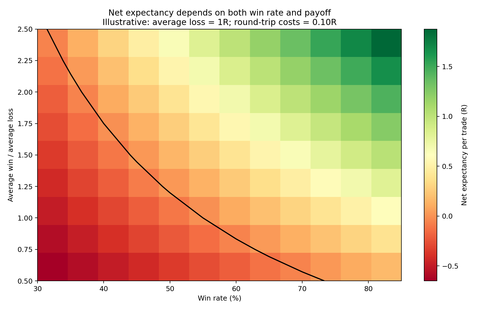
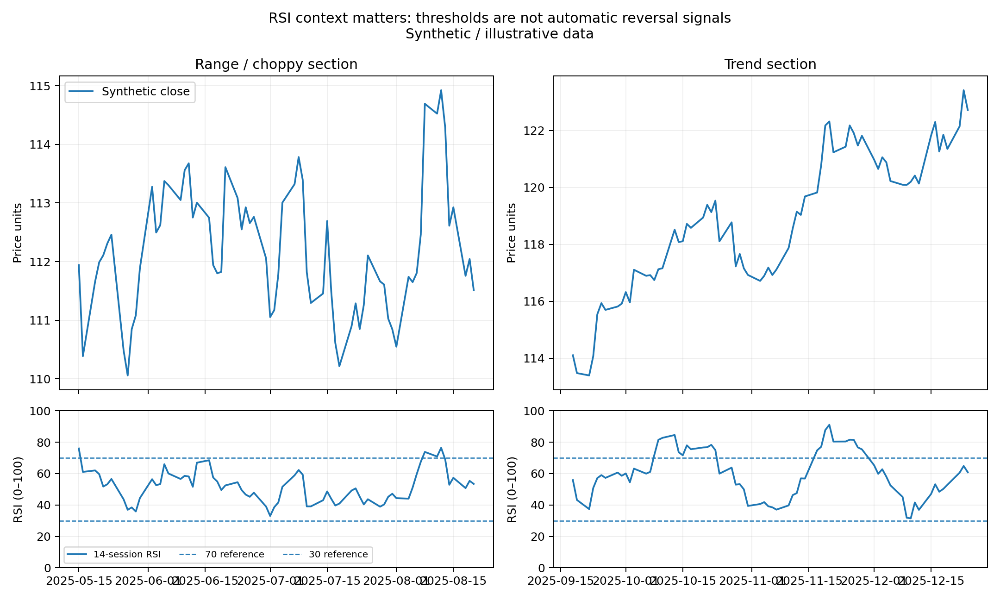
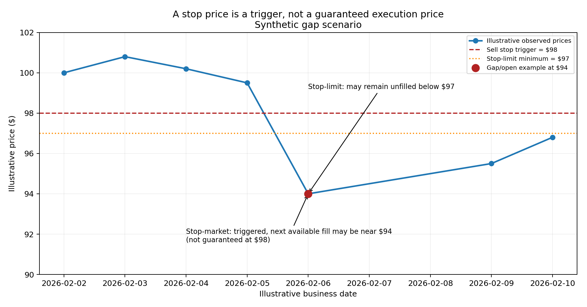
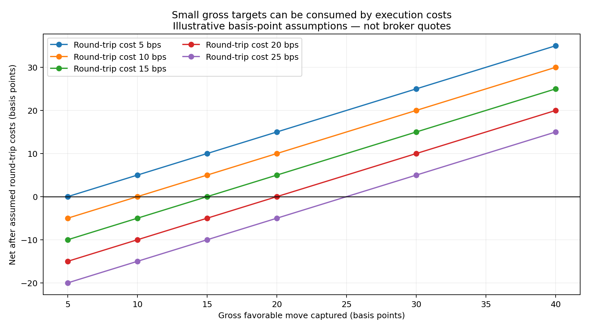
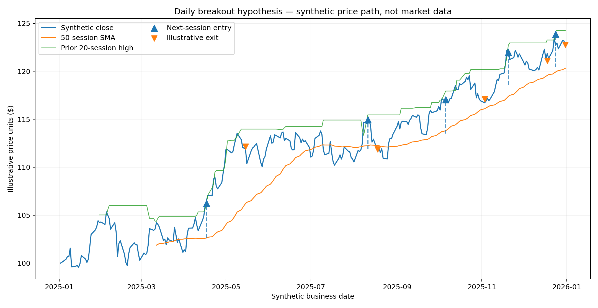
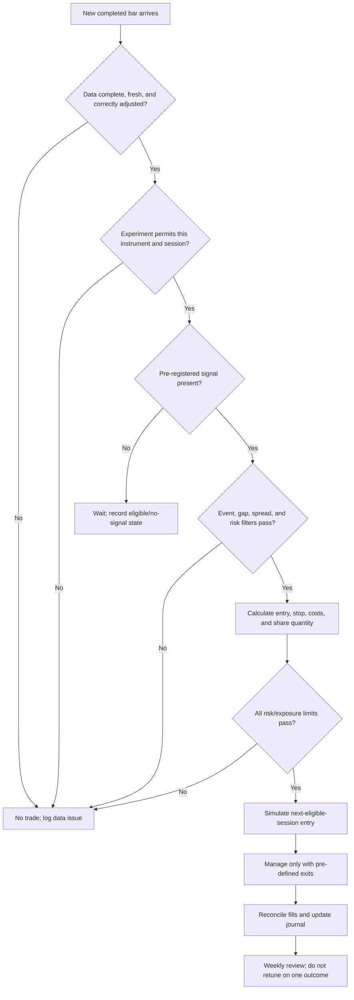
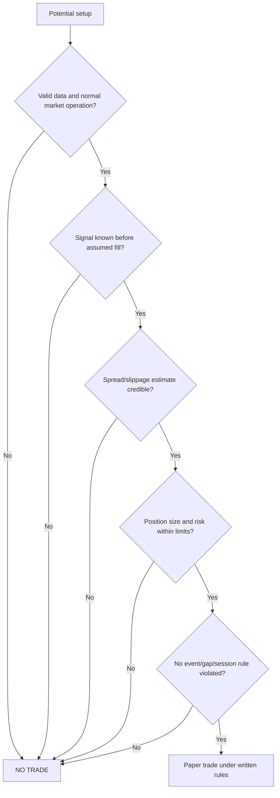

# 04 — Short-Term Trading Playbook

**As-of date for regulatory and source checks:** 10 November 2026  
**Purpose:** Learn to form, specify, risk-manage, and critically evaluate short-term trading hypotheses. This chapter is educational. It does not provide a recommendation to trade a particular security or claim that any strategy is profitable.

> **Important:** There is no strategy that reliably wins every trade, produces a guaranteed stream of small profits, or removes market risk. A high win rate can still lose money when average losses and costs are large. Stops do not guarantee a fill price. The first goal is to learn to test a repeatable process without risking money.

## 1. How to use this chapter

### Learning objectives

After completing this chapter, you should be able to:

1. Distinguish swing trading, day trading, scalping, and position trading by time horizon, effort, data needs, costs, and risk.
2. Read a price chart and understand the basic information in OHLCV data without treating chart patterns as certainty.
3. Explain what moving averages, VWAP, ATR, RSI, MACD, Bollinger Bands, Donchian channels, and volume measures do—and what they do not prove.
4. Describe trend/momentum, mean-reversion, and breakout/volatility-expansion strategies as falsifiable hypotheses.
5. Calculate a trade's size and planned cash risk before entering a simulated order.
6. Explain why stops can fill worse than expected and why short selling, margin, futures, options, and leveraged products add complexity.
7. Define a complete paper-trading experiment with entry, exit, sizing, cost, benchmark, and no-trade rules.
8. Record trades and review process quality separately from outcome quality.

### Prerequisites

Read Chapters [01 — Foundations and Market Mechanics](01-foundations-and-market-mechanics.md) and [02 — Markets and the Current Market Regime](02-markets-and-current-regime.md). Use Chapter 01 for the definitions and core return/expectancy/position-sizing equations; use Chapter 02 for why SPY is the first educational instrument in this guide. Chapter [03 — Long-Term Investing and Portfolio Building](03-long-term-investing-and-portfolio.md) explains why a long-term investment portfolio should remain separate from the short-term trading sandbox.

### What this chapter does not attempt

It does not teach high-frequency trading, options spreads, leveraged futures strategies, short-selling systems, machine learning signal discovery, or execution algorithms. Those subjects require additional data, legal/operational knowledge, and risk controls. They are optional later topics—not prerequisites for learning disciplined swing trading.

## 2. 80/20 — what matters most

- A strategy is a **testable set of rules**, not a chart screenshot, indicator combination, market opinion, or story told after the price moved.
- The sequence is: hypothesis → precise rules → historical test → realistic costs → out-of-sample test → paper trading. Chapter 05 teaches the detailed research and validation pipeline.
- A signal is not an order. The signal can be observed at a bar's close, but the earliest realistic entry may be the next bar or next session. Do not use information that was unavailable at the simulated decision time.
- Trade risk is set by the invalidation level and position size—not by how confident you feel. A stop is a plan, not a guaranteed maximum loss.
- Costs matter most when turnover is high or the target is small. Include spread, slippage, commissions/fees, financing/borrow costs when applicable, and other instrument-specific expenses.
- Indicators are transformations of past price and/or volume data. Several indicators can agree because they encode the same underlying information; agreement is not independent confirmation.
- Different approaches tend to behave differently in trends, ranges, high-volatility shocks, and event-driven markets. No one approach works in every regime.
- For the first experiment, use one liquid, unleveraged instrument, daily bars, long-only rules, one position at a time, and paper execution.
- Record every eligible signal—including skipped signals—and every trade. Otherwise, you can unconsciously select only the examples that support your belief.

## 3. Trading styles and their real trade-offs

| Style | Typical holding period | Main data | Main workload | Main risks and frictions | Beginner suitability |
|---|---|---|---|---|---|
| Position trading | Weeks to months | Daily/weekly OHLCV; fundamentals may matter | Periodic review | Overnight gaps, longer drawdowns, thesis/regime change | Reasonable after learning investing basics |
| Swing trading | Several days to several weeks | Daily bars; sometimes hourly for context | Review once or more per day; plan orders | Overnight gaps, event risk, spreads, stop slippage | **Best first short-term research style in this guide** |
| Day trading | Intraday; flat by session end | Intraday trades/quotes; session calendar | Continuous attention during the session | High decision frequency, execution costs, fast losses, margin rules | Not the first choice for a beginner |
| Scalping | Seconds to minutes | High-quality quotes, trades, depth, low-latency execution | Very high attention and technical demands | Spread, queue priority, latency, market impact, fees, adverse selection | Not recommended as an initial project |

The names are not perfectly standardized. A position held for two days may be called a swing trade by one trader and a short-term position by another. Define your holding period and rules rather than relying on the label. The SEC warns that day trading is extremely risky and can produce substantial losses in a short period; this is one reason the first research project below uses daily-bar swing-trading rules rather than intraday trading ([Investor.gov — Thinking of Day Trading? Know the Risks](https://www.investor.gov/additional-resources/spotlight/formerdirectorlorischock-directors-take/thinking-day-trading-know-risks)).

### 3.1 Why frequent small wins are not automatically safer

A strategy aiming for small gains may need a high percentage of winning trades. If average gains are small, costs can consume much of the gross return. A few large losses can then erase many small wins. Frequent trading also increases the number of times you cross the spread and face execution uncertainty.

Consider a hypothetical system with average winning trade **+0.6R**, average losing trade **−1.0R**, and round-trip costs **0.10R**. At a 65% win rate:

\[
E = pW - (1-p)L - C
  = 0.65(0.6) - 0.35(1.0) - 0.10 = -0.06R
\]

Despite winning 65% of the time, the strategy loses an expected 0.06R per trade under these assumptions. Its break-even win rate is:

\[
p_{BE}=\frac{L+C}{W+L}=\frac{1.0+0.10}{0.6+1.0}=68.75\%
\]

The result is not a forecast. It is a reminder to calculate the full distribution of wins, losses, and costs. The heatmap below shows how expectancy changes with both win rate and average payoff.



*Figure 1. Net expectancy sensitivity. Synthetic calculation: average loss = 1R and round-trip costs = 0.10R. The black line marks zero expectancy. It is not a performance record or a recommended target.*

## 4. Read the chart before choosing an indicator

### 4.1 OHLCV: what each bar actually says

For each interval, a standard price bar records:

- **Open:** first recorded trade price in the interval.
- **High:** highest recorded trade price.
- **Low:** lowest recorded trade price.
- **Close:** last recorded trade price in the interval.
- **Volume:** quantity traded during the interval, subject to the data provider's definition.

The same values can look different depending on the interval—one-minute, five-minute, hourly, daily, or weekly. A daily candle hides the path taken within the day. A stop-market order can be triggered intraday even if the daily close later recovers. Conversely, an opening gap may cross a stop before the regular session can provide a fill.

A chart is a compressed view of past transactions, not a view into future demand. Check whether prices are split-adjusted, dividend-adjusted, regular-session only, or inclusive of extended hours. These choices can materially affect indicators and backtests.

### 4.2 Basic price structure

- **Uptrend:** a sequence of higher swing highs and higher swing lows.
- **Downtrend:** lower swing highs and lower swing lows.
- **Range:** price oscillates between approximate areas of support and resistance without persistent directional progress.
- **Breakout:** price moves beyond a previously defined range or price boundary. The initial break may fail and return into the range.
- **Pullback:** a temporary move against an established trend; it is only identifiable with some hindsight unless rules define it mechanically.
- **Gap:** a discontinuity between one bar's close and the next bar's open. Gaps can reflect news, overnight trading, and changes in available liquidity.

Support and resistance are often drawn as zones, not exact prices. Their location can be subjective. If you want to test them, define an algorithmic rule (for example, a prior N-session high) rather than manually moving the line until historical examples look convincing.

### 4.3 Market regime and volatility context

A **market regime** is a description of the environment relevant to the strategy: trending or ranging, calm or volatile, liquid or thin, normal or event-driven. Regime labels can be useful for analysis, but they are not objectively known in real time unless the classification uses information available at that point.

A simple learning classification:

| Environment | Typical price behavior | Strategy family that may fit the hypothesis | Common failure |
|---|---|---|---|
| Persistent trend | Directional follow-through; pullbacks may be shallow | Trend/momentum | Whipsaws when the trend ends; entries after an extended move |
| Sideways range | Repeated moves around a central region | Mean reversion | A real breakout or news shock causes losses to accumulate against the new trend |
| Volatility expansion | Range and volume increase; price leaves a prior boundary | Breakout | False breakouts reverse; poor fills and wide spreads |
| News shock / gap | Price jumps before the next regular bar can be traded | No-trade filter or reduced exposure | A stop can gap through; historical bars may not model executable fills |
| Thin liquidity | Wide or unstable spreads and shallow depth | Usually avoid | Slippage and market impact overwhelm the expected edge |

Do not label a market as trending just because a moving average looks smooth after the fact. Your backtest regime rule must be calculated using data available at the time.

## 5. Essential indicators: purpose, calculation, and limitations

You do not need dozens of indicators. Learn a small set, understand what input they transform, and use them only when they answer a specific question.

### 5.1 Moving averages (SMA and EMA)

A simple moving average over N closes is:

\[
SMA_N(t)=\frac{1}{N}\sum_{i=0}^{N-1} Close_{t-i}
\]

An exponential moving average gives greater weight to recent observations. A common recursive form is:

\[
EMA_t=\alpha Close_t+(1-\alpha)EMA_{t-1},\quad \alpha=\frac{2}{N+1}
\]

Use cases: describe broad direction, define a trend filter, or smooth noisy price series. Limitations: both are lagging transformations; they can whipsaw in ranges and react after a move has already happened. A 20/50 or 50/200 crossover is not intrinsically profitable.

### 5.2 Average True Range (ATR)

True range includes intrabar movement and gaps:

\[
TR_t=\max(H_t-L_t, |H_t-C_{t-1}|, |L_t-C_{t-1}|)
\]

ATR is a smoothed average of true range over a chosen window. It measures recent price movement in **price units**, not direction. Traders use ATR to compare volatility, normalize moves, or define example stop distances. ATR does not tell you the probability of a stop being hit or guarantee a particular loss.

### 5.3 Relative Strength Index (RSI)

RSI compresses recent average gains and losses into a 0–100 oscillator. A common interpretation treats readings above 70 as “overbought” and below 30 as “oversold.” These labels do **not** mean the price must reverse. In a strong trend, RSI can remain elevated or depressed for a sustained period. The thresholds are conventions, not physical limits.



*Figure 2. RSI context matters. Both price paths and RSI values are synthetic. The figure illustrates that a threshold is not an automatic buy/sell instruction; use of RSI must be specified and tested in a defined regime.*

### 5.4 MACD

MACD is commonly defined as the difference between a 12-period EMA and a 26-period EMA; a 9-period EMA of MACD is often called the signal line. Crossovers and histogram changes are popular visual summaries of momentum. MACD is derived from moving averages, so it is lagging and overlaps information already present in the price series. Do not treat MACD, RSI, and moving-average direction as three independent confirmations.

### 5.5 VWAP

Volume-weighted average price is commonly estimated intraday as:

\[
VWAP=\frac{\sum_j Price_j\times Volume_j}{\sum_j Volume_j}
\]

The exact price input (trade price, typical price, or another provider convention) varies. VWAP resets according to session and provider rules. It is an intraday reference, not a fundamental value or guaranteed support/resistance level. It is not a core component of the daily-bar experiment below.

### 5.6 Bollinger Bands and Donchian channels

**Bollinger Bands** usually place bands a chosen number of standard deviations around a moving average. They can help visualize relative dispersion and a volatility squeeze/expansion, but price touching an outer band is not a guaranteed reversal.

**Donchian channels** use the highest high and lowest low over a chosen lookback. For a breakout test, use the prior completed window—not a window that includes the current bar. For example, today's breakout threshold can be `High.shift(1).rolling(20).max()`. This one-bar shift prevents today's high from raising the threshold that today's close is supposed to break.

### 5.7 Volume and relative volume

Volume can help describe participation. A relative-volume measure compares current volume with a historical average for the same or comparable interval. Volume is not uniformly comparable across pre-market, regular session, after-hours, and 24/7 venues. A high-volume breakout is still not proof that the move will continue.

### Indicator selection checklist

Before adding any indicator, answer:

1. What exact hypothesis does it represent?
2. Does it add information beyond the rule already present?
3. Is the calculation available at the time of the decision?
4. Does its parameter have a market/structural reason, or was it selected because it looked best in one historical sample?
5. What observation would make you reject it?
6. Have you included the extra turnover and costs caused by the signal?

## 6. Three strategy families as falsifiable hypotheses

A strategy family is a behavioral hypothesis, not a recipe guaranteed to work. Each hypothesis needs a market, time horizon, entry and exit rules, cost assumptions, and a way to fail.

### 6.1 Trend following / momentum

**Hypothesis:** once a market has moved persistently in one direction, some of that move may continue for a time because information, positioning, and investor behavior adjust gradually. Academic work has documented time-series momentum in a broad set of futures markets over one- to twelve-month horizons; that finding does not prove that a simple moving-average rule on SPY daily data will be profitable today. See Moskowitz, Ooi, and Pedersen (2012) in the sources.

**Typical rule components:** moving-average direction, higher highs/higher lows, a prior-period return filter, or a trend-strength measure. Exits may use a trailing stop, trend break, or time limit.

**May be more suitable when:** directional moves persist, price moves beyond a prior range, and costs do not consume the average move.

**Can fail when:** price alternates direction in a range; the trend reverses abruptly; the entry occurs late; the stop is too tight for normal volatility; or a gap exceeds the planned risk.

**How to disprove:** compare net results with a benchmark and a no-signal baseline; test several independent market periods; check whether the result comes from one unusually large trade or a few favorable regimes; include realistic entry timing and gaps.

### 6.2 Mean reversion

**Hypothesis:** some short-lived price deviations may partially reverse when they reflect temporary liquidity demand, positioning, or an overreaction rather than durable new information. Academic studies discuss short-horizon reversals and their relation to liquidity and bid–ask effects. These effects can be small, horizon-specific, and difficult to capture after spreads and slippage.

**Typical rule components:** distance from a rolling mean or VWAP, standardized deviation (z-score), RSI as a filter, or a prior move that exceeds a volatility threshold. The exit generally targets a return toward a reference value, with a strict invalidation rule.

**May be more suitable when:** the market is demonstrably range-bound, liquidity is adequate, and the deviation is not caused by material new information.

**Can fail when:** a genuine trend or news shock begins; the trader keeps adding to a losing position; the mean itself shifts; or the expected snapback is smaller than the spread and fees.

**How to disprove:** separate range and trend periods using a pre-defined real-time regime rule; compare gross and net returns; inspect losses around news and volatility expansion; test whether the apparent edge disappears when bid–ask costs are included.

### 6.3 Breakout / volatility expansion

**Hypothesis:** when price leaves a clearly defined recent range, new information or a change in supply/demand may lead to follow-through. Other breaks fail and move back into the range, so the strategy must accept frequent small losses or skipped moves.

**Typical rule components:** close beyond a prior N-session high/low, a trend filter, range/ATR contraction before the break, and optional volume confirmation. Entries should be defined at a realistic price after the signal becomes known.

**May be more suitable when:** the market is transitioning from compression to directional expansion, volume and liquidity remain adequate, and follow-through is large enough to cover costs.

**Can fail when:** price briefly pierces the level and reverses; the move is already exhausted; the next session gaps far beyond the planned entry; or the market is thin and the order has large slippage.

**How to disprove:** count all eligible breakouts, including failures; measure false-break frequency; vary costs conservatively; compare with buy-and-hold and a simple trend benchmark; test in both quiet and volatile regimes.

### 6.4 Compare the families without cherry-picking

| Question | Trend/momentum | Mean reversion | Breakout/expansion |
|---|---|---|---|
| Core behavior | Persistence | Temporary deviation reverses | Range boundary gives way |
| Typical entry | Directional confirmation | Move away from mean, then reversal evidence | Break beyond a prior boundary |
| Typical exit | Trend break/trailing rule | Mean/reference reached or invalidation | Stop, re-entry into range, or trailing/time exit |
| Common regime risk | Choppy sideways market | Strong directional trend | False breakout / gap reversal |
| Cost sensitivity | Medium; depends on turnover | Often high at very short horizons | Medium; gaps and slippage matter |
| Easy first test? | Yes, with daily data | Possible, but regime definition is hard | Yes, if look-ahead and false breaks are handled |

A technical pattern is not a causal explanation. A visually attractive historical example cannot tell you how many failed examples occurred before it. Chapter 05 will teach you to preserve the complete signal history and prevent backtest overfitting.

## 7. Risk, sizing, exits, and execution

### 7.1 Define the invalidation level before entering

A trade plan should state what price action invalidates the setup. The stop may be based on a structure level, volatility multiple, or time/condition exit. The correct stop is not simply the closest price that makes the share count look large. It should follow the hypothesis and market mechanics.

For a long position:

\[
RiskPerShare=(EntryPrice-StopPrice)+EstimatedPerShareCosts
\]

\[
RiskBudget=PaperEquity\times RiskFraction
\]

\[
Shares=\min\left(\left\lfloor\frac{RiskBudget}{RiskPerShare}\right\rfloor,
\left\lfloor\frac{ExposureCap}{EntryPrice}\right\rfloor\right)
\]

If the result is zero shares, skip the trade. Do not widen the stop merely to force a desired quantity. Risk fractions in examples are educational constraints, not personal recommendations.

**Worked example (hypothetical):** paper equity = $25,000; risk fraction = 0.25%; entry = $600; planned stop = $588; estimated round-trip cost = $0.05 per share. Risk budget = $62.50. Risk per share = $12.05, so size = floor(62.50 / 12.05) = 5 shares. A 25% gross exposure cap allows floor($6,250 / $600) = 10 shares, so the smaller risk-based quantity is 5. Planned loss at the stop plus estimated costs is about $60.25. A gap through the stop can make the actual simulated loss greater.

### 7.2 Stops are not guarantees

A stop order is triggered at a stop price and typically becomes a market order; the execution price can differ from the stop price, particularly in fast or gapping markets. A stop-limit order adds a limit price, which controls the worst acceptable price but introduces the risk that the order is not filled. Broker trigger conventions and supported order types vary. The SEC's Investor Bulletin on stop, stop-limit, and trailing-stop orders was updated **18 August 2026**; check your broker's current order policies before relying on a feature.



*Figure 3. Stop execution gap example. Synthetic illustration: a $98 stop is crossed by a gap to $94. A stop-market may execute near the next available price; a stop-limit with a $97 limit may remain unfilled. Neither outcome is guaranteed by the chart.*

A stop can also be triggered by a brief fluctuation and then price can recover. A trailing stop can move with favorable price movement, but may still trigger during normal volatility. A stop is a risk-management instruction, not insurance.

### 7.3 Risk/reward is a planning ratio, not a probability

If a trade's entry is $100, stop is $97, and target is $106, the planned reward/risk is $6/$3 = 2:1 before costs. That does not mean the target is twice as likely or that the trade has positive expectancy. Probability of reaching each exit, gaps, slippage, partial fills, and the distribution of all outcomes matter.

Use **R-multiples** to compare trades across different prices and sizes. If initial planned risk including assumed costs is $100, a realized gain of $150 is +1.5R and a loss of $100 is −1R. Report results both in R and dollars; R does not remove the need to model costs or gaps.

### 7.4 Execution costs and small targets

For a long round trip, the effective cost can include:

- Bid–ask spread paid when buying at/near the ask and selling at/near the bid.
- Slippage between the assumed price and actual/ simulated fill.
- Commissions, exchange/regulatory fees, and other broker charges where applicable.
- Market impact for orders large relative to available liquidity.
- Borrow fees and financing if shorting or using margin; these are excluded from the first experiment.
- Opportunity cost from limit orders that do not fill, and the adverse selection risk of fills that occur just before price moves against you.

A displayed last price is not necessarily executable. A market order emphasizes execution certainty but not price certainty; a limit order controls price but not execution. The SEC explains these distinctions in its [Types of Orders](https://www.investor.gov/introduction-investing/investing-basics/how-stock-markets-work/types-orders) guide.



*Figure 4. Illustrative basis-point arithmetic. The lines subtract assumed round-trip cost from gross favorable price movement. These are example assumptions, not current broker quotes; actual costs depend on instrument, venue, size, time, and broker.*

**Practical rule:** if your expected gross move is of similar size to the plausible round-trip cost, the setup is not suitable for the first experiment. Chapter 05 will show how to estimate costs and perform sensitivity analysis.

### 7.5 Gaps, volatility, liquidity, and event risk

- Overnight positions can gap through stops following earnings, macroeconomic announcements, geopolitical events, or unexpected news.
- Daily OHLC data may not reveal the order of intraday price movements. If both stop and target are touched in one daily bar, the sequence is unknown; use a conservative assumption or higher-resolution data.
- Wider spreads and shallow depth increase expected slippage and can make small-cap stocks, low-volume ETFs, and thin crypto pairs poor beginner test instruments.
- Trading halts, exchange outages, data delays, rejected orders, and market closures can prevent planned exits.
- Scheduled events such as CPI, employment reports, and Federal Reserve decisions can alter volatility and liquidity. Build an event calendar or specify an exclusion rule; do not add discretionary exceptions after observing the result.

### 7.6 Long and short positions are not symmetric

A long-only stock/ETF position can generally lose up to the amount invested (not counting borrowing or other account obligations). A short sale involves borrowed shares that must be returned. If the price rises, losses can theoretically be unlimited; borrow fees, buy-ins, margin requirements, and dividend payments may apply. Short availability and borrow cost can change. The SEC's [Regulation SHO overview](https://www.sec.gov/investor/pubs/regsho.htm) describes the mechanics and risks. **The first paper experiment is long-only; do not add shorting to make the results look better.**

Futures add contract specifications, expiry/roll, daily mark-to-market, margin, and possible delivery obligations. The CFTC explains that futures are complex and leveraged, and that losses can exceed the initial amount deposited. See [CFTC — Basics of Futures Trading](https://www.cftc.gov/LearnAndProtect/AdvisoriesAndArticles/FuturesMarketBasics/index.htm). Options add nonlinear exposure and time decay. Leveraged/inverse ETFs reset according to their prospectus and should not be treated as simple unleveraged index exposure. These are not required for this curriculum's first tests.

## 8. One first paper experiment: SPY daily trend-filtered breakout

This is a **candidate research experiment**, not a claim that the strategy is currently profitable or better than every alternative. It is selected because Chapter 02 prioritized a broad, liquid U.S. equity ETF as the easiest first practice instrument, daily data are widely available, and the rules can be stated without intraday data or leverage. The detailed historical evaluation belongs in Chapter 05.

### 8.1 Strategy specification card

| Element | Pre-registered rule for the first version |
|---|---|
| Instrument | SPY, long-only, unleveraged ETF exposure |
| Timeframe | Daily regular-session OHLCV bars |
| Universe | One instrument only; no scanning for winners |
| Trend filter | Signal-day close above its 50-session simple moving average |
| Breakout | Signal-day close above the highest high of the **prior 20 completed sessions** (`High.shift(1).rolling(20).max()`) |
| Signal timing | Evaluate after the signal-day close is final; never assume a fill at that same close |
| Entry | If flat and all filters pass, enter at the next regular session's open plus an explicit adverse slippage assumption |
| Gap filter | Skip if next open is at/below the signal-day prior-20-session breakout threshold (failed break by the open) or more than 1.0 × signal-day ATR(14) above signal-day close (do not chase a large gap) |
| Initial stop | Entry fill minus 2.0 × ATR(14) from the completed signal day |
| Protective exit | If next session opens below the stop, model exit at open less adverse slippage; otherwise, if the session low touches stop, model a stop fill at stop less slippage |
| Rule exit | If the prior completed session's close is below its prior 10-session low, exit at next session's open (conservative daily-bar sequencing) |
| Time exit | Exit at next session's open after 20 full trading sessions if neither exit has occurred |
| Position limit | At most one open position; no pyramiding, shorting, margin, or options |
| Position size | Maximum planned initial risk = 0.25% of paper equity; also cap gross notional at 25% of paper equity. Skip if the calculated whole-share quantity is zero |
| Daily circuit breaker | If paper equity drawdown from the day's starting equity reaches 1.0%, block new entries for the remainder of the session; continue to manage an existing position under its pre-defined exit rules |
| Experiment drawdown stop | Pause the experiment for review at 5.0% peak-to-trough paper equity drawdown. This is a test-control threshold, not a promise that loss cannot exceed it |
| Data filter | No entry with stale, missing, duplicated, non-monotonic, or inconsistent OHLCV data; no entry during a trading halt or when the source's session/adjustment convention is unknown |
| Execution filter | Use a documented spread/slippage/fee model. If data do not support a credible estimate, run conservative cost scenarios and report the uncertainty |
| Benchmark | SPY buy-and-hold over identical dates, with dividends/adjustments handled consistently; also report time in cash and exposure |
| No-trade conditions | Gap filter fails; a risk cap is reached; data are invalid; order/fill assumptions cannot be supported; the exchange is closed/ halted; or the signal was not available at the decision time |

The exact 20/50/10/2-ATR values are initial test settings, not universal optimal parameters. Freeze them before the first holdout test. Do not keep changing the values until the past chart looks attractive.

### 8.2 Why the entry is next session, not the signal close

At the end of session T, the final close and high are known. If the rule uses session T's final close to decide that a breakout occurred, a backtest cannot also buy at the exact closing price unless it can demonstrate that the signal and order were executable before that price was known. The conservative educational assumption is to observe the completed signal and transact no earlier than the next session. This introduces gap risk but avoids a common look-ahead/fill-timing error.



*Figure 5. Breakout rule schematic. Synthetic OHLCV prices, not SPY history or evidence of performance. The prior 20-session high is shifted one completed session; entry markers are illustrative next-session opens. Dashed vertical marks illustrate the 2×ATR initial-risk distance.*

The supporting data are in `data/ch04_synthetic_ohlcv.csv` and `data/ch04_schematic_breakout_trades.csv`; the deterministic script is `scripts/generate_ch04_visuals.py`. It uses no live market data and sends no broker orders. The script's four schematic trades are only artifacts for illustrating rule plumbing; they are **not** a performance sample and must not be quoted as strategy evidence.

### 8.3 What would invalidate this hypothesis?

- Net performance is not better than the pre-selected benchmark after plausible costs and dividends are treated consistently.
- The apparent result depends on one trade, a few months, one market regime, or a specific parameter combination.
- Performance collapses with modestly worse spread/slippage assumptions or realistic next-open fills.
- The signal does not survive an untouched out-of-sample period and a later paper-trading period.
- A small number of overnight gaps accounts for most losses or stop outcomes are poorly modeled by the available data.
- The number of trades is too small to estimate expectancy with useful precision.
- The data feed cannot support the adjustment, timestamp, or execution assumptions.

A negative result is useful. It tells you that the hypothesis did not survive this test under the stated assumptions. Do not respond by adding indicators until the historical result becomes positive.

## 9. A disciplined decision process

### 9.1 Before a paper trade

1. Is the instrument permitted by the experiment? Is the session open and the data feed healthy?
2. Did the exact signal occur using completed data only?
3. Is the market regime compatible with the hypothesis, according to a rule defined in advance?
4. Are there major scheduled events or abnormal conditions covered by the no-trade rules?
5. What is the entry assumption, stop, planned exit, position size, and estimated round-trip cost?
6. Is the order consistent with the one-position, exposure, per-trade, daily, and experiment-level limits?
7. What observation would invalidate the setup? Can you accept the planned loss without moving the stop farther away?
8. Has the signal been recorded before the outcome is known?

### 9.2 While a position is open

- Do not widen a stop merely because the trade is losing.
- Do not add to a losing position unless a separately researched and pre-registered scale-in rule exists; the first experiment has no scale-ins.
- Do not move a target or exit because social media sentiment changed.
- Do not count a partial fill as a full fill; record quantity and price for every fill.
- Do not replace a missed trade with a late chase entry.
- If data or broker simulation becomes unreliable, stop creating new trades and document the issue.

### 9.3 After a trade

Record whether the rules were followed before interpreting P&L. A process-compliant loss can be a valid observation. An accidental profit caused by breaking the rules is not evidence that the process is sound.

### 9.4 Decision flow



### 9.5 When not to trade



No-trade is a valid decision. A strategy that trades less often may have a better chance of surviving costs and operational errors than one that forces a setup every session—but this too must be measured rather than assumed.

## 10. Systematic rules versus discretionary decisions

| Dimension | Rules-based / systematic | Discretionary |
|---|---|---|
| Entry/exit | Written, testable conditions | Human interpretation and judgment |
| Repeatability | Higher if the data and implementation are stable | Depends on the trader and documentation |
| Testing | Can be backtested and replayed | Harder unless every decision is captured consistently |
| Adaptability | Requires a rule for new conditions and controlled revisions | Can react to context, but vulnerable to hindsight and emotion |
| Main failure mode | Model error, overfitting, bad data, regime change | Inconsistency, confirmation bias, impulse, selective memory |
| Best learning practice | Version rules and log all signals | Record the rationale and screenshot before outcome |

Systematic does not automatically mean profitable or safe; discretionary does not automatically mean irrational. For this curriculum, rules-based execution is preferred because it makes the hypothesis and results easier to reproduce. A discretionary override must be logged as a deviation, not silently rewritten as if it were part of the original strategy.

## 11. Keep the investing portfolio separate from the trading sandbox

Chapter 03 covers long-term investing. Do not use a long-term investment thesis as an excuse to keep a losing short-term trade open, and do not sell a long-term holding simply because a short-term chart looks weak.

Maintain separate records or virtual sub-accounts:

- **Investment book:** long horizon, strategic allocation, diversified holdings, contribution/rebalancing policy, and fundamental thesis.
- **Trading sandbox:** small fixed paper equity, one experiment version, pre-defined risk limits, exact entries/exits, and an experiment stop condition.

Do not transfer a losing trading position into the investment book without a new independent investment analysis. Do not count paper-trading profits as income or assume they could be withdrawn at the same price. Avoid using leverage to compensate for a small account.

## 12. Regulatory and product details to verify before any future real account activity

This guide is paper-only, but it is important not to learn outdated rules as if they were current. **As of 10 November 2026**, FINRA's amended Rule 4210 replaces the former day-trading margin provisions and “pattern day trader” framework with intraday margin standards. The SEC approved the change on 14 April 2026; FINRA's notice states an effective date of 4 June 2026 and an implementation phase-in through 20 October 2027 for firms needing more time. During that transition, a brokerage firm may still be operating under the former requirements or may already have moved to the new standards. Ask the specific broker which margin standard it currently applies and read its current disclosures. Do not rely on old summaries of the $25,000 minimum or four-day-trades-in-five-days rule as a universal current statement. Sources: [SEC approval, Release 34-105226](https://www.sec.gov/rule-release/34-105226); [FINRA investor explanation, 20 April 2026](https://syndication.finra.org/content/understanding-new-intraday-margin-requirements); [Federal Register, 17 April 2026](https://www.govinfo.gov/content/pkg/FR-2026-04-17/html/2026-07485.htm).

Broker requirements, account permissions, order types, short availability, data entitlements, fees, and extended-hours rules vary. Re-check official broker documents at the time of use. This is not legal, tax, or personalized financial advice.

## 13. Practical exercises — attempt before reading the answer key

Use the deterministic files in `data/` and the script `scripts/generate_ch04_visuals.py`. Install the lightweight dependencies from the repository root:

```bash
python -m pip install numpy pandas matplotlib
python study-guide/scripts/generate_ch04_visuals.py
```

### Exercise 1 — Annotate a breakout without hindsight

**Objective:** distinguish the signal time from the earliest assumed fill and avoid using the current bar in its own breakout threshold.  
**Inputs:** `data/ch04_synthetic_ohlcv.csv`.  
**Actions:**

1. Load the CSV and inspect the `Date`, `High`, `Close`, `SMA50`, and `Prior20High` columns.
2. Choose five rows where `Close > Prior20High` and `Close > SMA50`.
3. For each, write the signal date and the next available session date. Assume entry at that next session's `Open`, not the signal close.
4. Check whether `Prior20High` equals the maximum high over the previous 20 rows and excludes the current row.
5. Explain what would go wrong if you used `High.rolling(20).max()` without shifting it.

**Expected output:** a five-row table with signal date, threshold, signal close, next open, and explanation of timing.  
**Rubric (0–2 each):** correct previous-window calculation; correct next-session timing; clear look-ahead explanation.  
**Answer key:** see Section 14.

### Exercise 2 — Calculate share size and planned risk

**Objective:** translate a fixed paper risk budget into a whole-share quantity.  
**Inputs:** paper equity $25,000; risk fraction 0.25%; entry $600; stop $588; estimated round-trip cost $0.05/share; maximum notional exposure 25%.  
**Actions:** calculate risk budget, per-share risk, risk-limited shares, exposure-limited shares, final quantity, and planned loss including estimated costs.  
**Expected output:** a short calculation sheet.  
**Rubric (0–2 each):** correct budget; cost included; smaller of risk and exposure limits selected.  
**Answer key:** see Section 14.

### Exercise 3 — Can a small target survive costs?

**Objective:** calculate the net result of a small gross move under multiple cost assumptions.  
**Inputs:** `data/ch04_execution_cost_scenarios.csv`.  
**Actions:**

1. Filter for a gross favorable move of 10 bps.
2. Compare net outcome with round-trip costs of 5, 10, 15, 20, and 25 bps.
3. Calculate the break-even gross move for a 15-bps round-trip cost.
4. Explain which cost assumptions need live broker/instrument data before they can be used in a real test.

**Expected output:** one table plus a paragraph.  
**Rubric (0–2 each):** arithmetic; unit clarity; appropriate caution about assumptions.  
**Answer key:** see Section 14.

### Exercise 4 — Compute expectancy after costs

**Objective:** see why win rate alone is insufficient.  
**Inputs:** average win = +0.6R; average loss = −1.0R; win rate = 65%; round-trip cost = 0.10R.  
**Actions:** calculate expectancy, derive the break-even win rate, and compare it with the assumed win rate. Then inspect `data/ch04_expectancy_sensitivity.csv` and identify two combinations with negative expectancy and two with positive expectancy.  
**Expected output:** equations and four parameter examples.  
**Rubric (0–2 each):** net expectancy equation; break-even probability; correct interpretation of the heatmap.  
**Answer key:** see Section 14.

### Exercise 5 — Diagnose indicator context

**Objective:** avoid using an oscillator threshold as an automatic trade signal.  
**Inputs:** Figure 2 and `data/ch04_synthetic_ohlcv.csv`.  
**Actions:** compare the range section and the trend section. Record when RSI crosses 70 or 30 and note the subsequent price behavior over the next five synthetic sessions. Do not assume every cross is a trade.  
**Expected output:** a table of at least four threshold events and a short explanation of context.  
**Rubric (0–2 each):** event selection; correct forward-window observation; recognition that the data are synthetic and small-sample.  
**Answer key:** see Section 14.

### Exercise 6 — Compare the strategy families across regimes

**Objective:** explain which market behavior each hypothesis is designed to capture and where it may fail.  
**Inputs:** Section 6 and the `Regime` column in the synthetic OHLCV CSV.  
**Actions:**

1. Select one period from each of `Uptrend`, `Range / choppy`, and `Breakout / trend`.
2. For each, describe what a trend, mean-reversion, and breakout trader would look for.
3. Identify one situation in which each strategy should produce a no-trade decision.
4. Do not calculate a profitability ranking from these synthetic sections.

**Expected output:** a 3×3 regime/strategy matrix plus no-trade examples.  
**Rubric (0–2 each):** correct behavioral fit; plausible failure mode; no unsupported performance claim.  
**Answer key:** see Section 14.

### Exercise 7 — Build a pre-trade checklist and journal record

**Objective:** practice a complete paper-trade decision before knowing the outcome.  
**Inputs:** the SPY experiment specification in Section 8.  
**Actions:** create one hypothetical eligible signal, record data timestamp, signal inputs, next-open entry assumption, stop, estimated costs, position size, exposure, exit conditions, and no-trade checks. Then write one example where the correct decision is to skip.  
**Expected output:** two completed records: one trade candidate and one no-trade case.  
**Rubric (0–2 each):** all required fields; decision consistent with rules; no discretionary hindsight.  
**Answer key:** see Section 14.

### Exercise 8 — Paper-trading process review

**Objective:** evaluate rule-following separately from profit/loss.  
**Inputs:** create a paper journal for a fixed 20-session practice block. A no-signal session still receives a record. Do not submit live orders or use real money.  
**Actions:** record each session's signal status, eligibility, trade/skip decision, order/fill assumption, costs, and any rule deviation. At the end, summarize process adherence, not whether the small sample “proves” an edge.  
**Expected output:** 20 session records and a one-page weekly review.  
**Rubric (0–2 each):** complete record; deviations documented; appropriately cautious conclusion.  
**Answer key:** see Section 14.

## 14. Answer key and solution notes

### Exercise 1 — Breakout timing

`Prior20High` is `High.shift(1).rolling(20).max()`. It uses the prior 20 completed rows and excludes the signal row. The signal is known after the signal-day close. If a strategy uses that close, the earliest simple bar-based fill assumption is the next regular session's open. Using a same-close fill without a valid closing-auction/market-on-close signal process introduces look-ahead or unrealistic execution assumptions. A rolling maximum that includes the current high makes the signal threshold depend on the bar being tested; this may prevent valid breakouts or distort the rule.

### Exercise 2 — Position sizing

- Risk budget = $25,000 × 0.0025 = **$62.50**.
- Risk/share = ($600 − $588) + $0.05 = **$12.05**.
- Risk-limited quantity = floor($62.50 / $12.05) = **5 shares**.
- Exposure cap = $25,000 × 25% = **$6,250**; exposure-limited quantity = floor($6,250 / $600) = **10 shares**.
- Final quantity = min(5, 10) = **5 shares**.
- Planned risk including assumed cost = 5 × $12.05 = **$60.25**.

The gap scenario can exceed the planned loss. The quantity calculation is only as credible as the stop and cost assumptions.

### Exercise 3 — Cost drag

At a 10-bps gross target, net before other risks equals gross move minus round-trip cost:

| Round-trip cost | Net at 10-bps gross move |
|---:|---:|
| 5 bps | +5 bps |
| 10 bps | 0 bps |
| 15 bps | −5 bps |
| 20 bps | −10 bps |
| 25 bps | −15 bps |

A 15-bps cost requires more than 15 bps gross just to be positive before any other adverse effect. Costs must be estimated for the actual instrument, broker, venue, order size, and time of day; the chart's assumptions are synthetic.

### Exercise 4 — Expectancy

\[
E=0.65(0.6)-0.35(1.0)-0.10=-0.06R
\]

\[
p_{BE}=\frac{1.0+0.10}{0.6+1.0}=0.6875=68.75\%
\]

A 65% win rate is below this example's break-even level. In the CSV, a low win rate combined with a small average win tends to be negative; higher win rates and/or larger average wins can move expectancy above zero. These are mathematical scenarios, not a strategy forecast.

### Exercise 5 — RSI interpretation

Answers depend on the selected rows. Full credit requires recording the event date and the subsequent five-session path without treating it as a trade outcome. In a trend, an RSI reading above 70 can persist or be followed by additional gains; in a range, RSI may oscillate around its conventional bands. The sample is synthetic and too small to establish a general statistical relationship.

### Exercise 6 — Regime matrix

| Regime | Trend/momentum | Mean reversion | Breakout |
|---|---|---|---|
| Uptrend | Look for continuation/pullbacks; avoid late chasing | Avoid fading every new high; wait for a defined non-news overshoot if testing | Look for a break from a consolidation, but skip after an excessive gap |
| Range/chop | Risk of whipsaw; reduce/no trade if trend filter is absent | Look for a defined return toward the range center; invalidate if range breaks | Skip repeated weak breaks without expansion confirmation |
| Breakout/trend | May participate after confirmation but can enter late | Dangerous to fade a genuine regime change | Designed to test follow-through; stop if price returns into the range |

The matrix describes hypotheses, not realized performance. A valid no-trade example includes stale data, a gap that violates the entry filter, a scheduled event excluded by pre-registration, or a position/exposure limit already reached.

### Exercise 7 — Journal record

A complete candidate record includes: strategy version; date/time/time zone; instrument; data provider and freshness; completed signal values; signal close; prior 20-session high; 50-SMA; ATR; next-session open assumption; gap-filter result; entry and stop; shares; dollar risk and exposure; costs; exits; and rule-compliance status. A skip record should identify the exact no-trade condition rather than simply say “felt risky.”

### Exercise 8 — Paper review

A good review reports the number of sessions observed, number of valid signals, number of trades and skips, order/fill assumptions, costs, missing data, rule adherence, and deviations. It does not claim a 20-session sample proves profitability. A repeated rule violation is a process problem even if net P&L is positive; a compliant loss is not, by itself, a reason to change the rules.

## 15. Reusable trade journal and weekly review

### Trade / signal journal template

| Field | Record |
|---|---|
| Date and time / time zone | |
| Strategy name and version | |
| Instrument / venue | |
| Data source, bar interval, adjustment, freshness | |
| Regime label (pre-defined rule) | |
| Signal inputs and values | |
| Signal timestamp; earliest eligible entry time | |
| Entry order type / assumed fill / quantity | |
| Initial stop and reason | |
| Target, rule exit, and time exit | |
| Paper equity / risk budget / exposure | |
| Estimated spread, slippage, fees, borrow/funding if relevant | |
| No-trade filters checked | |
| Exit fill(s), timestamp(s), reason | |
| Gross P&L / costs / net P&L / R-multiple | |
| Maximum adverse/favorable excursion (if data support it) | |
| Rule compliance? If no, describe deviation | |
| Screenshot/file link and notes recorded before outcome | |

### Weekly process review

1. How many sessions were observed, and how many generated eligible signals?
2. Were all valid signals recorded, including skipped or missed ones?
3. Did every trade obey entry, stop, size, exposure, session, and exit rules?
4. What were gross P&L, estimated costs, and net P&L? Are costs based on realistic broker data or broad assumptions?
5. What was average win, average loss, expectancy, profit factor, drawdown, turnover, and exposure? Are sample sizes large enough to interpret?
6. Did one trade or one regime dominate the result?
7. Were there data errors, gaps, halts, news events, or ambiguous bar sequencing?
8. Did any discretionary action occur? Was it recorded as a deviation?
9. What specific failure mode appeared? Is it already covered by the written rules?
10. Change nothing during the fixed evaluation block unless a safety or data-integrity problem requires stopping. Record any necessary change and start a new strategy version.

## 16. Mastery checklist

You are ready to proceed to Chapter 05 when you can:

- [ ] Explain why swing trading is a more manageable first research style than scalping or margin-based day trading.
- [ ] Interpret OHLCV bars, price structure, ranges, breakouts, gaps, and volatility context.
- [ ] Explain SMA/EMA, ATR, RSI, MACD, VWAP, Bollinger Bands, Donchian channels, and volume without claiming they predict the future.
- [ ] State the testable hypothesis and failure modes for trend, mean reversion, and breakout strategies.
- [ ] Calculate planned share quantity, exposure, cost-adjusted risk, and R-multiple.
- [ ] Explain why a stop can fill at a worse price or remain unfilled if it is a stop-limit order.
- [ ] Explain why a 65% win rate can still produce negative expectancy.
- [ ] Reproduce the SPY breakout signal without look-ahead and enter no earlier than the next session.
- [ ] Complete the pre-trade checklist, journal, and weekly review.
- [ ] Keep the investment portfolio separate from the paper-trading experiment.

## 17. Glossary

- **ATR:** Average True Range; a smoothed measure of recent price range including gaps.
- **Breakout:** move beyond a pre-defined recent price boundary.
- **Donchian channel:** rolling highest high and lowest low over a specified lookback.
- **Expectancy:** average expected trade outcome under stated probabilities, payoff sizes, and costs.
- **False breakout:** price moves beyond a boundary but fails to sustain the move and returns into the range.
- **Gap:** price discontinuity between adjacent bars, commonly from one close to the next open.
- **Mean reversion:** hypothesis that a deviation from a reference value will partially reverse.
- **Momentum:** persistence of prior price movement over a defined horizon.
- **OHLCV:** open, high, low, close, and volume data.
- **R-multiple:** profit or loss expressed as a multiple of the initial planned risk.
- **RSI:** Relative Strength Index, a bounded oscillator derived from recent gains and losses.
- **Slippage:** difference between expected/assumed and actual execution price.
- **Spread:** difference between best displayed ask and bid.
- **Stop-limit:** stop-triggered limit order; it can remain unfilled if the limit cannot be met.
- **Stop-market:** stop-triggered market order; execution price is not guaranteed.
- **Trend filter:** pre-defined rule used to determine whether conditions align with a trend hypothesis.
- **VWAP:** volume-weighted average price over a specified session or interval.

## 18. Sources and further reading

All online references checked on **10 November 2026**, unless a publication/update date is specified.

### Market mechanics, execution, and investor risk

1. U.S. Securities and Exchange Commission / Investor.gov, [Types of Orders](https://www.investor.gov/introduction-investing/investing-basics/how-stock-markets-work/types-orders), accessed 10 November 2026.
2. SEC / Investor.gov, [Stop, Stop-Limit, and Trailing Stop Orders — Investor Bulletin](https://www.investor.gov/introduction-investing/general-resources/news-alerts/alerts-bulletins/investor-bulletins-15), originally 13 July 2017; **updated 18 August 2026**.
3. SEC / Investor.gov, [Thinking of Day Trading? Know the Risks](https://www.investor.gov/additional-resources/spotlight/formerdirectorlorischock-directors-take/thinking-day-trading-know-risks), accessed 10 November 2026; discusses the fast decision cycle, leverage, and risk of substantial losses.
4. SEC, [Key Points About Regulation SHO](https://www.sec.gov/investor/pubs/regsho.htm), accessed 10 November 2026.
5. CFTC, [Basics of Futures Trading](https://www.cftc.gov/LearnAndProtect/AdvisoriesAndArticles/FuturesMarketBasics/index.htm), accessed 10 November 2026.

### Current U.S. intraday margin rule context

6. SEC, [Release 34-105226 — approval of FINRA Rule 4210 amendments](https://www.sec.gov/rule-release/34-105226), 14 April 2026.
7. FINRA, [Understanding the New Intraday Margin Requirements](https://syndication.finra.org/content/understanding-new-intraday-margin-requirements), 20 April 2026; explains the 4 June 2026 effective date and phase-in through 20 October 2027.
8. Federal Register, [91 FR 20731 — FINRA intraday margin standards](https://www.govinfo.gov/content/pkg/FR-2026-04-17/html/2026-07485.htm), published 17 April 2026.

### Strategy research and research pitfalls

9. Tobias J. Moskowitz, Yao Hua Ooi, and Lasse Heje Pedersen, [Time Series Momentum](https://doi.org/10.1016/j.jfineco.2011.11.003), *Journal of Financial Economics*, 104(2), 2012, pp. 228–250. Findings concern a diversified set of futures/forward markets and specified horizons; they do not validate this chapter's SPY experiment.
10. Si Cheng, Allaudeen Hameed, Avanidhar Subrahmanyam, and Sheridan Titman, [Short-Term Reversals: The Effects of Past Returns and Institutional Exits](https://doi.org/10.1017/S0022109016000958), *Journal of Financial and Quantitative Analysis*, 52(1), 2017, pp. 143–173.
11. David H. Bailey, Jonathan M. Borwein, Amir Salehipour, Marcos López de Prado, and Qiji Zhu, [Backtest Overfitting in Financial Markets](https://escholarship.org/content/qt4hn4t174/qt4hn4t174_noSplash_2bb6c5b6dbbb66bcadbc3d0a05e3af6b.pdf), 9 February 2016. This paper motivates careful treatment of multiple testing and strategy selection; Chapter 05 covers practical validation methods.

## 19. Handoff to Chapter 05

Chapter 05 will turn this playbook into a reproducible research workflow: validate data; create signals without look-ahead; model fills, spread, slippage, commissions, and corporate actions; compare against benchmarks; evaluate drawdown and uncertainty; use out-of-sample and walk-forward methods; and then observe live market data in a paper environment. A positive backtest is a hypothesis—not proof of a durable edge.
