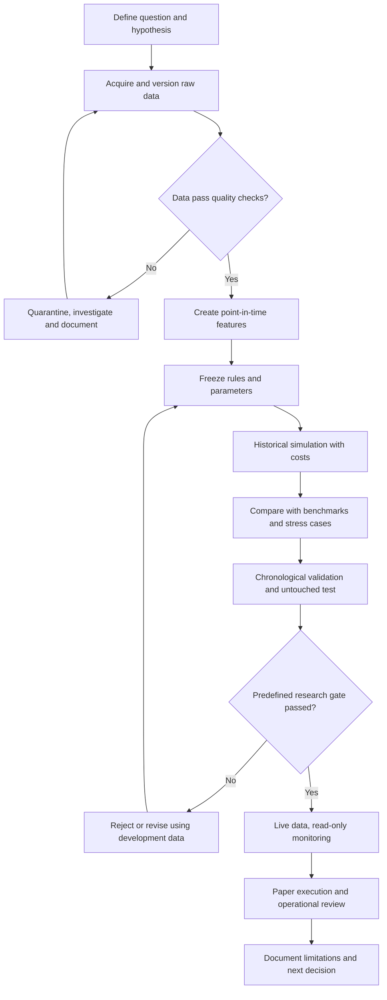
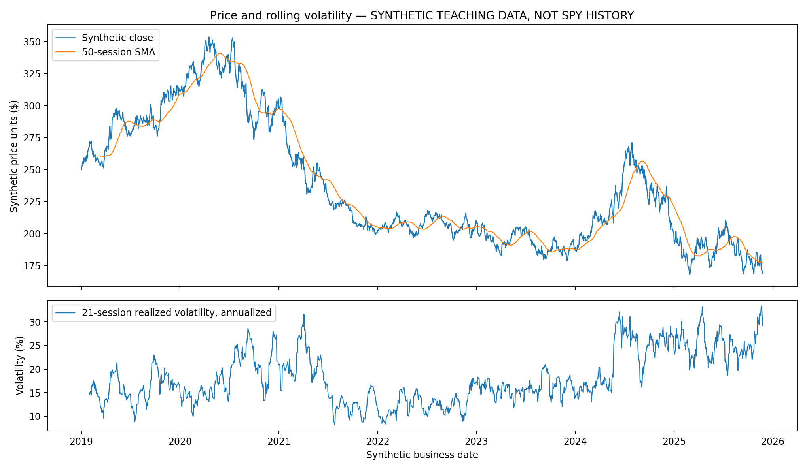
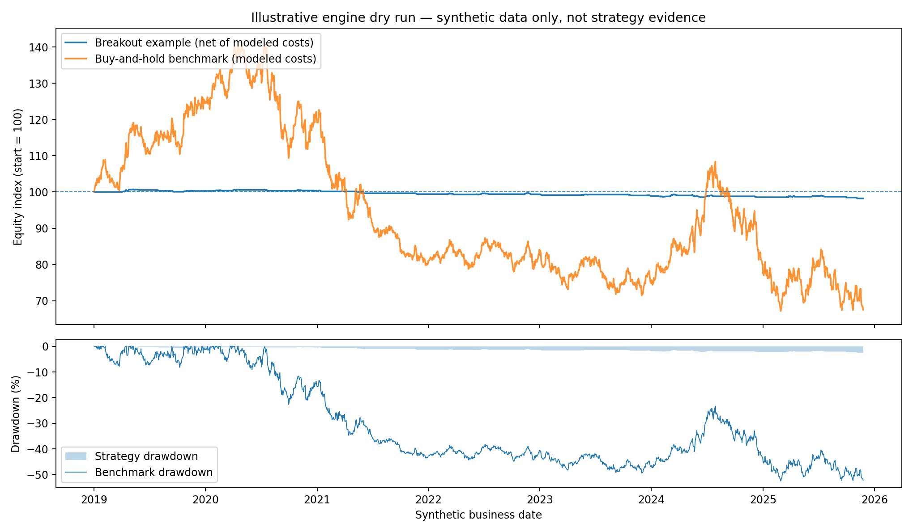
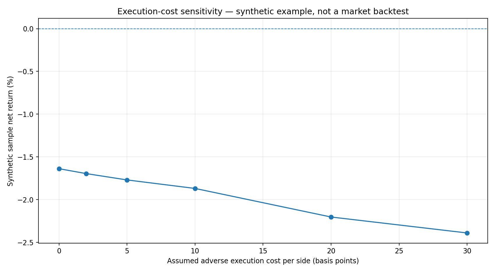
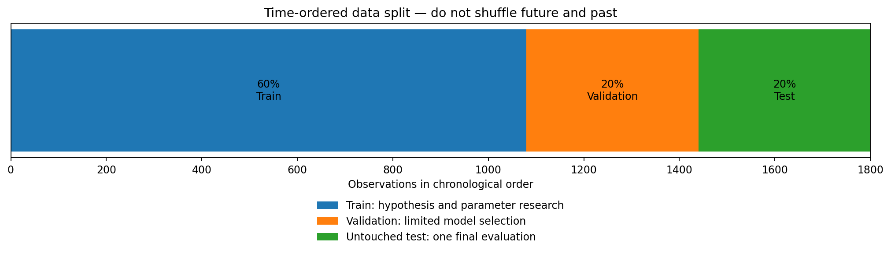
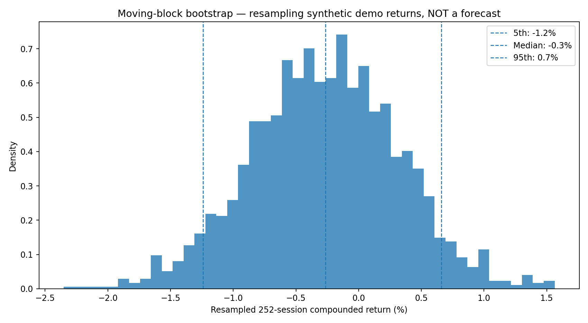

# Chapter 05 — Data, Backtesting, and Paper Trading

**Level:** Beginner to intermediate · **Estimated study time:** 10–14 hours including labs  
**Scope:** Daily-bar research first; live market data with read-only observation; simulated execution only  
**Research/API documentation checked:** 10 November 2026 (provider terms, entitlements, endpoints and SDK behavior can change)

> **Important:** This chapter teaches how to test a trading hypothesis. It does not identify a profitable strategy, promise returns, or authorize real-money trading. The included performance charts and CSVs are generated from synthetic data. They are not SPY history, a historical backtest of SPY, or evidence of an edge.

## Learning objectives

By the end, you should be able to:

1. Decide whether a dataset is suitable for a specific research question and record its provenance.
2. Validate timestamps, OHLCV relationships, missing data, corporate actions, price adjustments and session conventions.
3. Build a small, reproducible Python pipeline from raw bars to features, signals, simulated orders, metrics and a report.
4. Explain and detect look-ahead, leakage, survivorship, selection, overfitting and execution-model bias.
5. Simulate next-bar execution with explicit costs, position limits, gaps, stop handling and liquidity assumptions.
6. Evaluate results with benchmarks, drawdown, exposure, trade count, uncertainty and out-of-sample tests—not win rate alone.
7. Run a live, read-only data stream and log observations without submitting any order.

## Prerequisites

Read Chapters [01 — Foundations](01-foundations-and-market-mechanics.md), [02 — Markets](02-markets-and-current-regime.md), and [04 — Short-Term Trading](04-short-term-trading-playbook.md). Chapter 03's portfolio and benchmark concepts are also useful. You should be comfortable with basic Python, functions, pandas DataFrames, CSV files and command-line use.

## 80/20 — what matters most

- **Bad data produces bad conclusions.** Know the instrument, feed, time zone, session, adjustment method and timestamp meaning before calculating an indicator.
- **A signal cannot trade before it exists.** A signal using a completed daily close is known after that close; the earliest simple historical fill is the next session.
- **Costs and fill assumptions can erase an apparent edge.** Include spread, slippage, commissions, fees, gaps, partial fills and limits on order size.
- **Never shuffle time series at random.** Develop on earlier observations and evaluate later observations.
- **A final holdout is not a tuning set.** Define the experiment before opening it, evaluate it once, and report the result even when it is poor.
- **Paper trading is simulation.** Live data with simulated fills tests software and operational behavior; it does not reproduce all live-market execution conditions.

---

## 1. The research workflow

A backtest is a controlled experiment, not a chart with buy and sell arrows. It needs a defined hypothesis, appropriate data, explicit execution assumptions, a benchmark, and a method for testing whether the result could be an accident of the sample.



The first strategy candidate is the **SPY daily trend-filtered breakout** defined in Chapter 04. This chapter tests the quality of the research process, not whether the 20-session breakout, 50-session trend filter, 2×ATR stop, 10-session-low exit and 20-session time exit are optimal. Keep those original parameters frozen during the first evaluation.

## 2. Market data: what exactly are you testing?

### 2.1 The data contract

Before downloading a bar, record the following:

| Field | Questions to answer |
|---|---|
| Instrument identity | Is it SPY, a specific share class, a futures contract, spot BTC/USD, or a fund that tracks an underlying? What is its permanent/provider identifier? |
| Venue and feed | Which exchange, consolidated feed, crypto venue or broker feed supplied it? Does the subscription include all venues or one venue only? |
| Timestamp | Is this the start or end of the bar? Is it UTC, exchange-local, or a date-only session label? Are daylight-saving changes handled? |
| Session/calendar | Regular hours, pre-market, after-hours, overnight or 24/7? How are holidays, early closes and halts represented? |
| Interval | Trade, quote, 1-minute bar, daily bar, or another aggregation? What trades or conditions are excluded? |
| Price semantics | Raw or adjusted OHLC? Are dividends, splits and other corporate actions included? |
| Volume | Shares, contracts, base-asset units, quote currency, or another measure? Is it consolidated or venue-specific? |
| Coverage | Start/end dates, missing periods, delisted instruments and historical constituents? |
| Rights and limits | Personal or commercial use? Display, redistribution, storage, API-call and rate limits? |
| Retrieval record | Download time, query, provider/version, package versions, row count and file checksum? |

A ticker alone is not a sufficient instrument identifier. For example, a continuous oil futures series is a constructed sequence of expiring contracts; it is not a single contract that could have been held unchanged. Similarly, BTC/USD observations from one exchange do not necessarily match another exchange's trades or spread.

### 2.2 OHLCV and quote data

For a bar interval:

- **Open:** first eligible trade price in the interval, according to the provider's rules.
- **High / Low:** highest / lowest eligible trade in that interval.
- **Close:** last eligible trade price in the interval.
- **Volume:** aggregated traded quantity, with units and inclusion rules defined by the source.

An OHLCV bar is a summary, not a full execution record. It does not tell you the order-book queue, every price path inside the interval, or whether a limit order would have been filled. Quote data adds bid/ask prices and sizes; trade data records executed prints. Even quote snapshots do not necessarily show your place in a queue.

### 2.3 Raw versus adjusted prices and corporate actions

A split changes the share count and quoted price without representing an equivalent economic gain or loss. A cash dividend transfers value to shareholders and usually affects the ex-dividend price. A historical series may therefore provide:

- **Raw prices:** prices as quoted at the time, before adjustment for corporate actions.
- **Split-adjusted prices:** historical prices and volumes restated for splits.
- **Dividend-adjusted / total-return-oriented series:** historical price levels adjusted to reflect distributions under the provider's methodology.

Do not mix adjusted close with raw open/high/low when modeling actual execution. A common safe research design is to retain raw bars and a separate corporate-actions ledger, use raw prices for fills, and credit distributions / adjust share quantities according to the instrument's actual events. Alternatively, use a provider's explicitly documented adjusted series for return analysis, but do not treat those adjusted values as the exact historical executable quote.

The optional yfinance downloader in `examples/ch05/fetch_yfinance_history.py` preserves raw OHLC and the provider's `Adj Close` column when supplied. The Chapter 05 example backtester does **not** implement a dividend/split ledger. Its demo uses synthetic prices with no distributions. Do not feed the downloaded real SPY file into that demo and interpret the result as a complete total-return backtest without extending the corporate-action accounting first.

### 2.4 Time zones, sessions and missing bars

For US-listed equities, a daily date usually means an exchange session date. Keep that distinct from an intraday timestamp. For intraday research, store timezone-aware timestamps—usually normalized to UTC—with the exchange/session calendar retained separately. Convert to local exchange time only for display or session logic.

Do not assume every weekday is a market session. Exchanges have holidays and early closes; securities can halt; data vendors can have outages. Use the appropriate exchange/broker calendar rather than `pandas.bdate_range()` to infer real market sessions. The example uses business dates only because its input is explicitly synthetic.

A missing row is not automatically a zero-return bar. It may mean a holiday, no eligible trade, an outage, a halt, or an incomplete download. Do not forward-fill OHLCV to create fake tradable prices. Flag the gap, determine why it exists, and decide whether the period should be excluded or separately modeled. Never invent volume to make a chart continuous.

Outliers also require investigation, not automatic deletion. A large move can be a genuine market event, a split, a bad tick, a currency/unit change or a vendor correction. Preserve the raw row, record the investigation, and make any adjustment reproducible.

### 2.5 Provider choices — checked 10 November 2026

| Source | Useful for | Important limitation / control |
|---|---|---|
| [yfinance documentation](https://ranaroussi.github.io/yfinance/) | Convenient daily historical exploration and prototyping. | The project states it is not affiliated with or endorsed by Yahoo and describes the Yahoo Finance API as intended for personal use. Read Yahoo's terms. It is not a guaranteed real-time execution feed. Availability, history and fields can change. |
| [Alpaca historical market data](https://docs.alpaca.markets/us/docs/historical-api) | Historical bars, trades and quotes through a documented provider API. | Verify instrument coverage, plan entitlements, feed, date limits, pagination and adjustment settings. A successful API response does not prove it is the same feed or coverage your eventual paper broker uses. |
| [Alpaca real-time stock stream](https://docs.alpaca.markets/us/docs/real-time-stock-pricing-data) | WebSocket updates for stock trades, quotes and bars. | The requested feed must be included in your subscription. `IEX`, `SIP` and delayed feeds are different datasets; label which one you use. The current docs describe WebSocket bars and quote channels. |
| [Alpaca paper trading](https://docs.alpaca.markets/us/docs/paper-trading) | Testing an order workflow in a simulated broker account. | It is not live execution. A Paper Only account is entitled to IEX market data. The provider documents exclusions and fill assumptions; read them before interpreting results. |
| [SEC EDGAR APIs](https://www.sec.gov/search-filings/edgar-application-programming-interfaces) | Company submissions and reported XBRL fundamentals for investment research. | These are filings/fundamental data, not a substitute for tick/bar price data. Respect fair-access guidance and record filing/reporting dates to avoid look-ahead in fundamental strategies. |

**Provider rule:** Free data is useful for learning, but never assume that free means real-time, consolidated, licensed for redistribution, complete, or suitable for execution. Confirm the terms and entitlements on the day you use the feed. For commercial use, confirm data licensing separately.

### 2.6 Data manifest and reproducibility

For every research run, save a manifest beside the source file. Example:

```yaml
research_id: spy_daily_breakout_v1
instrument: SPY
asset_type: US-listed ETF
provider: replace_with_provider_name
feed: replace_with_feed_name
bar_interval: 1D
session: regular_session
price_basis: raw_ohlc_with_separate_actions_ledger
volume_unit: shares
exchange_timezone: America/New_York
retrieved_at_utc: "YYYY-MM-DDTHH:MM:SSZ"
start_date: "YYYY-MM-DD"
end_date: "YYYY-MM-DD"
provider_query: "record exact API parameters"
package_versions: "record Python and library versions"
source_file_sha256: "record checksum"
terms_reviewed_at: "YYYY-MM-DD"
```

Version the data and configuration used in a result. If a provider later revises a bar, you should be able to explain why a rerun changed. Do not commit API keys, secrets, paid datasets or data you are not licensed to redistribute.

## 3. The Python research pipeline

The reproducible mini-project is in [`examples/ch05/`](examples/ch05/README.md). It keeps the data generation, validation, strategy logic, reporting and optional provider connections separate.

```mermaid
flowchart LR
    A[CSV / provider client] --> B[Schema + quality validation]
    B --> C[Features from past data]
    C --> D[Signal after completed bar]
    D --> E[Position sizing + limits]
    E --> F[Order/fill simulation]
    F --> G[Cash + position accounting]
    G --> H[Metrics + benchmark]
    H --> I[Versioned report]
```



### 3.1 Validation before indicators

The sample validator checks required columns, parseable and ordered dates, duplicate timestamps, numeric values, positive prices, non-negative volume and valid OHLC relationships. It also refuses a dataset too short for the 50-session moving average. For a provider download, separately handle pagination (`next_page_token` where the API uses it), HTTP 429/rate-limit responses, retries with bounded exponential backoff, partial downloads and a stable retrieval manifest.

These checks are necessary but not sufficient. A production research process must also check:

- completeness against the correct session calendar;
- expected symbol and currency;
- valid exchange/feed and adjustment settings;
- duplicated / corrected / late bars;
- implausible changes and corporate-action dates;
- stale data and provider outages;
- whether the file is point-in-time appropriate for the test.

### 3.2 Feature calculation without looking ahead

For the breakout experiment, today's 20-session breakout threshold must use the 20 sessions completed **before** today. In pandas:

```python
prior_20_high = df["High"].shift(1).rolling(20).max()
prior_10_low = df["Low"].shift(1).rolling(10).min()
sma_50 = df["Close"].rolling(50).mean()
```

The order of operations matters. `High.rolling(20).max()` includes today's high. Using that value to decide whether today's close exceeded its own prior range contaminates the signal with information from the bar being evaluated. `shift(1)` makes the rule explicit.

A signal based on a daily close is only available after the bar is complete. The sample backtester therefore examines the previous row's completed signal and enters no earlier than the current row's open. Do not use the signal close as the fill price unless you have separately modeled an order submitted before that close and had information sufficient to justify it.

### 3.3 Reproducible project structure

```text
study-guide/
├── data/
│   ├── ch05_synthetic_ohlcv.csv
│   ├── ch05_demo_equity_curve.csv
│   ├── ch05_demo_trades.csv
│   ├── ch05_demo_metrics.json
│   ├── ch05_cost_sensitivity.csv
│   └── ch05_synthetic_block_bootstrap.csv
├── assets/
│   └── ch05-*.png
├── scripts/
│   └── generate_ch05_visuals.py
└── examples/ch05/
    ├── ch05_pipeline.py
    ├── generate_synthetic_data.py
    ├── run_ch05_demo.py
    ├── validate_ch05_data.py
    ├── export_ch05_splits.py
    ├── fetch_yfinance_history.py
    ├── alpaca_readonly_stream.py
    ├── test_ch05_pipeline.py
    └── requirements.txt
```

Keep configuration in a versioned file, results separate from source data, and logs/results identified by strategy version and run ID. The sample code is intentionally small enough to read. It is an educational daily-bar engine, not a complete institutional execution simulator.

## 4. Backtesting mechanics that must be modeled

### 4.1 Signal time, order time and fill time

Keep these distinct in your code and journal:

1. **Observation time:** when the provider publishes the data.
2. **Decision time:** when the completed information is available and the strategy evaluates it.
3. **Order submission time:** when the simulated or paper order is sent.
4. **Fill time:** when the order is assumed or reported to execute.

For a close-based daily signal, the basic conservative model is: close of session T → compute signal → submit after close / before next session → fill at session T+1 open plus a modeled adverse cost. This is not the only possible execution design, but the timing must be implementable and must never use a future price.

### 4.2 Event-driven versus vectorized backtests

A **vectorized** backtest calculates signals and returns across many rows at once. It is fast and useful for simple, fully invested rules. It can be misleading when stops, position state, cash constraints, partial fills, overlapping signals or order priority matter.

An **event-driven** simulation advances through time and updates orders, fills, cash and positions in a defined order. It is easier to reason about stateful rules and execution events, although it can still be wrong if its assumptions are unrealistic. The Chapter 05 mini-engine is a simple daily event loop with one open long position at most.

### 4.3 The minimum cost model

A realistic research report should consider at least:

| Cost / constraint | How to model or estimate it |
|---|---|
| Bid/ask spread | For a buy at mid, approximate crossing cost as half-spread; for a sell, another half-spread. With actual bid/ask data, model buys near ask and sells near bid. Do not double-count spread if it is already embedded in your assumed fill. |
| Slippage | Adverse difference between the assumed decision price and fill. Model in cents/share or basis points; estimate from data when possible and run conservative scenarios otherwise. |
| Commission | Per-share, per-order or percentage charges according to the actual broker/product schedule. Do not assume all products/providers are commission-free. |
| Regulatory / exchange fees | Include applicable sell-side, venue, clearing or product-specific fees using current official schedules. |
| Market impact | Larger orders can move the price. At minimum cap size as a small fraction of average dollar volume and stress-test higher participation. |
| Partial / missed fills | A limit order may not fill even if the bar touches its limit; a marketable order may partially fill. Model fill probability or use conservative no-fill assumptions where data are inadequate. |
| Funding / borrow / roll | Include financing, borrow availability and fees, futures roll effects and contract specifications when applicable. Do not apply stock assumptions to crypto, futures or leveraged ETFs. |

A simple one-side cost model in basis points is:

\[
P_{buy}=P_{reference}(1+c),\qquad P_{sell}=P_{reference}(1-c)
\]

where `c = adverse_cost_bps / 10,000`. If you already use ask for buys and bid for sells, your additional `c` should represent only incremental slippage/impact, not the spread again.

For risk-based sizing, include cost in the per-share risk estimate:

\[
Q=\min\left(\left\lfloor\frac{E r}{(P_{entry}-P_{stop})+C_{RT}}\right\rfloor,
\left\lfloor\frac{E w}{P_{entry}}\right\rfloor,
\left\lfloor\frac{ADV\,p}{P_{entry}}\right\rfloor\right)
\]

where `E` is current equity, `r` is the planned risk fraction, `w` is the maximum gross-exposure fraction, `ADV` is average daily dollar volume, `p` is the allowed participation fraction, and `C_RT` is estimated round-trip per-share costs. This is a sizing ceiling, not a guarantee that a stop loss will cap the realized loss. A gap can fill beyond the stop.

### 4.4 Stops and intrabar ambiguity

Daily OHLC does not reveal the exact path within a session. If both a stop and a target fall inside the day's high-low range, you cannot know which was hit first from that bar alone. Use finer-grained data or a conservative predeclared assumption. A stop-market order can fill beyond its stop after a gap. A stop-limit may not fill at all. Never report the stop price as a guaranteed exit price.

The sample SPY experiment uses no profit target, but it still models an opening gap through the stop at the worse open and a same-day low touching the stop at the stop price before applying adverse slippage. It does not model full order-book depth, intraday partial fills, auction queue behavior, market impact or halts.

### 4.5 Position and portfolio accounting

At each point in time, track:

- cash available;
- open positions and quantities;
- average/lot entry prices and commissions;
- open orders and their remaining quantities;
- realized and unrealized P&L;
- exposure and buying power;
- dividends/corporate actions where relevant;
- fees, financing and borrow costs where applicable.

Do not calculate strategy return by simply averaging trade percentages. Use an equity curve with the correct sequence of cash flows, mark-to-market valuation, and costs. Reconcile each trade's cash effect with the position ledger. Include cash drag and time out of the market. Compare against a benchmark over exactly the same calendar dates and with consistent distribution handling.

## 5. Backtest bias and failure modes

| Failure | What it means | Practical control |
|---|---|---|
| Look-ahead bias | A feature, label or fill uses information that was not available at decision time. | Shift completed-bar features; timestamp source availability; enter only after the signal can exist. |
| Data leakage | Test-period or future information enters preprocessing, feature selection, scaling, or tuning. | Fit transformations on training data only; preserve chronology; keep final test untouched. |
| Survivorship bias | Historical universe contains only assets that survived to the present. | Use point-in-time constituents, including delisted securities and delisting returns, when testing a universe. The one-symbol SPY example avoids constituent selection but not all survivorship/product-history issues. |
| Selection bias | You chose the market, dates, or strategy because the result looked good. | Record the research question and include failures; use a broad, predeclared test range. |
| Overfitting | Parameters are tuned to noise in the observed sample. | Use fewer parameters, pre-register them, examine nearby values and validate later periods. |
| Multiple testing / data snooping | Many strategies or variants were tried; the best result is selected after the fact. | Keep an experiment ledger with every variant; adjust conclusions for repeated search; do not treat the best chart as independent evidence. |
| Unrealistic fills | Every limit is assumed filled or stops execute exactly at the trigger. | Use quote/trade evidence, conservative queue assumptions, partial-fill logic and gap-aware stops. |
| Ignored costs | Gross performance is reported as net performance. | Include all cost layers and perform sensitivity analysis. |
| Stale / corrected data | A strategy acts on a bar that was late, revised or incomplete. | Check timestamps, provider status, sequence numbers where available, and stale thresholds; fail closed. |
| Regime dependence | A rule works only in one volatility/trend environment. | Report regime-specific behavior and test stress periods without selecting regimes after seeing outcomes. |
| Corporate-action error | Split/dividend adjustments produce artificial jumps or understated total returns. | Retain action metadata and use consistent raw execution / total-return accounting. |

A classic paper by Bailey, Borwein, López de Prado and Zhu explains why ordinary holdout techniques can be unreliable after extensive backtest selection. It introduces a framework for estimating the probability of backtest overfitting. You do not need to implement advanced combinatorially symmetric cross-validation for the first project; you do need to understand that testing hundreds of variants and highlighting the winner makes the apparent winner less trustworthy. See [The Probability of Backtest Overfitting (2017)](https://escholarship.org/uc/item/4w1110bb).

## 6. Performance measurement: report the whole distribution

Use the equity curve and trade ledger. These measures answer different questions and should not be collapsed into one score.

| Metric | Meaning / common calculation | Important caution |
|---|---|---|
| Total net return | Final equity / initial equity − 1 | Must include costs and all cash flows. |
| CAGR | \((E_T/E_0)^{252/N}-1\) for `N` US-equity daily intervals | Use only when the period and sampling convention justify annualization. Crypto uses a different calendar convention; short samples make CAGR unstable. |
| Annualized volatility | Daily return standard deviation × \(\sqrt{252}\) for US equity sessions | Does not distinguish upside from downside and assumes a sampling convention. |
| Maximum drawdown | Minimum of equity / previous running peak − 1 | Also report length/time under water and recovery duration. |
| Sharpe ratio | Mean excess periodic return / standard deviation, annualized | Use an appropriate risk-free rate and periodicity. It is sensitive to serial correlation, non-normal tails and small samples. The demo labels its simplified measure `Sharpe_zero_rf`. |
| Sortino ratio | Mean return over a minimum acceptable return / downside deviation | The chosen MAR and sample matter; it does not describe every tail risk. |
| Win rate | Winning closed trades / all closed trades | A high win rate can lose money if average losses are much larger. |
| Average win / loss | Mean winning and losing trade P&L | Report dollars and R multiples; note sample size. |
| Expectancy | \(p\times AvgWin-(1-p)\times AvgLoss-costs\) | Costs must be included once, not omitted or double-counted. |
| Profit factor | Sum of positive net trade P&L / absolute sum of negative net trade P&L | This chapter's code uses net trade P&L after modeled costs; undefined if there are no losses and unstable for few trades. |
| Turnover | Traded notional relative to average equity over the period | Higher turnover can magnify cost and capacity problems. Define whether you count one side or both sides. The sample counts entry plus exit notional. |
| Exposure | Fraction of sessions or capital invested | A low-volatility curve may simply be mostly cash. Compare time invested and opportunity cost. |
| Trade count / uncertainty | Number of independent-ish opportunities and dispersion of results | Many daily bars do not equal many independent trades; clustered trades may share the same regime. |

**Benchmark at least two things:**

1. A relevant passive benchmark, such as SPY buy-and-hold for a SPY strategy, with distributions treated consistently.
2. A cash / risk-free benchmark appropriate to the period. For education, state the rate assumption explicitly; do not silently assume cash earns zero when comparing with a real portfolio.

Report gross and net performance, costs as dollars and basis points, average exposure, time in cash, trade count, largest loss, drawdown and the period used. A strategy that appears to have high returns but spends 95% of the time in cash may be less impressive than the headline suggests.

### Synthetic engine dry run — what the example does and does not show

The bundled deterministic dataset has 1,800 synthetic daily bars from 2019 onward. It includes deliberately different uptrend, decline, range and volatile regimes. It is not market data. Running the reference engine with 5 bps adverse cost per side and $0.005/share commission generates 32 illustrative trades and a net sample return of approximately **−1.77%**. The corresponding synthetic buy-and-hold path is approximately **−32.54%** because the synthetic price path includes a prolonged decline. These numbers say nothing about SPY or future expected returns. They only demonstrate that the same code can generate a reproducible ledger, compare a strategy to a benchmark, and produce a loss rather than invent a successful outcome.



*Figure 1. Synthetic OHLCV price path and 21-session realized volatility. Notice that volatility changes across constructed regimes; it is not a forecast or estimate for the real market.*



*Figure 2. Synthetic engine comparison. The strategy spends most sessions in cash, so its normalized equity line is nearly flat; the benchmark is intentionally exposed to the synthetic downtrend. Do not infer that the strategy is superior from this constructed example.*



*Figure 3. Cost sensitivity. The model increases the assumed adverse fill penalty per side while holding the strategy rules fixed. The effect is small in this sample because the strategy has low exposure; a more active system can be much more sensitive.*

## 7. Chronological validation and uncertainty

### 7.1 Train, validation and untouched test

Do not randomly shuffle financial time series when the purpose is to simulate future deployment. Random splits can place later market observations in training and earlier observations in test, allowing information to flow backward in time.

A simple teaching split is 60% train, 20% validation and 20% final test, all in chronological order:



*Figure 4. Time-ordered split. The final test segment remains untouched while the hypothesis and settings are developed.*

- **Train/development:** formulate the rule, explore data quality and tune only a small, justified set of choices.
- **Validation:** compare a limited set of pre-declared alternatives and choose/freeze one specification.
- **Test:** evaluate the frozen strategy once. Do not change parameters based on the test result and then report that same test as independent evidence.

A split boundary must preserve enough prior history to calculate features. Warm-up rows should be present for moving averages and ATR, but performance scoring must start at the designated evaluation boundary. If labels or holding periods overlap the boundary, add a **gap/purge** so training outcomes do not leak into the next segment.

The scikit-learn [`TimeSeriesSplit`](https://scikit-learn.org/stable/modules/generated/sklearn.model_selection.TimeSeriesSplit.html) provides time-ordered splits with an optional `gap`; its documentation notes that comparable fold metrics assume equally spaced samples. It is a utility, not an automatic solution to look-ahead or financial leakage. Set the gap based on your label/holding horizon and feature construction, not by copying a default.

### 7.2 Walk-forward analysis

A walk-forward process repeatedly trains or selects using only the past and evaluates the next future slice. Two common designs:

- **Expanding window:** keep all prior observations in the training set and extend the training history over time.
- **Rolling window:** use a fixed-length recent history, dropping old observations as the window moves.

Example schedule (illustrative): develop on 2019–2022, validate on 2023, evaluate on 2024; then roll the evaluation window forward only under a predeclared research protocol. Each fold represents a new simulated deployment point. Aggregate all forward test slices without retuning on their outcomes.

### 7.3 Parameter sensitivity and robustness

If a rule works only at exactly 20 days but fails at 19 or 21, investigate whether the result is an artifact. A robustness check is not a search for the most profitable nearby setting. Show the full grid, identify broad stable regions if they exist, and report all tested combinations. Also test:

- higher spread/slippage and commissions;
- delayed signal execution (for example, next bar after the next open);
- alternate market regimes and volatility states defined without hindsight;
- reasonable changes to the start/end date;
- modest missing-data/outage scenarios;
- benchmark and alternative simple baseline;
- ablation (remove one filter at a time to test whether it contributes).

### 7.4 Bootstrap and Monte Carlo intuition

A bootstrap asks: if the observed return process were a sample from a broader process, how much might outcomes vary under resampling assumptions? A moving-block bootstrap samples contiguous blocks of daily returns to preserve some short-range dependence. It still assumes the observed history is informative about possible future blocks. It cannot create unseen crises, regime changes, liquidity failures or structural breaks.

A Monte Carlo trade-sequence shuffle can illustrate how the order of observed wins/losses changes drawdown, but it does not change the actual expected sample return and does not generate new independent market evidence. State precisely what was resampled, what was held fixed, block length, number of simulations and random seed.



*Figure 5. A deterministic moving-block resampling exercise. The percentiles describe the model's resampling output under its assumptions; they are not confidence bounds for real SPY returns.*

### 7.5 Research log and multiple testing

Maintain an experiment ledger with: ID, hypothesis, strategy code hash, data version/hash, parameters, test dates, cost model, benchmark, all performance measures, number of variants tried, rejection reason and author/date. Record unsuccessful experiments. Do not delete losing variants and present the winner as if it were the only test.

## 8. From historical backtest to live data and paper execution

These are distinct stages:

| Stage | What is real? | What is simulated? | What it can test |
|---|---|---|---|
| Historical backtest | Historical dataset | All fills and portfolio evolution | Whether the rules would have behaved under documented assumptions on that sample |
| Deterministic replay | Recorded historical messages | Strategy decisions and simulated fills | Repeatability, event ordering and recovery logic |
| Live data + read-only monitoring | Current provider messages | Signal decisions/logging only | Data freshness, timestamps, reconnects, schema changes and signal reproducibility |
| Live data + paper orders | Current data and broker API interactions | Order routing/fills/accounting | State handling, API integration, order updates and operational behavior, within simulator limitations |
| Real-money execution | Actual market and capital | Nothing about the execution itself is simulated | Real fills, fees and financial outcomes; outside this chapter's scope |

### 8.1 Current Alpaca documentation notes (checked 10 November 2026)

Alpaca documents a free paper-trading environment. Its current documentation states that a **Paper Only** account is limited to IEX market data. Its paper environment is a real-time simulation and the provider explicitly lists differences from live execution, including no market impact, no information leakage effects, no latency slippage, no non-marketable limit-order queue position, no price improvement, no regulatory fees and no dividends. The documentation also states that an order's quantity is not checked against displayed NBBO quantity and describes its own marketable-order fill and partial-fill assumptions. Read the full [Paper Trading documentation](https://docs.alpaca.markets/us/docs/paper-trading) before treating any paper result as representative.

Alpaca's current Python SDK documents `StockDataStream` for live stock data and supports minute-bar subscriptions through `subscribe_bars`. Its real-time stock docs distinguish IEX, SIP and delayed SIP feeds, and state that a feed not included in the user's subscription will be rejected. A free/paper-only account's IEX feed is not equivalent to a consolidated all-market SIP feed. Verify entitlements rather than assuming.

### 8.2 Read-only stream lab

The optional `examples/ch05/alpaca_readonly_stream.py` listens for SPY minute bars and prints timestamps and OHLCV. It imports only the **data stream** client. It does not instantiate a trading client, submit orders, or contain a live-order path.

Install the optional SDK using the chapter requirements, create appropriate provider data credentials, then set environment variables in the current terminal session. Never paste credentials into source code, notebooks, screenshots or commits.

PowerShell:

```powershell
$env:APCA_API_KEY_ID = "YOUR_DATA_KEY"
$env:APCA_API_SECRET_KEY = "YOUR_DATA_SECRET"
$env:APCA_DATA_FEED = "iex"
python study-guide/examples/ch05/alpaca_readonly_stream.py
```

macOS/Linux shell:

```bash
export APCA_API_KEY_ID="YOUR_DATA_KEY"
export APCA_API_SECRET_KEY="YOUR_DATA_SECRET"
export APCA_DATA_FEED="iex"
python study-guide/examples/ch05/alpaca_readonly_stream.py
```

The terminal prints each completed minute bar received. Stop with Ctrl+C. If authentication fails, check key validity, data entitlement and provider status. If a chosen feed is not available under the subscription, use an entitled feed; do not relabel IEX as SIP.

The example sets `data_timeout=90` as a staleness/reconnect guard for a normally active SPY minute-bar stream. A quiet market or an expected period without messages can require different handling; a stream connection alone does not prove current data are fresh. A production system should independently track last-message time, provider status, market calendar, reconnect count and subscription acknowledgements, and stop generating actionable signals when data are stale or the session state is unknown.

### 8.3 Paper forward test protocol

Before using a broker's paper-order environment (Chapter 06 builds the bot), define:

1. Exact instrument, feed, trading session and strategy version.
2. Fixed paper account equity and risk/exposure caps.
3. Order types allowed and maximum order size / participation.
4. What happens on a rejected, partially filled, canceled or unknown-status order.
5. Heartbeat and staleness thresholds; fail-closed behavior on disconnect.
6. Daily and total drawdown pause thresholds.
7. Required event logs and reconciliation frequency.
8. Minimum observation period and minimum number of genuine trade opportunities.
9. Predeclared success, failure and review criteria.

A paper system should reconcile its local order/position ledger with broker-reported account, order and position state. A network timeout after order submission does not prove that the broker failed to receive the order; blindly resending can duplicate it. Use stable client order IDs, query status, process order-update events idempotently and reconcile before retrying. This operational topic is implemented in Chapter 06.

## 9. Practical labs

### Environment setup

From the repository root, create an isolated virtual environment.

Windows PowerShell:

```powershell
py -m venv .venv
.\.venv\Scripts\Activate.ps1
python -m pip install --upgrade pip
python -m pip install -r study-guide/examples/ch05/requirements.txt
```

macOS/Linux:

```bash
python3 -m venv .venv
source .venv/bin/activate
python -m pip install --upgrade pip
python -m pip install -r study-guide/examples/ch05/requirements.txt
```

If you do not need optional provider connections, you may install only the core packages: `numpy`, `pandas` and `matplotlib`. `yfinance` and `alpaca-py` are optional integrations.

### Lab 1 — Generate and validate a dataset

**Goal:** verify basic schema and OHLCV consistency before analysis.

```bash
python study-guide/examples/ch05/generate_synthetic_data.py
python study-guide/examples/ch05/validate_ch05_data.py
```

**Expected:** 1,800 synthetic daily rows; a `PASS` message; first and last synthetic session labels. The dates are not a real exchange calendar and the prices are not historical SPY.

**Challenge:** copy the CSV, duplicate one row, and run the validator on that copy. Then change one row so `High < Low`. Both corrupted versions must be rejected.

### Lab 2 — Plot returns and rolling volatility

```bash
python study-guide/scripts/generate_ch05_visuals.py
```

Open `study-guide/assets/ch05-synthetic-price-volatility.png`. Calculate daily returns yourself using `Close.pct_change()`. Compare the 21-session standard deviation annualized by `sqrt(252)` with a 21-session volatility estimate that is not annualized. Explain why the y-axis changes.

**Expected:** one price/50-session-SMA chart and one annualized rolling-volatility panel. All observations are synthetic.

### Lab 3 — Compare a strategy with a naive benchmark

```bash
python study-guide/examples/ch05/run_ch05_demo.py
```

Open `study-guide/data/ch05_demo_equity_curve.csv` and `ch05_demo_metrics.json`. Compare the strategy equity with the same-period buy-and-hold benchmark. Identify cash drag, exposure, drawdown, trade count and the difference between a weak strategy and a weak benchmark in a constructed sample.

**Expected:** a reproducible JSON report, trade ledger and daily equity curve. The output should report 32 sample trades and approximately −1.77% strategy return with default settings. It also reports per-trade net expectancy, average net wins/losses, profit factor after modeled costs and two-sided traded-notional turnover. Small differences can occur if package behavior or code is changed; if you change the code, record the version.

### Lab 4 — Audit signal timing and look-ahead

Open `examples/ch05/ch05_pipeline.py`. Find the `Prior20High` calculation and the `Signal` field. Verify the code uses `High.shift(1).rolling(20).max()` and enters using the next session's open. Run:

```bash
python -m unittest discover -s study-guide/examples/ch05 -p "test_*.py" -v
```

**Expected:** six passing tests, including the test that the current bar is excluded from its prior-20 high. Add a test showing a deliberately unshifted calculation differs on a suitable breakout row; document why it leaks the current bar into the threshold.

### Lab 5 — Add and inspect execution costs

```bash
python study-guide/scripts/generate_ch05_visuals.py
```

Open `study-guide/data/ch05_cost_sensitivity.csv` and `study-guide/assets/ch05-cost-sensitivity.png`. Compare 0, 2, 5, 10, 20 and 30 bps of adverse cost per side. The commission assumption is stored separately in the engine config. Explain why spread must not be charged twice if your reference fill is already at the ask/bid.

**Expected:** six cost scenarios; in the supplied synthetic data, larger assumed adverse costs reduce the net result. This is an illustration of model sensitivity, not an estimated cost curve for SPY.

### Lab 6 — Build chronological splits and evaluate validation/test slices

```bash
python study-guide/examples/ch05/export_ch05_splits.py
python study-guide/examples/ch05/evaluate_ch05_splits.py
```

Inspect `study-guide/data/ch05_chronological_split.csv`. Extend the script or create a second file describing expanding-window folds. Keep the last test section sealed while selecting parameters. Add a gap at boundaries where the maximum holding period or target-label horizon overlaps adjacent samples.

**Expected:** approximately 60% train, 20% validation and 20% test, all in date order. `ch05_walk_forward_demo.json` reports validation metrics from the middle segment and test metrics from the final segment; the strategy parameters are held fixed. The sample test has only a small number of trades, demonstrating why a short/low-frequency sample is weak evidence. Do not shuffle rows. Record the date range and row count of each segment.

### Lab 7 — Collect real historical data for inspection

Only after reviewing the source terms, run the optional downloader:

```bash
python study-guide/examples/ch05/fetch_yfinance_history.py --ticker SPY --start 2015-01-01
```

It writes raw OHLC and `Adj Close` (when returned) to a CSV. Review row counts, duplicates, dates and adjustment fields. Compare it with the synthetic dataset's schema. **Do not use it as a real performance result with the sample engine**: the example engine does not yet process the full dividend/split ledger. The yfinance documentation says its use of Yahoo's public APIs is intended for personal use; read provider terms and do not redistribute data without permission.

### Lab 8 — Observe a live feed without orders

This lab is optional and requires an Alpaca market-data credential with an entitled feed. Follow Section 8.2 and run:

```bash
python study-guide/examples/ch05/alpaca_readonly_stream.py
```

**Expected:** timestamped SPY minute bars print while data arrive. No orders are submitted. Record the feed (`IEX` by default), data arrival time, bar timestamp, reconnect/error behavior and what happens outside regular trading hours. Confirm the source's current entitlement and market-data plan.

### Lab 9 — Write a research report and decide go/no-go

Using the template below, report the exact dataset, strategy version, assumptions, benchmark, all tested variants, out-of-sample metrics, costs, drawdowns, paper-feed details and limitations. Decide whether the candidate should be rejected, revised using development data, or moved to a defined paper-forward test. A weak result is a valid research result.

## 10. Answer key and solution notes

- **Lab 1:** the generated file contains 1,800 increasing business-date labels. Duplicate timestamps and invalid OHLC ranges must throw `ValueError`; do not silently drop the bad rows.
- **Lab 2:** `Close.pct_change()` is a decimal periodic return. Multiply by 100 for percent. If standard deviation is daily, multiply by `sqrt(252)` for the conventional annualized US-equity estimate; the annualization convention must match the data frequency.
- **Lab 3:** the default synthetic run reports 32 trades and approximately −1.77% strategy return, compared with about −32.54% synthetic benchmark return. It also exports net expectancy, average net winners and losers, net profit factor, and two-sided traded-notional turnover. This deliberately demonstrates an unattractive candidate and the danger of mistaking a constructed sample for market evidence. Strategy exposure is low, so the result should also be reviewed against time in cash and opportunity cost.
- **Lab 4:** a feature on row `t` must not use that row's future high/low when the strategy is evaluated after the close; the previous 20 completed highs are rows `t-20` through `t-1`. The code's `shift(1)` enforces this.
- **Lab 5:** increasing adverse execution cost reduces the reported net strategy result in the supplied deterministic run. Cost models should be checked against actual quotes/trades if available; do not claim these bps represent the real spread or slippage of SPY.
- **Lab 6:** preserve the chronological order. The supplied evaluator warms features from earlier rows but blocks new entries until each validation/test boundary. If a training label or simulated trade can continue into the validation/test interval, remove overlapping observations or impose a purge/gap appropriate to that horizon. Retain feature warm-up history without scoring pre-test performance.
- **Lab 7:** the downloader is an optional data-inspection exercise. A real historical performance test needs a complete corporate-action/total-return treatment and a feed/adjustment convention appropriate to the hypothesis.
- **Lab 8:** a visible connection is not enough. Confirm data freshness, feed entitlement, timestamps and reconnect behavior. No order should appear in a broker order list because this script contains no trading client.
- **Lab 9:** reject any report that omits costs, benchmarks, test dates, tested variants, data provenance or failure limitations. Do not decide based on one Sharpe ratio or a few winning trades.

## 11. Research report template

Copy this template for every experiment and commit the completed report with the code version (not the credentials or licensed raw data):

```markdown
# Research Report — [Strategy ID / Version]

- Research date / author:
- Hypothesis (falsifiable):
- Instrument and venue:
- Data provider / feed / license reviewed:
- Data file hash / retrieval time / timezone:
- Price adjustment and corporate-action treatment:
- Start/end dates and session calendar:
- Strategy code commit / environment versions:
- Parameters frozen before validation/test:
- Train / validation / untouched test dates:
- Number of variants tried (including rejected):

## Execution model
- Decision time and earliest fill time:
- Order type / fill assumptions:
- Spread / slippage / commissions / fees:
- Market impact / capacity / partial fills:
- Gap and stop assumptions:
- Dividends / funding / borrow / roll treatment:

## Results
- Net total return and benchmark return:
- CAGR / volatility and annualization convention:
- Maximum drawdown / time under water:
- Sharpe / Sortino and reference-rate / MAR assumptions:
- Trade count / win rate / average win and loss / expectancy:
- Profit factor / turnover / exposure / time in cash:
- Gross P&L / each cost component / net P&L:
- Sub-period / volatility-regime results:
- Robustness and cost stress tests:
- Uncertainty / bootstrap assumptions:

## Limitations and decision
- Data limitations / missing bars / known outages:
- Bias risks not eliminated:
- Paper execution limitations:
- Predefined acceptance / rejection criteria:
- Decision: reject / revise on development data / paper-forward test:
- Reason and next permitted experiment:
```

## 12. Go/no-go research gate

Do not move a candidate to paper-forward monitoring unless each relevant item is satisfied:

- [ ] Data source, instrument, feed, session, timezone, rights and adjustment semantics are documented.
- [ ] Data quality checks pass; unexplained gaps, duplicate bars and price jumps are investigated.
- [ ] No-look-ahead timing is tested; features use only data available at each decision time.
- [ ] Corporate actions, dividends, splits and benchmark total returns are handled consistently.
- [ ] Spread, slippage, commission, applicable fees, gaps and liquidity are modeled or disclosed as unknown.
- [ ] Net returns, drawdown, time under water, exposure, turnover, trade count and benchmark results are reported.
- [ ] Parameters and acceptance criteria were frozen before the final test.
- [ ] Validation is chronological; the final test was not used for tuning; all variants are logged.
- [ ] Stress tests and cost-sensitivity results do not depend on one narrow parameter/date choice.
- [ ] Paper monitoring has stale-data, disconnect, duplicate-event and logging behavior defined.
- [ ] The result is described as a candidate hypothesis—not a prediction or guarantee.

A failed gate means **no-go** for the next stage. Revisit the data or hypothesis using development data, create a new version, and reserve a fresh later period for a new evaluation. Do not repeatedly spend the final holdout until it produces a favorable result.

## 13. Common mistakes to catch before believing a backtest

1. Using today's high in today's breakout threshold.
2. Buying at a close that was required to calculate the signal.
3. Assuming a limit order fills merely because a bar touched the limit.
4. Filling every stop exactly at the trigger despite an opening gap.
5. Leaving out fees, spread, slippage, dividends or futures roll effects.
6. Treating a daily date label as midnight UTC or treating all weekdays as exchange sessions.
7. Mixing adjusted close and raw OHLC or comparing adjusted and unadjusted benchmarks.
8. Randomly shuffling bars or fitting a scaler/normalizer on the full dataset.
9. Tuning hundreds of parameters and reporting only the best combination.
10. Showing percentage returns without cash, exposure, benchmark or drawdown context.
11. Treating paper fills as proof that live orders will receive the same price or queue priority.
12. Retrying an order after a network timeout without first checking its state (covered in Chapter 06).

## 14. Glossary

- **Adjusted price:** historical price restated for specified corporate actions under a provider's methodology.
- **Data leakage:** information from outside the permitted decision/training window contaminates a model or test.
- **Look-ahead bias:** use of information that was unavailable at the time of a simulated decision.
- **Market impact:** price movement caused by executing the order itself.
- **Out-of-sample:** observations not used to design or tune the tested strategy.
- **Paper trading:** broker or platform simulation of orders and account changes, not real exchange execution.
- **Point-in-time data:** information as it was actually available on the historical date being tested.
- **Slippage:** difference between an intended/reference price and the actual or modeled fill.
- **Survivorship bias:** omission of securities that disappeared from the current universe.
- **Walk-forward test:** repeated evaluation in later time windows using only information available before each window.

## 15. Mastery criteria

You are ready for Chapter 06 when you can, without copying a finished answer:

- [ ] Explain why an OHLCV file's symbol, venue, feed, timestamp and corporate-action treatment matter.
- [ ] Validate and quarantine a deliberately corrupted input file.
- [ ] Calculate a rolling indicator and prove it uses only prior completed observations.
- [ ] Explain why a completed-close signal cannot automatically fill at that same close.
- [ ] Show how adverse fills and commissions change net results.
- [ ] Compare the strategy with a same-period benchmark and report exposure and drawdown.
- [ ] Create a chronological train/validation/test split and explain an embargo/gap.
- [ ] List the biases that remain in your test and what evidence would reduce them.
- [ ] Run the read-only live feed or explain its entitlement/freshness failure mode without placing an order.
- [ ] Produce a report with a defensible go/no-go decision even if the candidate loses.

## References and further reading

*Documentation and entitlements checked 10 November 2026. Recheck before using an API or relying on a plan feature.*

1. [Alpaca — Paper Trading](https://docs.alpaca.markets/us/docs/paper-trading) — simulator scope, account/data limits and fill assumptions.
2. [Alpaca — Historical API](https://docs.alpaca.markets/us/docs/historical-api) — historical market data endpoints.
3. [Alpaca — Real-Time Stock Data](https://docs.alpaca.markets/us/docs/real-time-stock-pricing-data) — WebSocket feeds, trades, quotes and bars.
4. [Alpaca-py — StockDataStream API reference](https://alpaca.markets/sdks/python/api_reference/data/stock/live.html) — current `StockDataStream` interface and subscription methods.
5. [Alpaca-py — Market Data guide](https://alpaca.markets/sdks/python/market_data.html) — historical clients and live streams.
6. [yfinance documentation](https://ranaroussi.github.io/yfinance/) — research-use context and Yahoo Finance API disclaimer.
7. [SEC — EDGAR APIs](https://www.sec.gov/search-filings/edgar-application-programming-interfaces) — filings and company XBRL data.
8. [scikit-learn — TimeSeriesSplit](https://scikit-learn.org/stable/modules/generated/sklearn.model_selection.TimeSeriesSplit.html) — chronological cross-validation and optional gap.
9. Bailey, Borwein, López de Prado and Zhu, [The Probability of Backtest Overfitting](https://escholarship.org/uc/item/4w1110bb), 2017 — multiple testing and strategy-selection bias.
10. [Chapter 01 — Foundations](01-foundations-and-market-mechanics.md), [Chapter 02 — Markets](02-markets-and-current-regime.md), [Chapter 03 — Long-Term Investing](03-long-term-investing-and-portfolio.md), [Chapter 04 — Short-Term Trading](04-short-term-trading-playbook.md), and [Chapter 06 generation prompt](../.github/prompts/06-automated-trading-bot.prompt.md) (planned output: `06-automated-trading-bot.md`).
